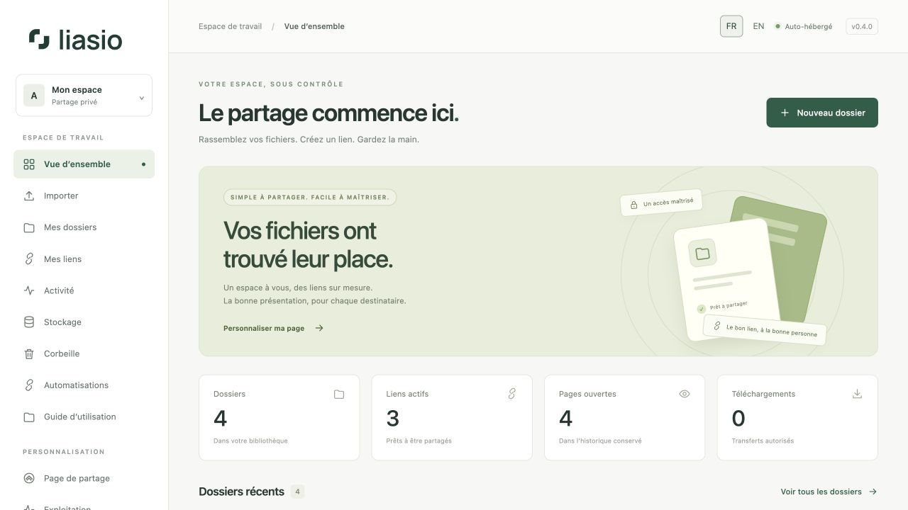
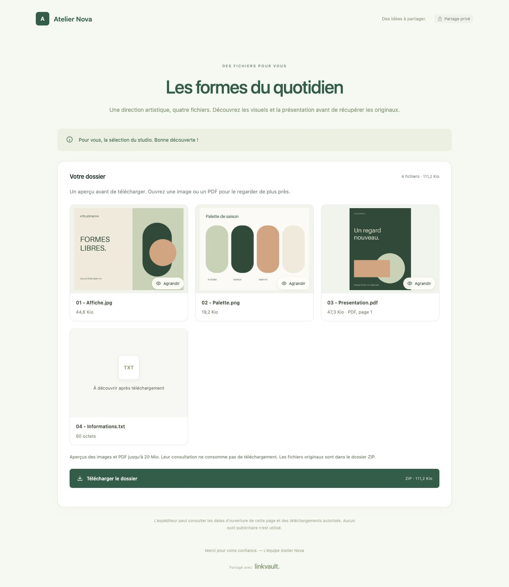
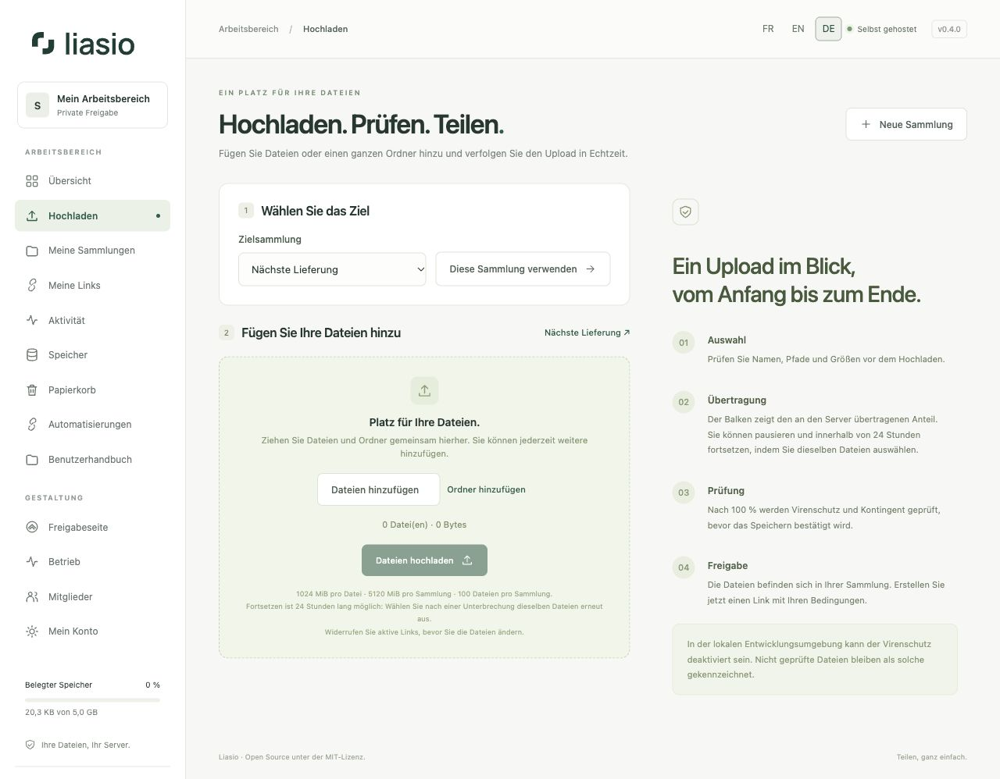

# Liasio

Liasio ist der neue Name von LinkVault. Das Repository heißt jetzt `fmacfa/liasio`. Bereits veröffentlichte LinkVault-Containerimages, Bereitstellungskennungen und API-v1-Header behalten ihre bisherigen Namen, damit bestehende Installationen und Integrationen weiter funktionieren.

[English](README.md) · [Français](README.fr.md) · **Deutsch**

**Ihre Dateien. Ihre Domain. Ihre Regeln.**

Liasio ist eine Open-Source-Anwendung zur Dateifreigabe auf Ihrem eigenen Server. Organisieren Sie Dateien in Sammlungen, gestalten Sie deren Präsentation und erstellen Sie unabhängige Freigabelinks mit Passwörtern, Ablaufdaten oder Downloadlimits.

Oberfläche auf Englisch, Französisch und Deutsch · **MIT**-Lizenz · Python / Django · Docker Compose

> **Version 0.5 — Zusammenarbeit im Team und mit Kunden.** Team-Arbeitsbereiche und Gruppen, unveränderliche Versionen, Kundendatei-Anfragen, Empfängerprüfung, freigegebene E-Mails, privater S3-Speicher und OIDC. Die Oberfläche und bebilderten Anleitungen sind auf Englisch, Französisch und Deutsch verfügbar. Dies ist weiterhin eine Version vor 1.0; ein unabhängiges menschliches Sicherheitsaudit steht noch aus. Dateien sind nicht Ende-zu-Ende-verschlüsselt.



## Video-Tutorials

[Überblick ansehen](https://youtu.be/fNS7tQkZM5k) · [Vollständiger Rundgang](https://youtu.be/HfYVWaYB8vc) · [YouTube-Playlist](https://www.youtube.com/playlist?list=PLCLPN5G0TwTo) · [Liasio-Kanal](https://www.youtube.com/@liasio-com)

Das [Verzeichnis der Video-Tutorials](docs/VIDEOS.de.md) behandelt Uploads, unabhängige Links, Zugriffsregeln, Gestaltung, Excel-/CSV-Stapel, die Empfängeransicht, Aktivitäten, Speicher und API-/Webhook-Automatisierung. Sprache und Untertitel sind Englisch; die Videos wurden mit Version 0.4 und fiktiven Beispieldaten aufgenommen.

## Funktionen

| Aufgabe | In Version 0.5 verfügbar |
| --- | --- |
| Ersteinrichtung | Zwei kurze Schritte: E-Mail und Passwort, anschließend Name und Passwortbestätigung; das erste Konto wird Administrator |
| Mehrere Konten | Persönliche, sieben Tage gültige Einladungen, einmalig nutzbar und widerrufbar; private Konten mit ausdrücklich erteilten Lese-/Mitarbeitsrechten je Sammlung |
| Dateibibliothek | Dateien oder vollständige Verzeichnisse mit ihrer Struktur hochladen; Titel, Beschreibung und Nachricht für den Empfänger hinzufügen |
| Uploadseite | Dateien und Ordner gemeinsam ablegen, Auswahl ergänzen, tatsächlichen Byte-Fortschritt sehen, 24 Stunden pausieren/fortsetzen und anschließend auf Schadsoftware prüfen |
| Freigabeseite | Logo, Hintergrundbild, Farben, Name, Slogan und Fußzeile je Konto mit Live-Vorschau |
| Dateivorschauen | Bildergalerie und Vorschau der ersten PDF-Seite, Großansicht und Tastaturnavigation; je Link optional |
| Mehrere Links je Sammlung | Interne Bezeichnung, optionales Passwort ohne Mindestlänge, Ablaufdatum oder Gültigkeitsdauer und maximale Downloadzahl |
| Linkstapel ohne Programmierung | 1–200 Links nach Anzahl oder per XLSX-/CSV-Import erstellen, Namen und gemeinsame Regeln prüfen und die Liste mit URLs herunterladen; Umbenennen ändert keine URL |
| Einmalige Links | Ein autorisierter Download, auch bei gleichzeitigen Anfragen |
| Aktivitäten | Datierte Seitenaufrufe und autorisierte Downloads, Filter nach Link und CSV-Export |
| Speicherverwaltung | Dateizahlen, Größen, Kontingente, Suche und Sortierung; einzelne oder mehrere Dateien in den 30 Tage wiederherstellbaren Papierkorb verschieben |
| Speicheradministration | Freier Speicherplatz, gesamte Dateizahl und Verbrauch je Konto; Kontingente in der Administration ändern |
| Zugriffsverwaltung | Mitglieder sperren und ihre Links/Sitzungen widerrufen; Passwortänderung/-wiederherstellung, optionales TOTP und einmalige Wiederherstellungscodes |
| Automatisierung | API-Schlüssel mit Berechtigungen und Ablaufdatum, fortsetzbare Uploads und Linkerstellung; signierte Webhooks mit Zustellverlauf und begrenzten Wiederholungen |
| Team-Arbeitsbereiche | Gruppen, Lese-/Mitarbeitsrechte, Eigentumsübertragung und optional verpflichtende MFA |
| Dokumentversionen | Festgeschriebene oder aktualisierbare Links, ausdrücklicher Dateiaustausch, Wiederherstellung von Versionen und gezielte Downloads |
| Kundendateien empfangen | Reine Uploadlinks mit Ablaufdatum, Byte- und Einreichungslimits, Virenprüfung und fortsetzbaren Übertragungen |
| E-Mail-Abläufe | Einzel-, Stapel- und Einladungsentwürfe, wiederverwendbare Vorlagen, ausdrückliche Freigabe, begrenzte Wiederholungen und optionale Benachrichtigungen an sich selbst |
| Bestätigte Empfänger | E-Mail-Zulassungslisten und browsergebundene Einmalcodes vor Ansicht oder Download |
| Kontosicherheit | Aktive Sitzungen einzeln widerrufen und OIDC-Identitäten ausdrücklich verknüpfen |
| Hosting | Private Originale lokal oder in S3-kompatiblem Speicher, verschlüsselte externe restic-Sicherungen und Wiederherstellung |
| API-Werkzeuge | OpenAPI-3.1-Vertrag und interaktiver Explorer auf derselben Instanz; Namen/E-Mails in personalisierte Links und Excel-/CSV-Exporte umwandeln |
| Bebilderte Hilfe | 19 Anleitungen auf Englisch, Französisch und Deutsch, auf GitHub und unter Benutzerhandbuch in der Anwendung |
| Sprachen | Englisch, Französisch und Deutsch mit automatischer Erkennung der Browsersprache, auch auf Empfängerseiten, in Formularen, Meldungen und Uploadfortschritt |
| Betrieb | Automatisches HTTPS über Caddy, PostgreSQL, ClamAV, Zustandsprüfungen alle fünf Minuten, optionale Warnungen und automatisch geprüfte Sicherungswiederherstellung |

**Links verwenden dieselben gespeicherten Dateien.** Beim Ersetzen bleiben ältere Dateiinhalte erhalten, solange eine Version darauf verweist; diese Versionen zählen zum Kontingent. Erstellen Sie etwa einen passwortgeschützten Link für einen Kunden, einen zweiten bis morgen und einen dritten für einen einmaligen Download.

**Kürzere Freigabe-URLs:** Auf `/s/` folgt ein undurchsichtiger Code aus 22 Zeichen statt der bisherigen Tokens mit 43 oder 97 Zeichen. Kopieren Sie einen Link unter **Meine Links** erneut oder exportieren Sie seinen Stapel, um die kurze URL zu erhalten. Bereits verteilte URLs behalten Passwort, Ablauf und Downloadzähler. Siehe [Linkformat, Migration und Kompatibilität](docs/SHARE_LINKS.md) (Englisch).

### Was „geöffnet“ und „heruntergeladen“ bedeuten

- **Seite geöffnet:** Der Browser hat die autorisierte Freigabeseite erhalten. Aufrufe derselben Sitzung werden 30 Minuten zusammengefasst. Auch ein Bot für Linkvorschauen kann eine Seite öffnen.
- **Download autorisiert:** Der Server hat das ZIP vorbereitet und vor dem Versand eine Nutzung reserviert. Das beweist keinen vollständigen Empfang. Auch ein Abbruch verbraucht diese Nutzung; der Eigentümer kann einen neuen Link erstellen.
- **Einmalige Nutzung:** Das Öffnen der Seite verbraucht keine Nutzung. Die Downloadschaltfläche sendet eine CSRF-geschützte POST-Anfrage. Eine atomare Datenbankoperation verhindert, dass gleichzeitige Downloads das Limit überschreiten.
- **Widerruf:** Sperrt künftige Autorisierungen. Bereits empfangene Dateien lassen sich damit nicht zurückholen; eine zuvor autorisierte Übertragung kann weiterlaufen.

## Benutzerhandbücher und Automatisierung

Beginnen Sie mit dem **[deutschen Benutzerhandbuch](docs/guide/de/README.md)**, dem **[English guide](docs/guide/en/README.md)** oder dem **[guide français](docs/guide/fr/README.md)**. Dieselben Seiten und Bildschirmaufnahmen finden Sie in der Anwendung unter `/help/`. Das [Dokumentationsverzeichnis](docs/README.de.md) zeigt die verfügbaren Sprachen.

Für n8n, Skripte und andere Werkzeuge stehen die [API-Referenz](docs/API.md) (Englisch), die [Automatisierungsanleitung](docs/guide/de/automation.md), der [Python-Uploadclient](examples/upload.py) und die [Webhook-Signaturprüfung](examples/verify_webhook.py) bereit. Öffentliche Registrierung bleibt geschlossen. Uploads ohne Konto erfordern eine vom Eigentümer erstellte, ablaufende Dateianfrage.

Direkt in der Oberfläche verwenden Sie **Mehrere Links erstellen**: Anzahl eingeben oder eine Excel-/CSV-Liste hochladen, Namen und Regeln prüfen und die fertige Liste herunterladen. Ursprüngliche Spalten und Reihenfolge bleiben als Werte erhalten. Die [Anleitung für Linkstapel](docs/guide/de/bulk-links.md) enthält Vorlage, Grenzen und bebilderte Schritte.

Die [Stapel-API](docs/guide/de/bulk-links-api.md) nimmt Namen oder eine Anzahl entgegen und liefert die Links in derselben Reihenfolge. Unter **Meine Stapel** können Sie Stapel abrufen und als Excel/CSV exportieren; Wiederholungen sind sicher möglich. Nutzen Sie den [Python-Client](examples/batches.py) im Terminal oder in Codex oder rufen Sie die API mit einem privaten Schlüssel aus dem Backend Ihrer Website auf.

## Server / VPS-Voraussetzungen

Sie benötigen einen Linux-Server mit **Docker Engine und Docker Compose v2**, Git und Python 3 zur Konfiguration. Die folgenden Werte dienen der Planung der vollständigen Installation einschließlich Virenschutz; sie sind keine gemessene Kapazitätsgarantie oder maximale Nutzerzahl. Ein GiB entspricht 1.073.741.824 Byte; prüfen Sie die Einheiten Ihres Hosting-Anbieters.

| Profil eines dedizierten Servers | CPU | RAM |
| --- | --- | --- |
| Kleine Instanz mit gelegentlichen gleichzeitigen Übertragungen | 2 vCPUs | **8 GiB** |
| Mehr Reserve für parallele Uploads, Virenprüfung und ZIP-Erstellung | 4 vCPUs | **12–16 GiB** |

### RAM und Swap

**RAM** ist der Arbeitsspeicher der laufenden Dienste. Die Grenzen in [compose.yaml](compose.yaml) ergeben derzeit **6,75 GiB**: ClamAV 4 GiB, Anwendung 1 GiB, PostgreSQL und Vorschauen jeweils 512 MiB, Wartung, Webhooks und E-Mail jeweils 256 MiB. Das sind einzelne Obergrenzen, kein reservierter oder konstanter Verbrauch. Linux, Docker, Caddy sowie Sicherungen und Builds benötigen zusätzlichen Speicher. ClamAV allein [empfiehlt 4 GiB](https://docs.clamav.net/manual/Installing/Docker.html#memory-ram-requirements); Signaturupdates können vorübergehende Spitzen erzeugen.

Auf einem **gemeinsam genutzten VPS** kommen vorhandene Websites, Datenbanken und Anwendungen einschließlich Lastspitzen hinzu. Ein Server mit 8 GiB insgesamt, aber nur 2 GiB verfügbarem RAM entspricht keinem dedizierten 8-GiB-Server. CloudPanel senkt den Bedarf nicht. Planen Sie Reverse Proxy und belegte Ports anhand der [Betriebsreferenz](docs/OPERATIONS.md#another-reverse-proxy) (Englisch).

**Swap** verwendet Speicherplatz als langsameren Puffer. Optionale **2–4 GiB** sind ein Ausgangspunkt für gelegentliche Engpässe und ersetzen keine ausreichende RAM-Ausstattung. Häufige Swap-Lese-/Schreibzugriffe während Übertragungen sprechen für mehr RAM oder weniger andere Last. Die wirksame Docker-Swap-Grenze hängt von Host und Containerkonfiguration ab; diese Compose-Datei setzt kein `memswap_limit`. Siehe [Docker-Speicher- und Swap-Limits](https://docs.docker.com/engine/containers/resource_constraints/#--memory-swap-details).

### Speicherplatz und Bandbreite

Verwenden Sie **SSD-/NVMe-Speicher auf einem lokalen Dateisystem** mit funktionierenden POSIX-Dateisperren. Planen Sie Betriebssystem, Dockerimages und Buildcache, Virensignaturen, Protokolle und Datenbank **sowie**:

- Dateien, erzeugte Vorschauen und den **30-Tage-Papierkorb**; ein abgelaufener Link löscht keine Dateien.
- Bis zu **24 Stunden** vorgehaltene Upload-Zwischendaten und temporäre ZIPs paralleler Downloads. Die Uploadzulassung reserviert vorsorglich die doppelte ausstehende Bytemenge, die ZIP-Zulassung die unkomprimierte Gesamtgröße plus Metadaten. Siehe [Speicherreservierungen](docs/RELIABILITY.md#resumable-uploads) (Englisch).
- Jede lokale Sicherung und eine weitere vollständige Kopie für den Wiederherstellungstest. Bereits komprimierte Dateien werden durch Sicherung womöglich nicht kleiner; halten Sie zusätzlich verschlüsselte externe Kopien vor.
- Swap, falls auf demselben Datenträger, und danach **mindestens 20 % freien Speicherplatz**.

**Planungsbeispiel:** 25 GiB für System, Dienstdaten und Swap + 20 GiB Dateien einschließlich Papierkorb + eine Sicherung mit 20 GiB + 20 GiB für deren Wiederherstellungstest + 10 GiB Übertragungsarbeitsraum = 95 GiB. Planen Sie **mindestens 120 GiB nutzbare Dateisystemkapazität**, um etwa 20 % Reserve zu behalten. Passen Sie die Werte an Aufbewahrung, Dateigrößen und parallele Transfers an; dies ist keine feste Mindestkapazität. `MIN_FREE_DISK_BYTES=1073741824` (1 GiB) ist standardmäßig eine Sicherheitsuntergrenze zur Zulassung und kein empfohlener freier Speicherplatz.

Kontingente schaffen keinen physischen Speicher. Mehrere Links verwenden dieselben Dateien, aber jeder Download verbraucht ausgehende Bandbreite. Prüfen Sie Transferbudget und Anbindung des Anbieters.

### Kernel und Kapazität prüfen

Produktive Vorschauen benötigen **Landlock ABI 3+**, üblicherweise Linux 6.2+ mit aktiviertem Landlock. Der tatsächlich laufende Kernel und die Containerberechtigungen müssen dies unterstützen. Bei fehlender Isolation bleiben Dateikarten und Originaldownloads verfügbar; siehe [Vorschau-Bereitstellung](docs/PREVIEWS.md) (Englisch). Ein neueres Containerimage aktualisiert den Hostkernel nicht.

Führen Sie diese ausschließlich lesenden Prüfungen **auf dem Linux-Host** vor der Installation sowie bei repräsentativen Uploads, Downloads und Signaturupdates aus:

```sh
free -h
swapon --show
vmstat 1 5
df -h
docker stats --no-stream
```

Prüfen Sie `available` in `free`, anhaltende `si`-/`so`-Aktivität in den späteren `vmstat`-Messungen sowie freien Platz für Dateien, Docker und Sicherungen. Belegter Swap allein beweist keinen aktuellen Engpass. Die Seiten **Speicher / Betrieb** zeigen Dateizahlen, Kontingente und Warnungen. Passen Sie den VPS an beobachtete Spitzen an.

## Auf Ihrer Domain installieren

Wählen Sie einen Server nach den [Voraussetzungen oben](#server--vps-voraussetzungen) und richten Sie Ihre Domain ein:

1. Setzen Sie den DNS-A-Eintrag Ihrer Domain und gegebenenfalls den AAAA-Eintrag auf den Server.
2. Erlauben Sie eingehend **Port 80 und 443**. Datenbank, Anwendung und Virenschutz dürfen nicht direkt öffentlich erreichbar sein.
3. Klonen Sie das Repository und erzeugen Sie eindeutige Geheimnisse:

```sh
git clone https://github.com/fmacfa/liasio.git
cd liasio
python3 scripts/configure.py --domain files.example.com
docker compose up -d --build
docker compose ps
```

4. Warten Sie auf die Betriebsbereitschaft von ClamAV; der erste Start kann mehrere Minuten dauern.
5. Öffnen Sie `https://files.example.com`. Geben Sie E-Mail und Passwort ein, wählen Sie **Weiter**, ergänzen Sie Ihren Namen und bestätigen Sie das Passwort. Wählen Sie **Mein Konto erstellen**. Ein Installationsschlüssel ist nicht nötig.
6. Erstellen Sie eine Sammlung, laden Sie Dateien hoch und wählen Sie **Link erstellen**. Mit **FR / EN / DE** ändern Sie die Sprache.

Das Konfigurationsskript erzeugt `.env` mit Berechtigungen `0600` und überschreibt keine vorhandene Datei. Sie enthält Geheimnisse und darf nicht veröffentlicht werden. Wer zuerst die Einrichtung abschließt, wird Administrator: Initialisieren Sie die Instanz, bevor Sie ihre Adresse weitergeben. Danach bleibt die Einrichtung dauerhaft geschlossen; weitere Nutzer kommen per Einladung hinzu.

Caddy beschafft und erneuert das TLS-Zertifikat. Lesen Sie vor einer anderen Reverse-Proxy-Topologie die [Betriebsreferenz](docs/OPERATIONS.md) (Englisch) oder die erhaltene [französische Fassung](docs/OPERATIONS.fr.md).

### Vorgefertigte Images und Updates

GitHub Actions veröffentlicht versionierte Images mit Software-Stückliste (SBOM) und Herkunftsnachweis. Releases enthalten außerdem ein komprimiertes Dockerarchiv für Offlineinstallationen. Siehe [Releases](https://github.com/fmacfa/liasio/releases) und [Änderungsprotokoll](CHANGELOG.md).

Setzen Sie `LINKVAULT_IMAGE=ghcr.io/fmacfa/liasio:0.5.0` in `.env`, um das Registryimage zu verwenden. Führen Sie dann `docker compose pull app maintenance preview webhooks mail` und `docker compose up -d --no-build` aus. Für Quellcode-Builds behalten Sie den Standard bei und verwenden `--build`.

Bewahren Sie vor einem Update von 0.1 die ursprünglichen Schlüssel auf und erstellen Sie eine vollständige Sicherung. Lesen Sie die [Update- und Zuverlässigkeitsanleitung](docs/RELIABILITY.md), einschließlich MFA-Schlüsseln, Papierkorbkontingenten, Überwachung und Wiederherstellungsprüfung.

Version 0.5 enthält die Härtungen nach 0.4 und additive Migrationen bis `0017`. Befolgen Sie die [Updateanleitung für 0.5](docs/UPGRADING_0_5.md), behalten Sie die Schlüssel und starten Sie alle schreibenden Dienste mit demselben Image neu. Produktive Vorschauen benötigen weiterhin Linux Landlock ABI 3+; ohne Vorschauen bleiben Originaldownloads verfügbar. Releaseartefakte enthalten genaue Imagedigests, SBOM und an Workflow, Tag und Commit gebundene Attestierungen.

## Lokal ausprobieren

Installieren Sie [uv](https://docs.astral.sh/uv/getting-started/installation/) und führen Sie aus:

```sh
git clone https://github.com/fmacfa/liasio.git
cd liasio
python3 scripts/configure.py --dev
uv sync --frozen
uv run --env-file .env python manage.py migrate
uv run --env-file .env python manage.py runserver 127.0.0.1:8000
```

Öffnen Sie [http://127.0.0.1:8000](http://127.0.0.1:8000). Erstellen Sie das erste Konto mit E-Mail und Passwort; ein Installationsschlüssel ist nicht nötig. Dieser Modus verwendet SQLite, HTTP und ausdrücklich deaktivierte Virenprüfung. Er ist nur für den lokalen Rechner und Demonstrationsdateien vorgesehen.

Um eine **leere lokale Installation** mit fiktiven Daten zu füllen, wählen Sie ein Demopasswort:

```sh
DEMO_PASSWORD='replace-with-your-demo-passphrase' uv run --env-file .env python manage.py seed_demo
```

Die Konto-E-Mail lautet `demo@example.com`. Der Befehl verweigert die Ausführung in Produktion oder wenn bereits ein Konto existiert. Übernehmen Sie weder Demodaten noch Geheimnisse auf Ihren öffentlichen Server.

## Konfiguration

Konfigurieren Sie `.env` anhand von [.env.example](.env.example).

| Einstellung | Standard / Zweck |
| --- | --- |
| `APP_URL` / `DOMAIN` | Kanonischer HTTPS-Ursprung ohne Pfad / Domainname |
| `SECRET_KEY` | Zufälliges Geheimnis mit mindestens 50 Zeichen; signiert Sitzungen und Zugriffstokens |
| `MAX_FILE_BYTES` | 1073741824: 1 GiB je Datei |
| `MAX_UPLOAD_BYTES` | 5368709120: 5 GiB je Sammlung; Multipart-Fallback weiterhin 500 MiB je Anfrage |
| `DEFAULT_QUOTA_BYTES` | 5368709120: 5 GiB je neuem Konto |
| `EVENT_RETENTION_DAYS` | 90 Tage für Aktivitäts- und Administrationsverlauf |
| `TIME_ZONE` | `Europe/Berlin`; Zeitstempel werden in UTC gespeichert und in dieser Zeitzone angezeigt |
| `ANTIVIRUS_REQUIRED` | `true` in Produktion; Uploads scheitern, wenn die Prüfung nicht abgeschlossen werden kann |
| `CLAMAV_HOST` | `clamav` in Compose; privater Dienst, der nie direkt ins Internet gehört |
| `EMAIL_HOST`, `EMAIL_PORT`, `EMAIL_HOST_USER`, `EMAIL_HOST_PASSWORD` | Optionales SMTP für Wiederherstellung, freigegebene Zustellungen, Empfängercodes und Benachrichtigungen |
| `EMAIL_USE_TLS` / `EMAIL_USE_SSL` | Standardmäßig STARTTLS; nicht gleichzeitig aktivieren |
| `DEFAULT_FROM_EMAIL` | Vom SMTP-Server zugelassene Absenderadresse |
| `TRUST_PROXY` | Nur hinter dem isolierten Compose-Reverse-Proxy `true` setzen |

Diese Version erlaubt fest 100 Dateien je Sammlung. Zulässige Endungen werden über `ALLOWED_EXTENSIONS` festgelegt. Höhere Uploadgrößen erfordern passende Caddy- und ClamAV-Limits; siehe Betriebsreferenz.

Einladungen erzeugen einen Link zum Kopieren und Weitergeben. Bei konfiguriertem SMTP wählen Sie **E-Mail vorbereiten**, prüfen Empfänger und Nachricht und bestätigen den Versand. Eine Einladung allein sendet nichts. Ohne SMTP kann der Serveradministrator mit `manage.py changepassword` ein Passwort zurücksetzen.

## Zuverlässigkeit

- **MFA:** Aktivieren Sie eine Authenticator-App unter **Mein Konto** und verwahren Sie die zehn Wiederherstellungscodes sicher.
- **Papierkorb:** Dateien oder Sammlungen 30 Tage wiederherstellen; erst endgültiges Löschen gibt das Kontingent frei.
- **Fortsetzbare Transfers:** Wählen Sie nach Pause oder Neuladen dieselben Dateien erneut; bestätigte Blöcke bleiben 24 Stunden erhalten.
- **Administration:** Kontingente, Kapazität, Warnungen und Sicherungsprüfungen unter **Betrieb** kontrollieren.
- **Sicherungen:** `scripts/backup-and-verify.sh` erstellt eine Sicherung und prüft die Wiederherstellung in isolierten Docker-Volumes. Planen Sie regelmäßige Ausführung und verschlüsselte externe Kopien.
- **Überwachung:** Optionale SMTP-Warnungen und Bearer-geschützter Endpunkt `/ready/`; `/health/` bleibt eine minimale Erreichbarkeitsprüfung.

[RELIABILITY.md](docs/RELIABILITY.md) erklärt Konfiguration, Grenzen, Fehlerverhalten und reproduzierbare Lasttests. Dazu gehören `MFA_ENCRYPTION_KEY`, `TRASH_RETENTION_DAYS`, `MIN_FREE_DISK_BYTES`, `MONITORING_TOKEN`, `MONITOR_EMAIL` und `BACKUP_MAX_AGE_HOURS`.

## Dateien vor dem Download ansehen

Aktivieren Sie Vorschauen beim Erstellen eines Links oder unter **Meine Links**. Empfänger sehen Bildminiaturen und die erste PDF-Seite und können sie vor dem ZIP-Download vergrößern. JPEG, PNG, WebP, GIF und PDF bis 20 MiB sind geeignet; andere Dateien behalten Name, Typ und Größe.

Ein isolierter Renderer erzeugt verkleinerte JPEGs ohne Metadaten. Sie beachten Passwort, Widerruf, Ablauf und Downloadlimit und verbrauchen keine Nutzung. **Sichtbare Vorschauen können kopiert werden.** Deaktivieren Sie sie, wenn Inhalte bis zum Download verborgen bleiben sollen. Nach einem Update bleiben bestehende Links ohne Vorschau. Siehe [Vorschaugrenzen und Bereitstellung](docs/PREVIEWS.md) (Englisch).



## Sicherheit und Datenschutz

- **Argon2id** für Passwörter; Kontopasswörter benötigen mindestens zwölf Zeichen. Optionale Linkpasswörter haben keine Mindestlänge; alle Passwortformulare akzeptieren höchstens 128 Zeichen.
- Keine öffentliche Registrierung; geschützte Einrichtung und signierte, ablaufende Einmaleinladungen.
- Eigentumsprüfung für jede Ressource; Webadministratoren können fremde Dateien nicht durchsuchen.
- Serverseitige Sitzungen, HttpOnly-/Secure-Cookies in Produktion, CSRF-Schutz, Hostprüfung, restriktive CSP und Schutz vor Einbettung.
- Undurchsichtige 128-Bit-Freigabecodes, mit HMAC-SHA256 abgeleitet und über einen eindeutigen Hashindex aufgelöst. Datenbankkennungen oder Suchdigests allein offenbaren keine Links. Frühere signierte URLs bleiben mit ihrer ursprünglichen Prüfung gültig. Linkpasswörter sind gehasht; Freigabecodes stehen nicht im Klartext in der Datenbank. Siehe [Tokenformat](docs/SHARE_LINKS.md).
- Datenbankgestützte, zwischen Workern geteilte Ratenlimits; IP-Identitäten sind HMAC-gehasht und werden später gelöscht.
- Dateien außerhalb des Webroots mit zufälligen physischen Namen; geprüfte relative Pfade, Endungs- und Größenbeschränkungen.
- Verpflichtende ClamAV-Prüfung in Produktion; unerwartete Antworten, Schadsoftware, Prüflimits und Ausfälle blockieren Uploads.
- Downloads als Anhänge; HTML-/SVG-Inhalte werden weder angezeigt noch ausgeführt.
- Aktivitätsverlauf ohne IP-Adressen, Standort- oder Werbekennungen; CSV-Exporte entschärfen Formelinjektionen.
- Löschen widerruft Freigabelinks sofort; Papierkorbinhalte belegen bis zur endgültigen Löschung Kontingent.
- Verschlüsselte TOTP-Geheimnisse, nicht wiederverwendbare Codes, einmalige Wiederherstellungscodes und ablaufende vorläufige Anmeldungen.
- Fortsetzbare Uploads reservieren Kontingent, prüfen Blockprüfsummen und veröffentlichen erst nach vollständiger Virenprüfung.

Der Betriebssystemadministrator kann gespeicherte Dateien lesen: **Dies ist keine Ende-zu-Ende-Verschlüsselung**. Nutzen Sie bei Bedarf verschlüsselte Datenträger und Sicherungen. Virenprüfung garantiert keine Harmlosigkeit. Endungsprüfungen validieren nicht jedes Dateiformat vollständig. Die Anwendung ist nicht für anonyme Uploads in großem Maßstab vorgesehen.

Lesen Sie die [deutsche Sicherheitsrichtlinie](SECURITY.de.md), das [Sicherheitsmodell](docs/SECURITY_MODEL.md) und die [Betriebsreferenz](docs/OPERATIONS.md) auf Englisch sowie die bebilderten Anleitungen in allen drei Oberflächensprachen.

## Tests und Mitarbeit

```sh
uv sync --frozen
uv run --env-file .env python manage.py test --noinput
uv run --env-file .env python manage.py makemigrations --check --dry-run
uv run --env-file .env pip-audit --local
```

Die [Zusammenfassung der Prüfung vor Veröffentlichung](docs/SECURITY_REVIEW.md) dokumentiert die automatisierte Quellcodeprüfung, drei behobene Probleme und Regressionstests.

Die Tests prüfen Kontentrennung, Uploadlimits, Einladungen, CSRF, Linkpasswörter, Pfadmanipulation, Löschung und gleichzeitige Zugriffe. Der GitHub-Workflow testet SQLite und PostgreSQL, baut das Containerimage und prüft den Virenschutz mit der EICAR-Testsignatur.

[CONTRIBUTING.de.md](CONTRIBUTING.de.md) erklärt Codeaufbau und Mitarbeit, [ROADMAP.md](ROADMAP.md) die geplanten Verbesserungen. Beitrags- und Sicherheitsrichtlinien sind auf Englisch, Französisch und Deutsch verfügbar. [Wartungsrichtlinie](docs/MAINTENANCE.md) · [Gemessene Lasttests](docs/benchmarks/README.md) · [Vorbereitung eines unabhängigen Audits](docs/INDEPENDENT_AUDIT.md) (technische Referenzen auf Englisch).

## Vorbilder und Umfang

Wir haben [Pingvin Share](https://github.com/stonith404/pingvin-share), [ProjectSend](https://github.com/projectsend/projectsend), [Gokapi](https://github.com/Forceu/Gokapi) und [Send](https://github.com/timvisee/send) betrachtet. Der [Vergleich](docs/COMPARISON.md) beschreibt auf Englisch deren Stärken und die Entwurfsentscheidungen von Liasio; eine [französische Fassung](docs/COMPARISON.fr.md) bleibt verfügbar.

Liasio konzentriert sich auf wiederverwendbare Sammlungen, Präsentation und ausdrückliche Linkregeln in einer kompakten Anwendung. Diese Version ersetzt nicht jede Funktion der etablierten Projekte. Anwendungscode und visuelle Elemente wurden für Liasio erstellt; aus diesen vier Repositories wurde kein Code übernommen.

### Upload-Vorschau



## Lizenz

[MIT](LICENSE), Copyright 2026 Filippo Maria Celi und Mitwirkende. Abhängigkeiten und Containerimages behalten ihre jeweiligen Lizenzen. Siehe [THIRD_PARTY.md](THIRD_PARTY.md).
