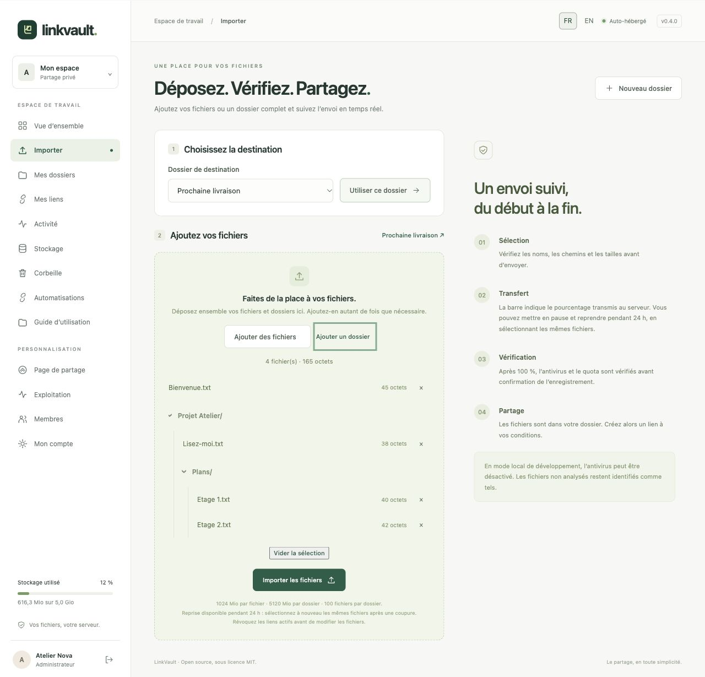

# Liasio

Liasio est le nouveau nom de LinkVault. Le dépôt se trouve désormais sous `fmacfa/liasio`. Les images de conteneur LinkVault déjà publiées, les identifiants de déploiement et les en-têtes de l’API v1 conservent leurs noms pour assurer la continuité des installations et intégrations existantes.

[English](README.md) · **Français**

**Vos fichiers, votre domaine, vos conditions.**

Liasio est une application open source de partage de fichiers à installer sur votre serveur. Constituez des dossiers, personnalisez leur présentation et créez plusieurs liens indépendants avec mot de passe, expiration ou limite de téléchargements.

Interface français / anglais · Licence **MIT** · Python / Django · Docker Compose

> **Version 0.4 — automatisations et interface bilingue.** API à permissions limitées, webhooks signés et guides illustrés complètent les aperçus, TOTP, les envois reprenables et la corbeille. Le projet reste jeune, sans audit humain indépendant ni chiffrement de bout en bout.


## Ce que vous pouvez faire

| Besoin | Disponible dans la version 0.4 |
| --- | --- |
| Première connexion | Deux étapes courtes : e-mail et mot de passe, puis nom et confirmation ; le premier compte devient administrateur |
| Plusieurs comptes | Invitations personnelles, valables 7 jours, usage unique, révocables ; comptes membres isolés |
| Bibliothèque | Import de fichiers ou d’un dossier avec son arborescence, titre, présentation et message au destinataire |
| Page Importer | Dépôt mixte de fichiers et dossiers, sélection cumulative, progression réelle en octets, pause et reprise pendant 24 h, puis vérification |
| Page de partage | Logo, image de fond, couleurs libres, nom, signature et pied de page propres à chaque compte ; aperçu en direct |
| Aperçus des fichiers | Galerie d’images et première page des PDF, visionneuse et navigation au clavier ; option par lien |
| Plusieurs liens par dossier | Nom interne, mot de passe facultatif sans minimum, expiration par date ou durée, nombre maximal de téléchargements |
| Liens en lot sans code | De 1 à 200 liens par quantité ou liste Excel/CSV, vérification des noms et conditions, export de la liste avec les URL, renommage sans changer les liens |
| Usage unique | Un seul téléchargement autorisé, y compris en cas de requêtes simultanées |
| Suivi | Ouvertures et téléchargements autorisés datés, filtre par lien, export CSV |
| Stockage | Nombre de fichiers, tailles, quotas, recherche, tri par taille/nom/date, suppression individuelle ou multiple vers une corbeille récupérable de 30 jours |
| Administration du stockage | Volume disque disponible, total de fichiers, consommation par compte ; quotas modifiables dans l’interface |
| Gestion des accès | Suspension d’un membre, révocation de ses liens et sessions ; changement/récupération du mot de passe, TOTP et codes de récupération |
| Exploitation | HTTPS automatique avec Caddy, PostgreSQL, antivirus ClamAV, surveillance toutes les cinq minutes, alertes facultatives, restauration testée |

**Un dossier n’est stocké qu’une fois.** Vous pouvez créer un lien pour un client avec un mot de passe, un autre qui expire demain et un troisième utilisable une fois.

**Des liens de partage plus courts :** un code opaque de 22 caractères suit `/s/`, à la place des anciens jetons de 43 ou 97 caractères. Recopiez un lien depuis **Mes liens** ou exportez son lot pour obtenir l’URL courte. Les anciennes URL restent valables avec le même mot de passe, la même expiration et le même compteur de téléchargements. Voir le [format, la migration et la compatibilité des liens](docs/SHARE_LINKS.md).

### Ce que signifie « ouvert » ou « téléchargé »

- **Page ouverte** : la page autorisée a été servie au navigateur. Les ouvertures d’une même session sont dédupliquées pendant 30 minutes. Un robot de prévisualisation peut aussi ouvrir une page.
- **Téléchargement autorisé** : le serveur a préparé le ZIP et réservé une utilisation avant de l’envoyer. Cela ne prouve pas la réception complète du fichier. Un transfert interrompu consomme l’utilisation ; le propriétaire peut créer un nouveau lien.
- **Usage unique** : ouvrir la page ne consomme rien. Le bouton de téléchargement effectue un POST protégé par CSRF. Une réservation atomique en base empêche deux téléchargements simultanés de dépasser la limite.
- **Révocation** : bloque les prochaines autorisations. Elle ne rappelle pas les fichiers déjà reçus et n’interrompt pas nécessairement un transfert déjà autorisé.

## Guides et automatisations

Le **[guide français illustré](docs/guide/fr/README.md)** et sa **[version anglaise](docs/guide/en/README.md)** sont aussi intégrés à l’application, menu **Guide d’utilisation** (`/help/`). Le sélecteur **FR / EN** traduit les formulaires, les messages, la progression et les pages destinataires.

Pour n8n et vos scripts : [référence API](docs/API.md), [guide des automatisations](docs/guide/fr/automation.md), [client Python d’import](examples/upload.py) et [vérificateur de signature](examples/verify_webhook.py). Les clés sont limitées, expirables et révocables ; les webhooks disposent d’un historique et de nouvelles tentatives bornées.

Pour tout faire depuis l’interface, choisissez **Créer plusieurs liens** : indiquez une quantité ou importez une liste Excel/CSV, vérifiez les noms et conditions, puis téléchargez la liste complétée. Les colonnes et l’ordre d’origine sont conservés en valeurs. Le [guide des liens en lot](docs/guide/fr/bulk-links.md) détaille les étapes, le modèle à télécharger et les limites.

L’[API des lots](docs/guide/fr/bulk-links-api.md) reçoit des noms ou une quantité et renvoie les liens correspondants dans l’ordre. Les lots apparaissent dans **Mes lots**, sont consultables et exportables en Excel/CSV, avec reprise sans doublons. Utilisez le [client Python](examples/batches.py) depuis un terminal ou Codex, ou appelez l’API depuis le serveur de votre site avec une clé privée.

## Besoins serveur / VPS

Prévoir un serveur Linux avec **Docker Engine et Docker Compose v2**, Git et Python 3 pour la configuration. Les recommandations ci-dessous concernent la pile complète, antivirus compris ; ce sont des points de départ, pas des capacités mesurées ni un nombre maximal d’utilisateurs garanti. Un Gio représente 1 073 741 824 octets ; vérifiez les unités annoncées par votre hébergeur.

| Profil de serveur dédié | Processeur | RAM |
| --- | --- | --- |
| Petite instance avec quelques transferts simultanés occasionnels | 2 vCPU | **8 Gio** |
| Davantage de marge pour les imports, analyses et créations de ZIP simultanés | 4 vCPU | **12–16 Gio** |

### Mémoire vive et swap

La **RAM**, ou mémoire vive, sert au fonctionnement des services. Les limites actuelles de [compose.yaml](compose.yaml) totalisent **6,5 Gio** : ClamAV 4 Gio, application 1 Gio, PostgreSQL et aperçus 512 Mio chacun, maintenance et webhooks 256 Mio chacun. Ce sont des plafonds individuels, pas une consommation constante ou une réservation de mémoire. Linux, Docker, Caddy, les sauvegardes et les constructions d’images ont besoin d’une marge supplémentaire. ClamAV seul [recommande 4 Gio](https://docs.clamav.net/manual/Installing/Docker.html#memory-ram-requirements), avec des pics pendant les mises à jour de signatures.

Sur un **VPS partagé**, ajoutez les besoins de vos sites, bases et applications existantes, y compris leurs pics. Un serveur avec 8 Gio installés mais seulement 2 Gio disponibles n’équivaut pas à un serveur dédié de 8 Gio. CloudPanel ne réduit pas ces besoins ; prévoyez le reverse proxy et les ports déjà utilisés avec le [guide d’exploitation](docs/OPERATIONS.md#autre-reverse-proxy).

Le **swap** utilise de l’espace disque comme réserve de mémoire plus lente. Une zone facultative de **2 à 4 Gio** peut amortir une pression occasionnelle ; elle ne permet pas de dimensionner la pile complète sur un VPS trop petit. Des lectures/écritures fréquentes dans le swap pendant les transferts appellent davantage de RAM ou moins d’applications concurrentes. Le swap réellement accessible à Docker dépend de l’hôte et des réglages des conteneurs ; ce fichier Compose ne définit pas `memswap_limit`. Voir les [limites de mémoire et de swap Docker](https://docs.docker.com/engine/containers/resource_constraints/#--memory-swap-details).

### Espace disque et bande passante

Utilisez un **disque SSD/NVMe avec un système de fichiers local** prenant en charge les verrous POSIX. Prévoyez le système, les images et caches de construction Docker, les signatures antivirus, les journaux et la base de données, **puis ajoutez** :

- Les fichiers conservés, les aperçus générés et la **corbeille de 30 jours** ; l’expiration d’un lien ne supprime pas ses fichiers.
- Les imports temporaires conservés jusqu’à **24 heures** et les ZIP des téléchargements simultanés. L’admission des imports réserve prudemment deux fois les octets en attente ; celle des ZIP réserve la taille décompressée complète et les métadonnées. Voir les [réservations de disque](docs/RELIABILITY.md#resumable-uploads).
- Chaque sauvegarde locale conservée et une copie complète supplémentaire pour tester une restauration. Ne comptez pas sur une réduction de taille des fichiers déjà compressés ; gardez aussi des copies chiffrées hors du serveur.
- Le swap s’il utilise le même disque, avec un objectif d’**au moins 20 % d’espace libre** après ces réserves.

**Exemple de dimensionnement :** 25 Gio pour le système, les données des services et le swap + 20 Gio de fichiers, corbeille comprise + une sauvegarde de 20 Gio + 20 Gio pour son test de restauration + 10 Gio de travail pour les transferts = 95 Gio. Prévoyez **au moins 120 Gio de capacité utilisable du système de fichiers** pour conserver environ 20 % de marge. Adaptez chaque poste à la rétention, à la taille des fichiers et aux transferts simultanés ; ce n’est pas une exigence fixe de disque. La valeur par défaut `MIN_FREE_DISK_BYTES=1073741824` (1 Gio) est un seuil de protection à l’admission, pas l’espace libre conseillé.

Les quotas des comptes ne créent pas de capacité disque. Plusieurs liens réutilisent les mêmes fichiers, mais chaque téléchargement consomme de la bande passante sortante ; vérifiez le volume de trafic inclus et le débit montant de l’hébergeur.

### Noyau et contrôles de capacité

Les aperçus de production exigent **Landlock ABI 3+**, normalement Linux 6.2+ avec Landlock activé. Le noyau en cours d’exécution et les permissions du conteneur doivent réellement le permettre. Si l’isolation des aperçus n’est pas disponible, les cartes des fichiers et les téléchargements des originaux restent accessibles ; voir le [déploiement des aperçus](docs/PREVIEWS.md). Une image de conteneur plus récente ne met pas à jour le noyau de l’hôte.

Exécutez ces contrôles en lecture seule **sur l’hôte Linux**, avant l’installation puis pendant des imports, téléchargements et mises à jour de signatures représentatifs :

```sh
free -h
swapon --show
vmstat 1 5
df -h
docker stats --no-stream
```

Surveillez `available` dans `free`, l’activité durable de `si`/`so` dans les échantillons suivants de `vmstat`, et l’espace libre des systèmes de fichiers contenant les données, Docker et les sauvegardes. Du swap occupé ne prouve pas à lui seul une pression actuelle. Les pages **Stockage / Exploitation** affichent les fichiers, quotas et alertes ; adaptez le VPS aux pics observés.

## Installer sur votre domaine

Choisissez un serveur selon les [besoins ci-dessus](#besoins-serveur--vps), puis configurez votre domaine :

1. Faites pointer l’enregistrement DNS A, et AAAA si utilisé, de votre domaine vers le serveur.
2. Autorisez les ports entrants **80 et 443**. La base, l’application et l’antivirus ne doivent pas être exposés directement.
3. Installez le dépôt et générez des secrets uniques :

```sh
git clone https://github.com/fmacfa/liasio.git
cd liasio
python3 scripts/configure.py --domain fichiers.example.com
docker compose up -d --build
docker compose ps
```

4. Attendez que ClamAV soit prêt ; son premier démarrage peut prendre plusieurs minutes.
5. Ouvrez `https://fichiers.example.com`. Saisissez votre e-mail et un mot de passe, cliquez sur **Continuer**, puis renseignez votre nom et confirmez le mot de passe. Choisissez **Créer mon compte**. Aucune clé d’installation n’est nécessaire.
6. Créez un dossier, importez les fichiers, puis choisissez **Créer un lien**.

Le script crée `.env` avec des permissions `0600` et refuse de l’écraser. Le fichier contient des secrets : ne le publiez jamais. La première personne qui termine l’installation devient administrateur : initialisez l’instance avant de diffuser son adresse. L’assistant se ferme définitivement après la création de ce compte ; les autres utilisateurs rejoignent l’espace sur invitation.

Caddy obtient et renouvelle le certificat TLS. Si vous utilisez un autre proxy, consultez le [guide d’exploitation](docs/OPERATIONS.md) avant de modifier la topologie.

## Essayer en local

Installer [uv](https://docs.astral.sh/uv/getting-started/installation/), puis :

```sh
git clone https://github.com/fmacfa/liasio.git
cd liasio
python3 scripts/configure.py --dev
uv sync --frozen
uv run --env-file .env python manage.py migrate
uv run --env-file .env python manage.py runserver 127.0.0.1:8000
```

Ouvrez [http://127.0.0.1:8000](http://127.0.0.1:8000). Créez le premier compte avec votre e-mail et votre mot de passe, sans clé d’installation. Ce mode utilise SQLite, HTTP et un antivirus désactivé explicitement. Il est réservé à la machine locale et aux fichiers de démonstration.

Pour créer des données fictives sur une **installation locale vide**, choisissez un mot de passe de démonstration et exécutez :

```sh
DEMO_PASSWORD='remplacez-par-votre-phrase-de-demo' uv run --env-file .env python manage.py seed_demo
```

Le compte est `demo@example.com`. Cette commande refuse de s’exécuter en production ou si un compte existe déjà. Ne réutilisez pas les données ou secrets de démonstration pour votre serveur public.

## Paramètres principaux

Toutes les valeurs sont configurées dans `.env` ; un modèle est fourni dans [.env.example](.env.example).

| Paramètre | Valeur par défaut / usage |
| --- | --- |
| `APP_URL` / `DOMAIN` | Origine HTTPS canonique, sans chemin / nom de domaine |
| `SECRET_KEY` | Secret aléatoire d’au moins 50 caractères ; signe sessions et capacités |
| `MAX_FILE_BYTES` | 1073741824, soit 1 Gio par fichier |
| `MAX_UPLOAD_BYTES` | 5368709120, soit 5 Gio par dossier ; formulaire classique limité à 500 Mio par requête |
| `DEFAULT_QUOTA_BYTES` | 5368709120, soit 5 Gio pour chaque nouveau compte |
| `EVENT_RETENTION_DAYS` | 90 jours d’historique d’activité et d’administration |
| `TIME_ZONE` | `Europe/Berlin`, dates stockées en UTC et affichées dans ce fuseau |
| `ANTIVIRUS_REQUIRED` | `true` en production ; les imports échouent si l’analyse ne peut pas aboutir |
| `CLAMAV_HOST` | `clamav` dans Compose ; service privé, jamais exposé à Internet |
| `EMAIL_HOST`, `EMAIL_PORT`, `EMAIL_HOST_USER`, `EMAIL_HOST_PASSWORD` | SMTP facultatif pour récupérer un mot de passe |
| `EMAIL_USE_TLS` / `EMAIL_USE_SSL` | STARTTLS par défaut ; ne pas activer les deux simultanément |
| `DEFAULT_FROM_EMAIL` | Adresse d’expédition autorisée par votre serveur SMTP |
| `TRUST_PROXY` | `true` uniquement derrière le proxy isolé prévu dans Compose |

La limite de 100 fichiers par dossier est fixe dans cette version. Les formats acceptés sont définis dans `ALLOWED_EXTENSIONS`. Pour augmenter les tailles, ajustez aussi Caddy et les limites ClamAV ; voir le guide d’exploitation.

Les invitations créent un lien à copier et transmettre. Elles n’envoient pas d’e-mail automatiquement. Sans SMTP, l’administrateur du serveur peut réinitialiser un mot de passe via `manage.py changepassword`.

## Fiabilité de la version 0.2

- **Double authentification TOTP**, clé chiffrée, protection contre la réutilisation et dix codes de récupération à usage unique. Activation dans **Mon compte**.
- **Corbeille de 30 jours**, restauration de fichiers et dossiers ; le quota est libéré seulement après purge définitive. Les anciens liens restent révoqués.
- **Envois reprenables pendant 24 heures**, blocs de 4 Mio avec empreinte SHA-256, pause, annulation et réservation du quota. Resélectionnez les mêmes fichiers après une coupure.
- **Page Exploitation** : quotas modifiables, état du disque et de l’antivirus, alertes et dernière restauration vérifiée. Alertes SMTP facultatives et endpoint `/ready/` protégé par jeton.
- **Sauvegarde et restauration automatique de contrôle** avec `scripts/backup-and-verify.sh`, dans des volumes Docker isolés. Planifiez-la sur votre serveur et conservez des copies chiffrées hors serveur.
- **Publication versionnée** : changelog, image Docker avec provenance et SBOM, archive téléchargeable dans les releases.

Limites par défaut : **1 Gio par fichier, 5 Gio par dossier et 100 fichiers**. Le formulaire classique sans JavaScript reste limité à 500 Mio par requête. Les réglages existants dans `.env` sont conservés.

Lisez le [guide de mise à niveau et d’exploitation de la version 0.2](docs/RELIABILITY.md) (anglais), notamment avant toute modification des clés MFA. Le [changelog](CHANGELOG.md) et les [releases](https://github.com/fmacfa/liasio/releases) décrivent les versions publiées.

Pour une image précompilée, ajoutez `LINKVAULT_IMAGE=ghcr.io/fmacfa/linkvault:0.4.0` dans `.env`, puis exécutez `docker compose pull app maintenance preview webhooks` et `docker compose up -d --no-build`.

Les sources après 0.4.0 incluent les [renforcements en préparation](CHANGELOG.md#unreleased) : équité des webhooks, protection des fichiers/états et isolation des aperçus. Arrêtez les processus de webhooks avant la migration `0006`, puis redémarrez toute la pile mise à jour. Les aperçus de production exigent Linux avec Landlock ABI 3+ ; consultez le [guide d’exploitation actualisé](docs/guide/fr/operations.md). L’image 0.4.0 existante ne contient pas ces changements. Les images fournisseur sont fixées par empreinte et nécessitent des mises à jour revues ; les prochaines notes de version préciseront la vérification des attestations par workflow, tag et commit ainsi que la référence immuable de l’image.

## Voir les fichiers avant de télécharger

Activez les aperçus à la création du lien ou depuis **Mes liens** pour un lien existant. Les destinataires voient les vignettes des images et la première page des PDF, puis peuvent les agrandir avant de télécharger le ZIP. JPEG, PNG, WebP, GIF et PDF jusqu’à 20 Mio sont éligibles ; les autres fichiers conservent leur nom, leur type et leur taille.

Les aperçus sont des JPEG réduits, sans métadonnées, générés par un moteur isolé. Ils respectent le mot de passe, la révocation, l’expiration et l’épuisement du lien, sans consommer de téléchargement. **Un aperçu visible peut être copié.** Désactivez cette option si le contenu doit rester caché jusqu’au téléchargement. Après mise à niveau, les liens existants restent sans aperçu jusqu’à leur activation. Consultez le [guide des aperçus et du déploiement](docs/PREVIEWS.md) (anglais).


## Sécurité et confidentialité

- Mots de passe **Argon2id** ; minimum de 12 caractères pour les comptes. Les mots de passe facultatifs des liens n’ont pas de minimum ; tous les formulaires acceptent au maximum 128 caractères.
- Aucune inscription publique ; initialisation protégée, invitations signées, expirables et consommées une seule fois.
- Contrôle du propriétaire sur chaque ressource ; un administrateur web ne peut pas parcourir les fichiers d’un autre compte.
- Sessions serveur, cookies HttpOnly/Secure en production, protection CSRF, validation d’hôte, CSP restrictive, protection contre l’encapsulation.
- Codes de partage opaques de 128 bits dérivés avec HMAC-SHA256, résolus par un index unique d’empreintes ; ni les identifiants ni ces empreintes ne suffisent à retrouver les codes. Les anciennes URL signées conservent leur validation d’origine. Mots de passe des liens hachés, aucun code de partage en clair dans la base. Voir le [format des jetons](docs/SHARE_LINKS.md).
- Limitation des tentatives en base, partagée entre workers ; identité IP utilisée sous forme de HMAC pour cette limitation et purgée ensuite.
- Fichiers hors du répertoire web, noms physiques aléatoires, chemins relatifs validés, contrôle des extensions et des volumes.
- ClamAV obligatoire dans la pile de production ; réponse inattendue, virus, limite d’analyse ou indisponibilité bloquent l’import.
- Téléchargements forcés en pièce jointe ; les contenus HTML/SVG ne sont pas prévisualisés ou exécutés.
- Historique sans IP, géolocalisation ou identifiant publicitaire ; export CSV neutralisant les formules.
- La suppression révoque les liens ; la purge définitive de la corbeille libère le quota ; les blobs orphelins sont purgés après un délai de sécurité.

Les fichiers sont lisibles par l’administrateur du système d’exploitation : **ce n’est pas du chiffrement de bout en bout**. Utilisez un volume et des sauvegardes chiffrés si nécessaire. Un antivirus ne garantit pas l’absence de menace. Le contrôle d’extension n’est pas une validation complète du contenu de tous les formats acceptés. L’application n’est pas conçue pour des dépôts anonymes massifs.

[Politique de sécurité](SECURITY.md) · [Modèle de sécurité](docs/SECURITY_MODEL.md) · [Sauvegarde, restauration, maintenance](docs/OPERATIONS.md)

## Vérifier et contribuer

```sh
uv sync --frozen
uv run --env-file .env python manage.py test --noinput
uv run --env-file .env python manage.py makemigrations --check --dry-run
uv run --env-file .env pip-audit --local
```

La [synthèse de revue préalable](docs/SECURITY_REVIEW.md) (anglais) décrit la revue automatisée, les trois problèmes corrigés et leurs tests.

La suite couvre notamment les droits entre comptes, les limites d’import, les invitations, le CSRF, les mots de passe de liens, la traversée de chemins, la suppression et les accès simultanés. Le workflow GitHub teste SQLite et PostgreSQL, construit l’image et vérifie l’antivirus avec sa signature de test EICAR.

Voir [CONTRIBUTING.md](CONTRIBUTING.md) pour l’organisation du code et [ROADMAP.md](ROADMAP.md) pour les prochaines évolutions.

## Inspirations et positionnement

Nous avons étudié [Pingvin Share](https://github.com/stonith404/pingvin-share), [ProjectSend](https://github.com/projectsend/projectsend), [Gokapi](https://github.com/Forceu/Gokapi) et [Send](https://github.com/timvisee/send). Le [comparatif](docs/COMPARISON.md) décrit ce que ces projets apportent et les choix de Liasio.

Liasio privilégie les dossiers réutilisables, la présentation et des règles de liens explicites dans une application compacte. Cette version ne prétend pas remplacer toutes les fonctions de ces projets plus anciens. Le code applicatif et les éléments graphiques de Liasio ont été créés pour ce projet ; aucun code de ces quatre projets n’a été repris.

### Aperçu de l’import



## Licence

[MIT](LICENSE), copyright 2026 Filippo Maria Celi et contributeurs. Les dépendances et images de conteneurs conservent leurs propres licences. Voir [THIRD_PARTY.md](THIRD_PARTY.md).
