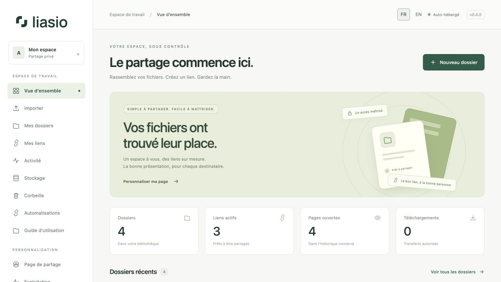
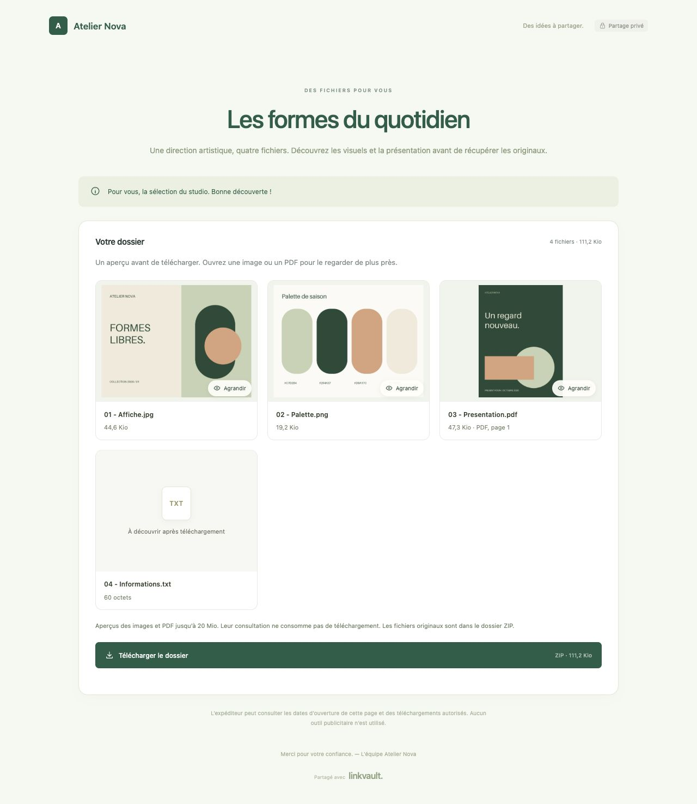
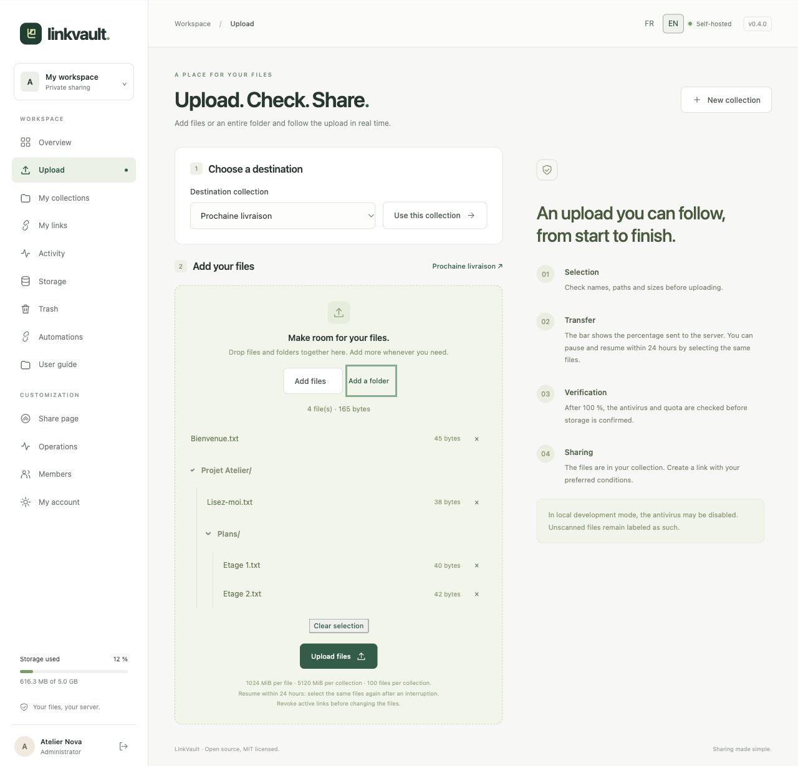

# Liasio

Liasio is the new name of LinkVault. The repository is now `fmacfa/liasio`. Published LinkVault container images, deployment identifiers and API v1 headers keep their existing names so existing installations and integrations continue to work.

**English** · [Français](README.fr.md)

**Your files. Your domain. Your rules.**

Liasio is an open-source file-sharing application that you host on your own server. Organize files into folders, customize their presentation, and create independent sharing links with passwords, expiration dates, or download limits.

French / English / German interface · **MIT** license · Python / Django · Docker Compose

> **Version 0.5 — team and client workflows.** Team spaces and groups, immutable versions, client file requests, recipient verification, reviewed emails, private S3 storage and OIDC. The interface and illustrated guides are available in French, English and German. This remains a pre-1.0 release; an independent human security audit is still pending and files are not end-to-end encrypted.



## Features

| Need | Available in version 0.5 |
| --- | --- |
| First-time setup | Two short steps: email and password, then name and password confirmation; the first account becomes the administrator |
| Multiple accounts | Personal invitations valid for 7 days, single-use and revocable; private accounts with explicit Reader/Collaborator access per collection |
| File library | Upload files or a complete directory while preserving its structure; add a title, description, and message to the recipient |
| Upload page | Mixed file/folder drops, cumulative selection, real byte progress, pause/resume for 24 hours, then antivirus verification |
| Sharing page | Per-account logo, background image, custom colors, name, tagline and footer, with a live preview |
| File previews | Image gallery and first-page PDF previews, lightbox and keyboard navigation; optional per link |
| Multiple links per folder | Internal label, optional password without a minimum length, expiry date or duration, and maximum download count |
| Bulk links without code | Create 1–200 links by quantity or import XLSX/CSV, review names and shared rules, then download your list with URLs; rename without changing URLs |
| Single-use links | One authorized download, including when requests arrive simultaneously |
| Activity tracking | Dated page opens and authorized downloads, filtering by link, and CSV export |
| Storage management | File counts, sizes, quotas, search, sorting by size/name/date, and individual/bulk deletion to a recoverable 30-day trash |
| Storage administration | Available disk space, total file count, and per-account usage; quotas editable in the administration page |
| Access management | Suspend members and revoke their links and sessions; password changes/recovery, optional TOTP and one-use recovery codes |
| Automations | Scoped, expiring API keys; resumable imports and link creation; signed webhooks, delivery history and bounded retries |
| Team spaces | Groups, Reader/Collaborator grants, owner transfers and optional mandatory MFA |
| Document versions | Frozen or updating links, explicit file replacement, version restoration and selective downloads |
| Client deposits | Upload-only links with expiry, byte and submission limits, scanning and resumable transfers |
| Email workflows | Individual/batch/invitation drafts, reusable templates, explicit approval, bounded retries and opt-in self-notifications |
| Verified recipients | Email allowlists and browser-bound one-time codes before viewing or downloading |
| Account security | Active sessions with revocation and optional explicitly linked OIDC identities |
| Hosting choices | Private local or S3-compatible originals, encrypted off-server restic backups and restore workflow |
| API tooling | OpenAPI 3.1 contract and a same-instance interactive explorer; names/emails to personalized links and Excel/CSV exports |
| Illustrated help | 19 guides in English, French and German, available on GitHub and under User guide in the application |
| Languages | French, English and German with automatic browser-language detection, including recipient pages, forms, messages and upload progress |
| Operations | Automatic HTTPS through Caddy, PostgreSQL, ClamAV antivirus, five-minute health checks, optional alerts, and automatically tested backup restoration |

**Links reuse stored files.** Replacing a file retains its older bytes while a version references them; retained versions count toward the owner’s quota. Create a password-protected link for one client, another that expires tomorrow, and a third that allows a single download.

**Shorter sharing URLs:** an opaque 22-character code follows `/s/`, replacing the previous 43- or 97-character tokens. Copy a link again from **My links** or export its batch to get the short URL. Previously shared URLs remain valid with the same password, expiry and download counter. See [link format, migration and compatibility](docs/SHARE_LINKS.md).

### What “opened” and “downloaded” mean

- **Page opened:** the authorized sharing page was served to a browser. Opens within the same session are deduplicated for 30 minutes. A link-preview bot may also open a page.
- **Download authorized:** the server prepared the ZIP archive and reserved one use before sending it. This does not prove that the complete file was received. An interrupted transfer consumes that use; the owner can create a new link.
- **Single-use:** opening the page does not consume a use. The download button sends a CSRF-protected POST request. An atomic database operation prevents simultaneous downloads from exceeding the limit.
- **Revocation:** blocks future authorizations. It cannot recall files already received and does not necessarily interrupt a transfer already authorized.

## User guides and automations

Start with the **[illustrated English guide](docs/guide/en/README.md)**, the **[guide français](docs/guide/fr/README.md)** or the **[deutsches Benutzerhandbuch](docs/guide/de/README.md)**. The same pages and screenshots are built into `/help/`.

For n8n, scripts and other tools, see the [API reference](docs/API.md), the [automation walkthrough](docs/guide/en/automation.md), the [Python upload client](examples/upload.py) and the [webhook signature verifier](examples/verify_webhook.py). Public registration stays closed. Anonymous uploads require an owner-created, expiring file-request capability.

For a workflow entirely in the interface, use **Create multiple links**: enter a quantity or upload an Excel/CSV list, check the names and conditions, then download the completed list. Original columns and row order are kept as values. See the [bulk-link guide](docs/guide/en/bulk-links.md), including the downloadable template, limits and illustrated steps.

The [batch API](docs/guide/en/bulk-links-api.md) accepts names or a quantity and returns the corresponding links in order. Batches appear in **My batches**, can be read and exported as Excel/CSV, and support safe retries. Use the included [Python client](examples/batches.py) from a terminal or Codex, or call the API from your website's backend with a private key.

## Server / VPS requirements

Use a Linux server with **Docker Engine and Docker Compose v2**, Git, and Python 3 for configuration. The following are planning recommendations for the complete stack, including antivirus; they are not measured capacity guarantees or a maximum user count. One GiB is 1,073,741,824 bytes; check the units advertised by your hosting provider.

| Dedicated server profile | CPU | RAM |
| --- | --- | --- |
| Small instance with occasional simultaneous transfers | 2 vCPUs | **8 GiB** |
| More headroom for simultaneous uploads, scanning and ZIP generation | 4 vCPUs | **12–16 GiB** |

### RAM and swap

**RAM** is working memory for the running services. The limits in [compose.yaml](compose.yaml) currently total **6.75 GiB**: ClamAV 4 GiB, application 1 GiB, PostgreSQL and previews 512 MiB each, maintenance, webhooks and email workers 256 MiB each. These are individual ceilings, not reserved or constant consumption. Linux, Docker, Caddy and backup/build processes need additional memory. ClamAV alone [recommends 4 GiB](https://docs.clamav.net/manual/Installing/Docker.html#memory-ram-requirements), with temporary peaks during signature updates.

On a **shared VPS**, add the needs of your existing sites, databases and applications, including their peaks. A server with 8 GiB installed but only 2 GiB available is not equivalent to a dedicated 8 GiB server. CloudPanel does not reduce these requirements; plan the reverse proxy and existing port bindings using the [operations guide](docs/OPERATIONS.md#autre-reverse-proxy).

**Swap** uses disk space as a slower memory buffer. An optional **2–4 GiB** swap area is a starting allowance for occasional pressure, not a way to fit the complete stack onto an undersized VPS. Frequent swap reads/writes during transfers call for more RAM or less competing workload. Docker's effective swap allowance depends on the host and container settings; this Compose file does not set `memswap_limit`. See [Docker memory and swap limits](https://docs.docker.com/engine/containers/resource_constraints/#--memory-swap-details).

### Disk space and bandwidth

Use **SSD/NVMe storage on a local filesystem** with working POSIX file locks. Budget for the operating system, Docker images/build cache, antivirus signatures, logs and database, **plus**:

- Stored files, generated previews and the **30-day trash**; an expired link does not delete its files.
- Upload staging retained for up to **24 hours**, and temporary ZIPs for simultaneous downloads. Upload admission conservatively reserves twice the pending bytes; ZIP admission reserves the full uncompressed size plus metadata. See [disk reservations](docs/RELIABILITY.md#resumable-uploads).
- Every retained local backup and an additional full copy for a restore test. Do not assume already-compressed files will shrink in a backup; keep encrypted copies off the server too.
- Swap, if stored on the same disk, and a target of **at least 20% free space** after these budgets.

**Planning example:** 25 GiB for the system, service data and swap + 20 GiB of files including trash + one 20 GiB backup + 20 GiB for its restore test + 10 GiB of transfer workspace = 95 GiB. Allow **at least 120 GiB of usable filesystem capacity** to retain roughly 20% headroom. Adjust each allowance to your retention, file sizes and concurrent transfers; this is an example, not a fixed disk requirement. The default `MIN_FREE_DISK_BYTES=1073741824` (1 GiB) is an admission safety floor, not the recommended free space.

Account quotas do not create disk capacity. Multiple sharing links reuse the same files, but every download consumes outbound bandwidth; check both your provider's transfer allowance and uplink speed.

### Kernel and capacity checks

Production previews need **Landlock ABI 3+**, normally Linux 6.2+ with Landlock enabled. The running kernel and container permissions must actually support it. Unsupported preview isolation leaves file cards available and originals downloadable; see [preview deployment](docs/PREVIEWS.md). A newer container image alone cannot upgrade the host kernel.

Run these read-only checks **on the Linux host**, before installation and again during representative uploads, downloads and signature updates:

```sh
free -h
swapon --show
vmstat 1 5
df -h
docker stats --no-stream
```

Check `available` in `free`, sustained `si`/`so` activity in the later `vmstat` samples, and free space on the files, Docker and backup filesystems. Used swap alone does not prove current pressure. Use the application's **Storage / Operations** pages for file counts, quotas and alerts; adapt the VPS size to observed peaks.

## Install on your domain

Choose a server using the [requirements above](#server--vps-requirements), then configure your domain:

1. Point your domain's DNS A record, and AAAA record if used, to the server.
2. Allow inbound ports **80 and 443**. Do not expose the database, application, or antivirus service directly.
3. Clone the repository and generate unique secrets:

```sh
git clone https://github.com/fmacfa/liasio.git
cd liasio
python3 scripts/configure.py --domain files.example.com
docker compose up -d --build
docker compose ps
```

4. Wait for ClamAV to become ready; its first startup may take several minutes.
5. Open `https://files.example.com`. Enter your email and a password, choose **Continue**, then enter your name and confirm the password. Select **Create my account**. No installation key is needed.
6. Create a folder, upload files, then select **Create a link**. Choose **FR / EN / DE** to change the interface language.

The configuration script creates `.env` with `0600` permissions and refuses to overwrite an existing file. It contains secrets: never publish it. The first person to complete setup becomes the administrator: initialize the instance before sharing its address. Setup permanently closes after this account is created; other users join by invitation.

Caddy obtains and renews the TLS certificate. If you use another reverse proxy, read the [operations guide](docs/OPERATIONS.md) (French) before changing the topology.

### Prebuilt images and upgrades

Versioned images are published by GitHub Actions with a software bill of materials (SBOM) and provenance. Releases also provide a compressed Docker archive for offline installation. See [releases](https://github.com/fmacfa/liasio/releases) and the [changelog](CHANGELOG.md).

Set `LINKVAULT_IMAGE=ghcr.io/fmacfa/liasio:0.5.0` in `.env` to use the registry image, then `docker compose pull app maintenance preview webhooks mail` and `docker compose up -d --no-build`. For source builds, keep the default and use `--build`.

Before upgrading from 0.1, preserve your original keys and take a complete backup. Read the [upgrade and reliability guide](docs/RELIABILITY.md), including MFA key handling, trash quotas, monitoring and restore verification.

Version 0.5 includes the hardening changes made after 0.4, together with additive migrations through `0017`. Follow the [0.5 upgrade guide](docs/UPGRADING_0_5.md), preserve the original keys and restart every writer with the same image. Production previews still require Linux Landlock ABI 3+; disabling previews keeps original downloads available. Release assets include exact image digests, SBOM and workflow/tag/commit-bound attestations.

## Try it locally

Install [uv](https://docs.astral.sh/uv/getting-started/installation/), then run:

```sh
git clone https://github.com/fmacfa/liasio.git
cd liasio
python3 scripts/configure.py --dev
uv sync --frozen
uv run --env-file .env python manage.py migrate
uv run --env-file .env python manage.py runserver 127.0.0.1:8000
```

Open [http://127.0.0.1:8000](http://127.0.0.1:8000). Create the first account with your email and password; no installation key is required. This mode uses SQLite, HTTP, and explicitly disabled antivirus scanning. It is intended only for your local machine and demonstration files.

To populate an **empty local installation** with fictional demo data, choose a demo password and run:

```sh
DEMO_PASSWORD='replace-with-your-demo-passphrase' uv run --env-file .env python manage.py seed_demo
```

The account email is `demo@example.com`. This command refuses to run in production or when an account already exists. Do not reuse demo data or secrets on your public server.

## Configuration

Configure values in `.env`; [.env.example](.env.example) provides a template.

| Setting | Default / purpose |
| --- | --- |
| `APP_URL` / `DOMAIN` | Canonical HTTPS origin without a path / domain name |
| `SECRET_KEY` | Random secret of at least 50 characters; signs sessions and access tokens |
| `MAX_FILE_BYTES` | 1073741824: 1 GiB per file |
| `MAX_UPLOAD_BYTES` | 5368709120: 5 GiB per folder; multipart fallback remains 500 MiB/request |
| `DEFAULT_QUOTA_BYTES` | 5368709120: 5 GiB for each new account |
| `EVENT_RETENTION_DAYS` | 90 days of activity and administrative history |
| `TIME_ZONE` | `Europe/Berlin`; timestamps are stored in UTC and displayed in this time zone |
| `ANTIVIRUS_REQUIRED` | `true` in production; uploads fail if scanning cannot complete |
| `CLAMAV_HOST` | `clamav` in Compose; a private service that must never be exposed to the Internet |
| `EMAIL_HOST`, `EMAIL_PORT`, `EMAIL_HOST_USER`, `EMAIL_HOST_PASSWORD` | Optional SMTP settings for password recovery |
| `EMAIL_USE_TLS` / `EMAIL_USE_SSL` | STARTTLS by default; do not enable both at the same time |
| `DEFAULT_FROM_EMAIL` | Sender address authorized by your SMTP server |
| `TRUST_PROXY` | `true` only behind the isolated reverse proxy supplied in Compose |

This version has a fixed limit of 100 files per folder. Accepted file extensions are configured through `ALLOWED_EXTENSIONS`. If you increase upload sizes, also adjust Caddy and ClamAV limits; see the operations guide.

Invitations generate a link to copy and share. They do not send email automatically. Without SMTP, the server administrator can reset a password using `manage.py changepassword`.

## Reliability

- **MFA:** enable an authenticator app from **Mon compte** and securely save the ten recovery codes.
- **Trash:** restore a file or folder for 30 days; permanently purging it frees the quota.
- **Resumable transfers:** reselect the same files after a pause or reload; confirmed blocks are retained for 24 hours.
- **Administration:** adjust quotas and inspect capacity, alerts and backup checks in **Exploitation**.
- **Backups:** `scripts/backup-and-verify.sh` creates a backup and proves it can be restored in isolated Docker volumes. Schedule it on your server and keep encrypted off-server copies.
- **Monitoring:** optional SMTP alerts and a bearer-protected `/ready/` endpoint; `/health/` remains a minimal liveness probe.

See [RELIABILITY.md](docs/RELIABILITY.md) for configuration, limits, failure behavior and reproducible load-test evidence. New settings include `MFA_ENCRYPTION_KEY`, `TRASH_RETENTION_DAYS`, `MIN_FREE_DISK_BYTES`, `MONITORING_TOKEN`, `MONITOR_EMAIL` and `BACKUP_MAX_AGE_HOURS`.

## Preview files before downloading

Enable previews when creating a link, or from **Mes liens** for an existing one. Recipients see image thumbnails and the first page of PDFs, and can open them in a large viewer before downloading the ZIP. JPEG, PNG, WebP, GIF and PDF files up to 20 MiB are eligible; other files retain their name, type and size.

Previews are reduced, metadata-free JPEGs generated by an isolated renderer. They honor passwords, revocation, expiry and download exhaustion, and never consume a download. **Visible previews can be copied.** Disable them when content should remain hidden until download. Existing links stay opted out after upgrading. See [preview limits and deployment](docs/PREVIEWS.md).



## Security and privacy

- **Argon2id** password hashing; account passwords require at least 12 characters. Optional share-link passwords have no minimum; all password forms accept at most 128 characters.
- No public registration; protected initialization and signed, expiring, single-use invitations.
- Ownership checks on every resource; web administrators cannot browse another account's files.
- Server-side sessions, HttpOnly/Secure cookies in production, CSRF protection, host validation, a restrictive CSP, and framing protection.
- Opaque 128-bit sharing codes derived with HMAC-SHA256 and resolved through a unique hash index; database identifiers or lookup digests alone cannot reveal them. Previous signed URLs remain accepted with their original validation. Link passwords are hashed and sharing codes are not stored in plaintext in the database. See [the token format](docs/SHARE_LINKS.md).
- Database-backed rate limits shared between workers; IP identities are HMAC-hashed for rate limiting and subsequently purged.
- Files stored outside the web root under random physical names; validated relative paths, extension restrictions, and size limits.
- Mandatory ClamAV scanning in the production stack; unexpected responses, malware detections, scanning limits, or service outages block uploads.
- Downloads served as attachments; HTML/SVG content is not previewed or executed.
- Activity history without IP addresses, geolocation, or advertising identifiers; CSV exports neutralize formula injection.
- Deletion revokes sharing links immediately; trash retains quota until permanent purge.
- TOTP secrets are encrypted; codes cannot be replayed, recovery codes are one-use, and pending logins expire.
- Resumable uploads reserve quota, verify block checksums and publish only after complete antivirus verification.

The operating-system administrator can read stored files: **this is not end-to-end encryption**. Use encrypted volumes and backups where needed. Antivirus scanning does not guarantee that a file is harmless. Extension checks do not fully validate the contents of every accepted format. This application is not designed for large-scale anonymous uploads.

Supporting guides are currently in French: [security policy](SECURITY.md), [security model](docs/SECURITY_MODEL.md), and [backup, restore, and maintenance](docs/OPERATIONS.md).

## Testing and contributing

```sh
uv sync --frozen
uv run --env-file .env python manage.py test --noinput
uv run --env-file .env python manage.py makemigrations --check --dry-run
uv run --env-file .env pip-audit --local
```

The [pre-release review summary](docs/SECURITY_REVIEW.md) records the automated source review, three corrected issues and regression evidence.

The test suite covers account isolation, upload limits, invitations, CSRF, link passwords, path traversal, deletion, and concurrent access. The GitHub workflow tests SQLite and PostgreSQL, builds the container image, and checks antivirus behavior using the EICAR test signature.

See [CONTRIBUTING.md](CONTRIBUTING.md) for the code organization and [ROADMAP.md](ROADMAP.md) for planned improvements. Both documents are currently in French.

## Inspiration and scope

We reviewed [Pingvin Share](https://github.com/stonith404/pingvin-share), [ProjectSend](https://github.com/projectsend/projectsend), [Gokapi](https://github.com/Forceu/Gokapi), and [Send](https://github.com/timvisee/send). The [comparison](docs/COMPARISON.md) (French) describes their strengths and Liasio's design choices.

Liasio focuses on reusable folders, presentation, and explicit link rules in a compact application. This release does not aim to replace every feature in these more established projects. Liasio's application code and visual assets were created for this project; no code was copied from those four repositories.

### Upload preview



## License

[MIT](LICENSE), copyright 2026 Filippo Maria Celi and contributors. Dependencies and container images retain their respective licenses. See [THIRD_PARTY.md](THIRD_PARTY.md).
