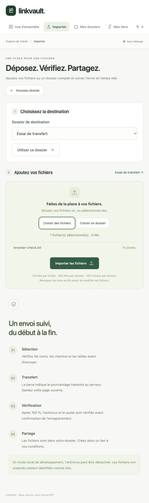

# LinkVault

**English** · [Français](README.fr.md)

**Your files. Your domain. Your rules.**

LinkVault is an open-source file-sharing application that you host on your own server. Organize files into folders, customize their presentation, and create independent sharing links with passwords, expiration dates, or download limits.

French user interface · **MIT** license · Python / Django · Docker Compose

> **Version 0.1 — initial functional release.** Security controls are tested, but the project has not undergone an independent security audit. End-to-end encryption and two-factor authentication are not yet available.


## Features

| Need | Available in version 0.1 |
| --- | --- |
| First-time setup | Setup wizard protected by an installation key; create the administrator account with an email address and password |
| Multiple accounts | Personal invitations valid for 7 days, single-use and revocable; isolated member accounts |
| File library | Upload files or a complete directory while preserving its structure; add a title, description, and message to the recipient |
| Upload page | Select a destination folder, review filenames and sizes, follow real upload progress, then see the verification stage |
| Sharing page | Per-account name, tagline, color palette, and footer, with a live preview |
| Multiple links per folder | Internal label, optional password, expiration date, and maximum download count |
| Single-use links | One authorized download, including when requests arrive simultaneously |
| Activity tracking | Dated page opens and authorized downloads, filtering by link, and CSV export |
| Storage management | File counts, sizes, quotas, search, sorting by size/name/date, and individual or bulk deletion with confirmation |
| Storage administration | Available disk space, total file count, and per-account usage; quotas adjustable from the command line |
| Access management | Suspend members and revoke their links and sessions; password changes and recovery |
| Operations | Automatic HTTPS through Caddy, PostgreSQL, ClamAV antivirus, hourly maintenance, and documented backup/restore procedures |

**A folder is stored only once.** Create a password-protected link for one client, another that expires tomorrow, and a third that allows a single download.

### What “opened” and “downloaded” mean

- **Page opened:** the authorized sharing page was served to a browser. Opens within the same session are deduplicated for 30 minutes. A link-preview bot may also open a page.
- **Download authorized:** the server prepared the ZIP archive and reserved one use before sending it. This does not prove that the complete file was received. An interrupted transfer consumes that use; the owner can create a new link.
- **Single-use:** opening the page does not consume a use. The download button sends a CSRF-protected POST request. An atomic database operation prevents simultaneous downloads from exceeding the limit.
- **Revocation:** blocks future authorizations. It cannot recall files already received and does not necessarily interrupt a transfer already authorized.

## Install on your domain

Use a Linux server with **Docker Engine and Docker Compose v2**, Git, and Python 3 for configuration. For the complete stack, start with **8 GB of RAM** (including up to 4 GB for ClamAV), 2 vCPUs, and enough disk space for your files. These are starting recommendations, not load-test results.

1. Point your domain's DNS A record, and AAAA record if used, to the server.
2. Allow inbound ports **80 and 443**. Do not expose the database, application, or antivirus service directly.
3. Clone the repository and generate unique secrets:

```sh
git clone https://github.com/fmacfa/linkvault.git
cd linkvault
python3 scripts/configure.py --domain files.example.com
docker compose up -d --build
docker compose ps
```

4. Wait for ClamAV to become ready; its first startup may take several minutes.
5. Open `https://files.example.com` and create your account using **SETUP_TOKEN** from your `.env` file, your name, email address, and password.
6. Create a folder, upload files, then select **Créer un lien** (“Create a link”). The application interface is currently in French.

The configuration script creates `.env` with `0600` permissions and refuses to overwrite an existing file. It contains secrets: never publish it. Once initialization is complete, first-account creation stays closed even if the setup key remains in the configuration.

Caddy obtains and renews the TLS certificate. If you use another reverse proxy, read the [operations guide](docs/OPERATIONS.md) (French) before changing the topology.

## Try it locally

Install [uv](https://docs.astral.sh/uv/getting-started/installation/), then run:

```sh
git clone https://github.com/fmacfa/linkvault.git
cd linkvault
python3 scripts/configure.py --dev
uv sync --frozen
uv run --env-file .env python manage.py migrate
uv run --env-file .env python manage.py runserver 127.0.0.1:8000
```

Open [http://127.0.0.1:8000](http://127.0.0.1:8000). The first-time setup key is in `.env`. This mode uses SQLite, HTTP, and explicitly disabled antivirus scanning. It is intended only for your local machine and demonstration files.

To populate an **empty local installation** with fictional demo data, choose a demo password and run:

```sh
DEMO_PASSWORD='replace-with-your-demo-passphrase' uv run --env-file .env python manage.py seed_demo
```

The account email is `demo@example.com`. This command refuses to run in production or when an account already exists. Do not reuse demo data or secrets on your public server.

## Configuration

Configure values in `.env`; [.env.example](.env.example) provides a template.

| Setting | Default / purpose |
| --- | --- |
| `APP_URL` / `DOMAIN` | Canonical HTTPS origin without a path / domain name |
| `SECRET_KEY` | Random secret of at least 50 characters; signs sessions and access tokens |
| `SETUP_TOKEN` | Secret of at least 32 characters for first-account creation |
| `MAX_FILE_BYTES` | 104857600: 100 MiB per file |
| `MAX_UPLOAD_BYTES` | 524288000: 500 MiB per upload **and per folder** |
| `DEFAULT_QUOTA_BYTES` | 5368709120: 5 GiB for each new account |
| `EVENT_RETENTION_DAYS` | 90 days of activity and administrative history |
| `TIME_ZONE` | `Europe/Berlin`; timestamps are stored in UTC and displayed in this time zone |
| `ANTIVIRUS_REQUIRED` | `true` in production; uploads fail if scanning cannot complete |
| `CLAMAV_HOST` | `clamav` in Compose; a private service that must never be exposed to the Internet |
| `EMAIL_HOST`, `EMAIL_PORT`, `EMAIL_HOST_USER`, `EMAIL_HOST_PASSWORD` | Optional SMTP settings for password recovery |
| `EMAIL_USE_TLS` / `EMAIL_USE_SSL` | STARTTLS by default; do not enable both at the same time |
| `DEFAULT_FROM_EMAIL` | Sender address authorized by your SMTP server |
| `TRUST_PROXY` | `true` only behind the isolated reverse proxy supplied in Compose |

This version has a fixed limit of 100 files per folder. Accepted file extensions are configured through `ALLOWED_EXTENSIONS`. If you increase upload sizes, also adjust Caddy and ClamAV limits; see the operations guide.

Invitations generate a link to copy and share. They do not send email automatically. Without SMTP, the server administrator can reset a password using `manage.py changepassword`.

## Security and privacy

- **Argon2id** password hashing; web forms require at least 12 characters and accept at most 128.
- No public registration; protected initialization and signed, expiring, single-use invitations.
- Ownership checks on every resource; web administrators cannot browse another account's files.
- Server-side sessions, HttpOnly/Secure cookies in production, CSRF protection, host validation, a restrictive CSP, and framing protection.
- HMAC-SHA256 access tokens that cannot be derived from database identifiers alone; hashed link passwords. Sharing tokens are not stored in plaintext in the database.
- Database-backed rate limits shared between workers; IP identities are HMAC-hashed for rate limiting and subsequently purged.
- Files stored outside the web root under random physical names; validated relative paths, extension restrictions, and size limits.
- Mandatory ClamAV scanning in the production stack; unexpected responses, malware detections, scanning limits, or service outages block uploads.
- Downloads served as attachments; HTML/SVG content is not previewed or executed.
- Activity history without IP addresses, geolocation, or advertising identifiers; CSV exports neutralize formula injection.
- File deletion revokes affected sharing links and releases quota; orphaned blobs are removed after a safety delay.

The operating-system administrator can read stored files: **this is not end-to-end encryption**. Use encrypted volumes and backups where needed. Antivirus scanning does not guarantee that a file is harmless. Extension checks do not fully validate the contents of every accepted format. This application is not designed for large-scale anonymous uploads.

Supporting guides are currently in French: [security policy](SECURITY.md), [security model](docs/SECURITY_MODEL.md), and [backup, restore, and maintenance](docs/OPERATIONS.md).

## Testing and contributing

```sh
uv sync --frozen
uv run --env-file .env python manage.py test --noinput
uv run --env-file .env python manage.py makemigrations --check --dry-run
uv run --env-file .env pip-audit --local
```

The test suite covers account isolation, upload limits, invitations, CSRF, link passwords, path traversal, deletion, and concurrent access. The GitHub workflow tests SQLite and PostgreSQL, builds the container image, and checks antivirus behavior using the EICAR test signature.

See [CONTRIBUTING.md](CONTRIBUTING.md) for the code organization and [ROADMAP.md](ROADMAP.md) for planned improvements. Both documents are currently in French.

## Inspiration and scope

We reviewed [Pingvin Share](https://github.com/stonith404/pingvin-share), [ProjectSend](https://github.com/projectsend/projectsend), [Gokapi](https://github.com/Forceu/Gokapi), and [Send](https://github.com/timvisee/send). The [comparison](docs/COMPARISON.md) (French) describes their strengths and LinkVault's design choices.

LinkVault focuses on reusable folders, presentation, and explicit link rules in a compact application. This release does not aim to replace every feature in these more established projects. LinkVault's application code and visual assets were created for this project; no code was copied from those four repositories.

### Upload preview



## License

[MIT](LICENSE), copyright 2026 Filippo Maria Celi and contributors. Dependencies and container images retain their respective licenses. See [THIRD_PARTY.md](THIRD_PARTY.md).
