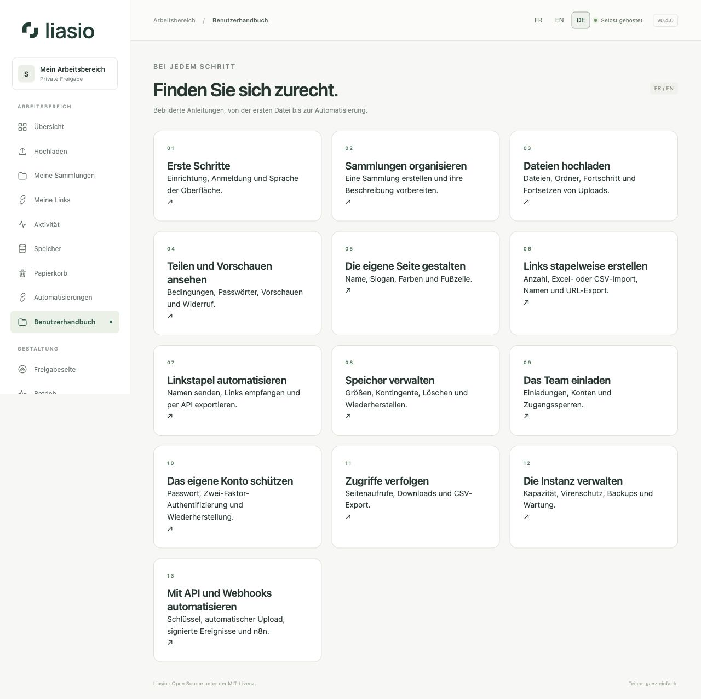

# Liasio-Benutzerhandbuch

Version 0.4 · Dieselben Anleitungen finden Sie in Ihrer Instanz unter **Benutzerhandbuch**. Die Bilder sind echte Aufnahmen einer lokalen Entwicklungsumgebung mit ausschließlich fiktiven Daten. Virenschutz und Betriebsdienste hängen von der Serverkonfiguration ab. Es werden keine echten Zugangsdaten gezeigt.

1. [Erste Schritte und Sprache](getting-started.md)
2. [Sammlungen organisieren](collections.md)
3. [Dateien hochladen und Uploads fortsetzen](uploads.md)
4. [Links, Bedingungen und Vorschauen](sharing.md)
5. [Die Freigabeseite gestalten](branding.md)
6. [Speicher und Papierkorb](storage.md)
7. [Mitglieder und Einladungen](team.md)
8. [Kontosicherheit und Wiederherstellung](account.md)
9. [Aktivität und CSV-Export](activity.md)
10. [Betrieb und Kontingente](operations.md)
11. [API, Webhooks und n8n](automation.md)
12. [Linkstapel, Excel und CSV](bulk-links.md)
13. [Stapel per API erstellen, abrufen und exportieren](bulk-links-api.md)

[English](../en/README.md) · [Français](../fr/README.md) · **Deutsch** · [API-Referenz (Englisch)](../../API.md)
