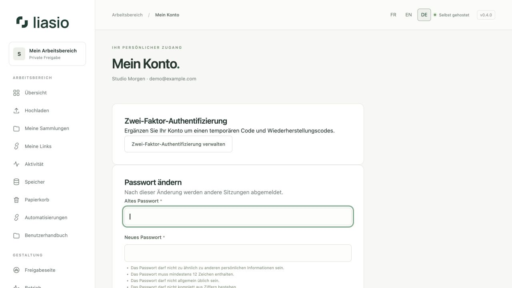
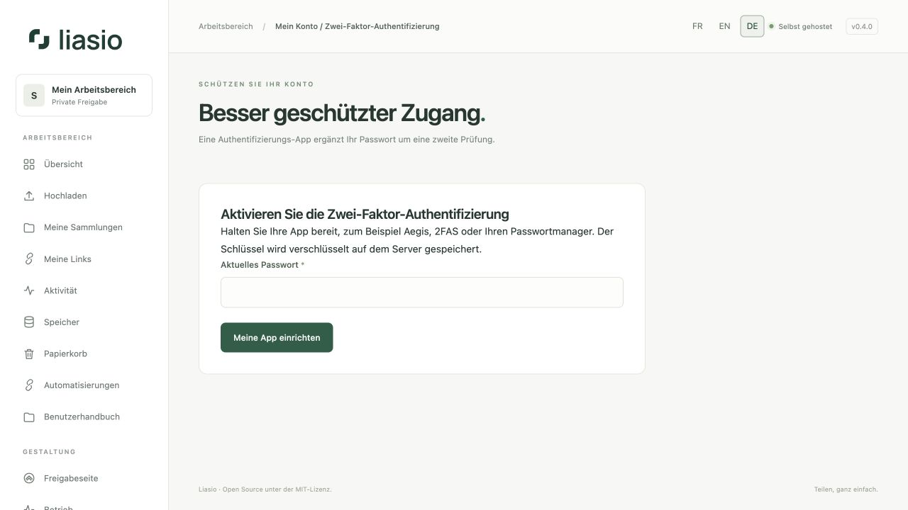

# Konto schützen und wiederherstellen

## Passwort ändern

Öffnen Sie **Mein Konto**, geben Sie Ihr aktuelles Passwort, ein neues einzigartiges Passwort mit mindestens zwölf Zeichen und dessen Bestätigung ein. Wählen Sie **Passwort aktualisieren**. Andere Sitzungen werden abgemeldet; die aktuelle bleibt bestehen. Bestehende API-Schlüssel werden ungültig. Ersetzen Sie sie in Ihren Automatisierungswerkzeugen.

## Zwei-Faktor-Authentifizierung aktivieren

1. Öffnen Sie **Zwei-Faktor-Authentifizierung verwalten** und bestätigen Sie Ihr aktuelles Passwort, um die Einrichtung zu beginnen.
2. Scannen Sie den QR-Code in einer TOTP-App oder geben Sie den Schlüssel manuell ein. QR-Code und Schlüssel sind geheim. Die Einrichtung läuft nach zehn Minuten ab.
3. Geben Sie einen neuen sechsstelligen Code ein und wählen Sie **Aktivieren und Codes anzeigen**.
4. Speichern Sie die Wiederherstellungscodes in einem privaten Passwortmanager. Sie werden nur einmal angezeigt. Jeder ersetzt einmalig einen App-Code.

Bei späteren Anmeldungen geben Sie nach dem Passwort einen App-Code ein. Ein bereits im aktuellen Zeitfenster verwendeter Code kann nicht erneut genutzt werden; warten Sie auf den nächsten. Ein Wiederherstellungscode hilft, wenn Sie Ihre App verlieren.

## Codes erneuern oder MFA deaktivieren

Bestätigen Sie auf derselben Seite Passwort und einen gültigen App- oder Wiederherstellungscode. Wählen Sie **Codes erneuern** oder **Deaktivieren**. Beim Erneuern werden die alten Wiederherstellungscodes ungültig. MFA-Änderungen beenden andere Sitzungen und machen API-Schlüssel ungültig. Entfernen Sie Ihre Authentifizierungs-App erst nach bestätigter Änderung.

## Passwort vergessen oder zweiter Faktor verloren

Wählen Sie bei der Anmeldung **Passwort vergessen?**. Ist SMTP eingerichtet und existiert ein passendes aktives Konto, wird ein persönlicher Link gesendet, der eine Stunde gültig ist. Die Antwort bleibt für unbekannte Adressen absichtlich gleich. Die E-Mail verwendet die Sprache der Anfrage. Ein Passwort-Reset umgeht die Zwei-Faktor-Authentifizierung nicht.

Bei verlorener Authentifizierungs-App verwenden Sie einen Wiederherstellungscode. Sind App und Wiederherstellungscodes verloren, wenden Sie sich an die Administration für einen kontrollierten Wiederherstellungsprozess. Es gibt keine öffentliche MFA-Umgehung. Eine abgelaufene Einladung benötigt eine neue Einladung und keinen Passwort-Reset.

## Sitzungen und Teamschutz

Unter [Aktive Sitzungen](advanced-operations.md) sehen Sie Ihre Geräte und können eine einzelne Sitzung oder alle anderen Geräte abmelden. Bestehende Sitzungen werden beim Upgrade übernommen; das ursprüngliche Gerät kann unbekannt sein. Wenn ein [Team-Arbeitsbereich](workspaces.md) MFA verlangt, müssen Sie diese einrichten und können sie während dieser Verpflichtung nicht deaktivieren. Eine optionale Unternehmensanmeldung wird ausdrücklich im Konto verknüpft; eine identische E-Mail-Adresse führt nie zur Zusammenführung von Identitäten.
