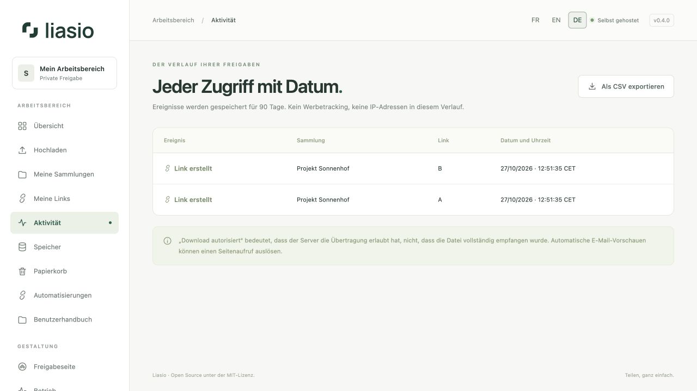

# Aktivität und Download-Zähler verstehen

Unter **Aktivität** finden Sie den datierten Verlauf Ihrer Links. Über die Aktivitätsaktion eines Links in einer Sammlung oder unter **Meine Links** filtern Sie nach diesem Link. **Alle Links anzeigen** stellt den vollständigen Verlauf wieder her.

| Ereignis | Bedeutung |
| --- | --- |
| Link erstellt | Ein neuer Freigabelink wurde angelegt. |
| Seite geöffnet | Die freigegebene Seite wurde ausgeliefert. Weitere Aufrufe derselben Sitzung innerhalb von 30 Minuten werden nicht erneut gezählt. |
| Download autorisiert | Der Server hat das ZIP vorbereitet und die Übertragung erlaubt. Das beweist nicht, dass der Empfänger jedes Byte erhalten hat. |
| Link widerrufen | Zukünftige Zugriffe über diesen Link wurden gesperrt. |

Vorschauen erhöhen den Download-Zähler nicht. Linkscanner, E-Mail-Vorschauen und eigene Besuche können Seitenaufrufe auslösen. Zähler stehen daher weder für eindeutige Personen noch für Zustellnachweise. Der Verlauf speichert keine Werbetracker und keine unverarbeiteten Besucher-IP-Adressen.

## Export und Aufbewahrung

**Als CSV exportieren** lädt bis zu 10.000 Ereignisse des aktuellen Filters herunter. CSV-Datumsangaben verwenden ISO 8601 mit UTC-Zeitzone; die Oberfläche zeigt die Serverzeitzone. Namen, die als Tabellenformeln interpretiert werden könnten, werden im Export abgesichert.

Ereignisse werden standardmäßig 90 Tage aufbewahrt (`EVENT_RETENTION_DAYS`). Lebenslange Download-Zähler können deshalb größer sein als die noch gespeicherte Ereignisliste. Die Wartung entfernt abgelaufene Einträge. Exportieren Sie rechtzeitig, wenn Sie einen eigenen Verlauf aufbewahren möchten.

Für automatische Benachrichtigungen abonnieren Sie unter [Automatisierungen](automation.md) `link.opened` oder `download.started`. Diese Ereignisse enthalten Kennungen, keine Empfängeradressen oder Dateiinhalte.
