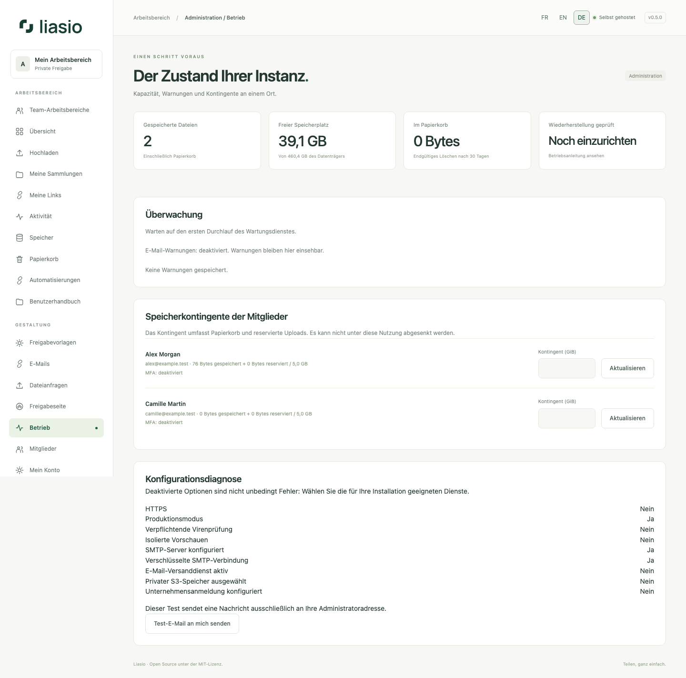

# Erweitertes Hosting und Kontoschutz

Administratoren sehen unter **Betrieb** Speicher, Kontingente, Wartung, Virenschutz, Sicherungsprüfungen und die Konfigurationsdiagnose. Eine ausgeschaltete optionale Funktion ist nicht automatisch ein Fehler. Der SMTP-Test sendet nur an die eigene Administratoradresse und erscheint unter **E-Mails**; er ändert keine SMTP-Einstellungen.

## Sitzungen und Unternehmensidentität

Unter **Mein Konto → Aktive Sitzungen** sehen Sie dieses Gerät, weitere angemeldete Geräte und deren letzte Aktivität. Die Bezeichnungen stammen aus Browserangaben; IP-Adressen werden nicht gespeichert. Trennen Sie ein anderes Gerät oder alle anderen, ohne die aktuelle Sitzung zu beenden. Passwort-/MFA-Änderungen behalten ihre bisherigen Regeln zur Sitzungsentwertung. Ältere Geräte können bis zur nächsten Nutzung unbekannt bleiben.

Wenn der Betreiber OIDC einrichtet, erscheint **Unternehmensanmeldung**. Melden Sie sich lokal an, bestätigen Sie Passwort und gegebenenfalls MFA-Code und verknüpfen Sie die Identität ausdrücklich. Gleiche E-Mail-Adressen verbinden Konten niemals automatisch. Sperren und lokale MFA gelten weiterhin. Bei Ausfall des Anbieters bleibt die Passwortanmeldung verfügbar; eine lokale Abmeldung beendet nicht dessen Sitzung.

## Speicher und Sicherungen

Privater S3-Speicher wird optional vom Betreiber eingerichtet. Originaldateien erhalten keine direkten URLs, die Liasio-Rechte umgehen. Upload-Zwischenspeicher und Downloads benötigen weiterhin lokalen Speicher. Aktuelle Dateien, Versionen und Papierkorb zählen zum Kontingent. Die [Hosting-Anleitung](../../ADVANCED_HOSTING.md) erläutert Rechte und eine Migration mit Hash-Prüfung.

Verschlüsselte externe Sicherungen verwenden restic mit einstellbarer Aufbewahrung. Exportiert werden Datenbank, Dateiversionen, wartende Blöcke und verschlüsselte Konfiguration; Wiederherstellungsziele müssen leer sein. Erproben Sie die vollständige Wiederherstellung auf einem anderen Server und verwahren Sie das Repository-Passwort außerhalb des VPS. Siehe [Sicherungen](../../OFFSITE_BACKUPS.md) und [Upgrade auf 0.5](../../UPGRADING_0_5.md).

SMTP, OIDC, S3 und externe Backups benötigen Betreiberkonfiguration und werden nicht stillschweigend aktiviert. Die unabhängige menschliche Sicherheitsprüfung steht weiterhin aus: [Audit-Vorbereitung](../../INDEPENDENT_AUDIT.md).
