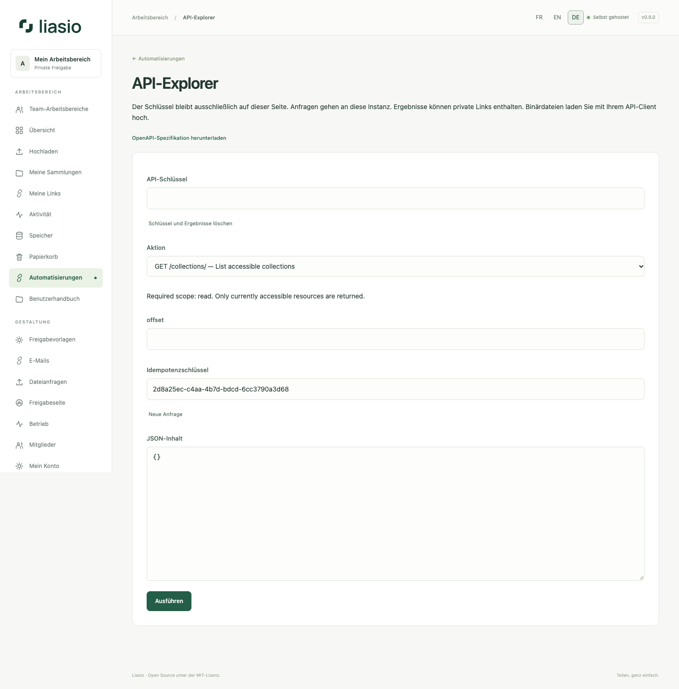

# API im Browser testen

1. Erstellen Sie unter **Automatisierungen** einen API-Schlüssel mit den erforderlichen Rechten. Halten Sie ihn geheim und beachten Sie sein Ablaufdatum. Eine Browser-Anmeldung ersetzt keinen API-Schlüssel.
2. Öffnen Sie den **API-Explorer** und fügen Sie den Schlüssel in das verdeckte Feld ein. Er bleibt nur im Arbeitsspeicher der Seite, niemals im Browser-Speicher oder in URL-Parametern. Alle Aufrufe gehen an diese Instanz, ohne Sitzungscookies.
3. Wählen Sie eine Aktion. Mit `GET /collections/` finden Sie die UUID eines zugänglichen Ordners und können sie in das Pfadfeld eintragen. Lesen benötigt `read`, Erstellung `files:write` oder `links:write`.
4. Prüfen Sie bei Schreibzugriffen den JSON-Inhalt, behalten Sie den Idempotenzschlüssel bei, bestätigen Sie die Änderung und führen Sie sie aus. Nach einem Netzfehler verwenden Sie denselben Schlüssel mit identischem Inhalt erneut. **Neue Anfrage** erzeugt einen Schlüssel für eine absichtlich neue Aktion.
5. Prüfen Sie HTTP-Status und Antwort. Die Stapelerstellung liefert Namen und URLs in Eingabereihenfolge, den Eintrag unter **Meine Link-Sammlungen** und Excel-/CSV-Exporte. Exporte zeigen eine Download-Schaltfläche. Binäre Upload-Blöcke senden Sie mit Ihrem API-Client.
6. Wählen Sie abschließend **Schlüssel und Ergebnisse löschen**. Veröffentlichen Sie keine Antwort-Screenshots mit privaten Links. Beim Verlassen/Schließen der Seite wird der Schlüssel entfernt; ein Neuladen bewahrt ihn nicht auf.

Die [OpenAPI-3.1-Spezifikation](../../openapi.json) liegt auch unter `/api/openapi.json`. Sie beschreibt Routen, Rechte, Felder, Statuscodes, Seitennavigation und Prüfsummen. Der Explorer nutzt diesen versionierten Vertrag ohne externe Skripte oder CDN. Siehe [API-Referenz](../../API.md), [Link-Sammlungen per API](bulk-links-api.md) und [Uploads](automation.md).
