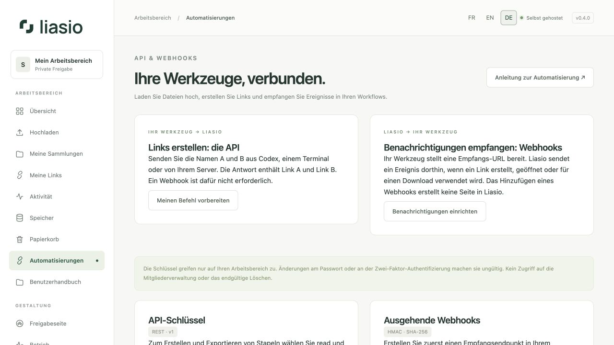
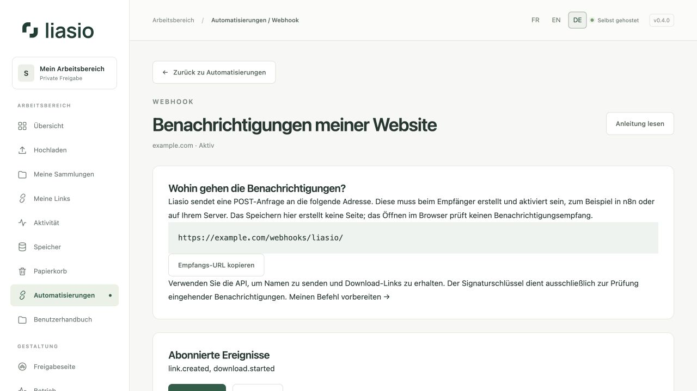

# Mit API und Webhooks automatisieren

Die **API empfängt Befehle** aus Ihren Werkzeugen: Sammlung erstellen, Dateien hochladen, Links erzeugen. **Webhooks senden Benachrichtigungen** an Ihre Werkzeuge, wenn Ereignisse eintreten. Eine Webhook-URL allein erlaubt keinen Upload.

| Ziel | Funktion | Ergebnis |
| --- | --- | --- |
| A und B senden und Link A und Link B erhalten | API-Schlüssel und Stapelerstellungsbefehl | JSON-Antwort und gespeicherte Liste unter **Meine Links → Meine Stapel** |
| Über Aufrufe oder Downloads informiert werden | Ausgehender Webhook | POST-Benachrichtigung an die URL Ihres Werkzeugs |
| Geteilte Dateien herunterladen | `/s/…/`-URL aus der API oder **Meine Links** | Öffentliche Präsentation der Sammlung |

Für Listen brauchen Sie keinen Webhook. Unter **Automatisierungen → A und B senden, ihre Links erhalten** wählen Sie eine Sammlung und kopieren einen passenden Befehl. Das Beispiel erstellt Links ohne Ablaufdatum und Download-Limit. [Stapel per API](bulk-links-api.md) erklärt Bedingungen, Abruf und Export.



## 1. API-Schlüssel mit passenden Rechten erstellen

Öffnen Sie **API-Schlüssel erstellen**, vergeben Sie einen erkennbaren Namen und wählen Sie nur erforderliche Rechte. Als Gültigkeit wählen Sie **Nach einer Anzahl von Tagen** zwischen 1 und 365, standardmäßig 90, oder **Ohne Ablaufdatum**. Bestätigen Sie aktuelles Passwort und gegebenenfalls einen neuen MFA- oder Wiederherstellungscode.

| Berechtigung | Zugriff |
| --- | --- |
| `read` | Eigene Sammlungen, Dateimetadaten, Links und Upload-Fortschritt lesen. Linkantworten enthalten die private Freigabe-URL. |
| `files:write` | Sammlungen erstellen und Uploads starten, blockweise senden, abschließen oder abbrechen. |
| `links:write` | Links und Linkstapel erstellen sowie Links widerrufen. |

Kopieren Sie den Schlüssel sofort in den Zugangsdaten-Speicher Ihres Werkzeugs. Er wird nur einmal angezeigt; gespeichert bleibt ein schlüsselabhängiger Hash. Höchstens zehn nicht abgelaufene, nicht widerrufene Schlüssel sind möglich. Schlüssel können weder Konten verwalten noch Rechte vergeben, Gestaltung ändern oder gespeicherte Dateien endgültig löschen.

**Widerrufen** beendet die künftige Nutzung. Passwort- und MFA-Änderungen machen Schlüssel ungültig; eine Kontosperrung widerruft sie dauerhaft. Auch Schlüssel ohne Ablaufdatum beachten diese Regeln. Bestehende Laufzeiten bleiben unverändert; erstellen Sie einen neuen Schlüssel, um die Gültigkeit zu ändern.

Senden Sie `Authorization: Bearer YOUR_KEY` ausschließlich über HTTPS. Schlüssel gehören nicht in URLs, Quellcodeverwaltung, Screenshots, öffentliche Workflows oder Gespräche. Browser-Cookies authentifizieren die API nicht.

## 2. Datei oder Ordner hochladen und Link erhalten

Der Python-3.12+-Client für Linux/macOS benötigt keine Zusatzbibliotheken. Setzen Sie `LINKVAULT_API_KEY` über Ihre private Umgebung oder Ihren Geheimnisspeicher. Anschließend:

```sh
mkdir -p .linkvault-state
chmod 700 .linkvault-state
python3 examples/upload.py ./lieferung \
  --url https://files.example.com \
  --title "Kundenlieferung" \
  --state .linkvault-state/lieferung.json \
  --max-downloads 1 --hours 168 --previews
```

Die Zustandsdatei muss **außerhalb** des hochgeladenen Ordners liegen. Zum Fortsetzen führen Sie denselben Befehl mit denselben Dateien und derselben Zustandsdatei aus. Für eine neue Lieferung verwenden Sie eine neue Zustandsdatei. Ändern Sie Quelldateien während des Uploads nicht. Fortschritt erscheint auf Standardfehlerausgabe, Linkdetails auf Standardausgabe. Letztere enthalten eine private Freigabe-URL; schützen Sie Protokolle entsprechend. `LINKVAULT_LINK_PASSWORD` ergänzt optional ein Link-Passwort ohne Mindestlänge, mit höchstens 128 Zeichen.

Das Zustandsverzeichnis muss Ihrem Konto gehören und Rechte **0700** besitzen. Vorhandene Zustandsdateien müssen private reguläre Dateien mit **0600** sein. Verschieben Sie ältere Dateien vor dem Fortsetzen dorthin. Nur ein Client darf das Verzeichnis gleichzeitig verwenden. Zustandsänderungen nutzen exklusive, nicht vorhersagbare temporäre Dateien und atomaren Austausch.

Verwenden Sie einen **vertrauenswürdigen Quellordner**, den andere Konten nicht verändern können. Kopieren Sie gemeinsam empfangene Dateien vorher in privaten Speicher. Der Client hält geöffnete Dateien fest und weist erkannte Änderungen zurück, ist aber keine Sandbox gegen einen bösartigen lokalen Schreiber. Symbolische Links werden nicht unterstützt.

Der Titel darf höchstens 120 Zeichen enthalten; die ersten 80 werden zum Linknamen. Der Client benötigt alle drei Rechte, prüft jeden Block und verwendet bestätigte Übertragungspositionen erneut. Ausstehende Uploads laufen nach 24 Stunden ab. Erfolgreiche Sammlungs- und Link-IDs werden lokal gespeichert; Erstellungsergebnisse bleiben für Wiederholungen 24 Stunden verfügbar. Setzen Sie nach einer Unterbrechung zügig fort, falls eine ID noch nicht gespeichert wurde.

Für Listen senden Sie `names: ["A", "B"]` und erhalten die zugehörigen URLs in Reihenfolge. Lesen und Excel-/CSV-Export benötigen `read`. Beispiele für Terminal und Website-Server stehen unter [Stapel per API](bulk-links-api.md). Alle Endpunkte, Felder und Fehlercodes enthält die [API-Referenz (Englisch)](../../API.md).

## 3. Ausgehenden Webhook hinzufügen

Wählen Sie **Webhook hinzufügen**, geben Sie Namen und **öffentliche HTTPS-Empfangs-URL** ein, wählen Sie Ereignisse und bestätigen Sie Passwort/MFA. Nur Port 443 ist erlaubt. Interne oder private IPs, Zugangsdaten in URLs, Abfrageparameter, Fragmente und Weiterleitungen werden abgelehnt. Für n8n auf demselben VPS verwenden Sie die öffentliche HTTPS-Domain, nicht den Docker-Dienstnamen oder `localhost`.

Erstellen Sie den Empfänger **zuerst** in n8n oder auf Ihrem Server. n8n stellt zum Beispiel nach Anlegen eines Webhook-Triggers eine Produktions-URL bereit. Aktivieren Sie den Workflow und kopieren Sie diese URL nach Liasio. Eine Eingabe wie `https://files.example.com/test/` erstellt keine neue Route auf Ihrer Instanz. Eine normale Webseite ist nicht automatisch ein POST-Empfänger.

Die Detailseite zeigt die vollständige Adresse mit **Empfangs-URL kopieren** und die Zustellversuche. Der Pfad kann privat sein; veröffentlichen Sie ihn nicht. Ein Webhook erstellt keinen Download-Link.

Kopieren Sie den **Signaturschlüssel** einmalig und richten Sie die Prüfung beim Empfänger ein. Er ist vom API-Schlüssel getrennt. Ziele und Signaturschlüssel werden verschlüsselt gespeichert. Ereignisse enthalten Ereignis-, Sammlungs- und Link-IDs, aber keine Freigabe-URLs, Passwörter, E-Mails oder Dateiinhalte. Zusätzliche Daten kann der Empfänger bei Bedarf mit einem separat berechtigten API-Schlüssel abrufen.

Verfügbar sind `collection.created`, `files.uploaded`, `link.created`, `link.revoked`, `link.opened` und `download.started`. `files.uploaded` bedeutet erfolgreiches Speichern nach erforderlichen Prüfungen. `download.started` bezeichnet einen autorisierten Transfer, keinen Empfangsnachweis. Löschen oder Verschieben einer Sammlung in den Papierkorb kann Widerrufsereignisse auslösen. Automatischer Ablauf erzeugt kein `link.revoked`.

## 4. Zustellung testen und prüfen



Öffnen Sie den Webhook und wählen Sie **Test senden**. Dies stellt ein echtes `webhook.test` für Ihre URL in die Warteschlange. Aktualisieren Sie die Seite für Status, HTTP-Code und Versuche. Der [Zustelldienst](operations.md) muss laufen.

| Status oder Code | Bedeutung und nächste Aktion |
| --- | --- |
| Ausstehend | Noch nicht gesendet; Seite später aktualisieren. |
| Zugestellt, HTTP 2xx | Der Empfänger hat die Benachrichtigung angenommen. |
| HTTP 404 | Pfad prüfen und empfangenden Workflow aktivieren. |
| HTTP 405 | Kein POST erlaubt; verwenden Sie die Webhook-Trigger-URL. |
| HTTP 401 / 403 | Zugriff verweigert; Konfiguration und Signaturschlüssel prüfen. |
| HTTP 3xx | Weiterleitung abgelehnt; direkt die endgültige HTTPS-URL speichern. |
| HTTP 429 / 5xx | Vorübergehend nicht verfügbar; verbleibende Versuche werden erneut ausgeführt. |

Das Öffnen im Browser sendet normalerweise GET. **Test senden** verwendet POST und prüft damit einen anderen Vorgang.

Der Empfänger muss die exakten unveränderten Bytes vor dem Parsen prüfen:

```text
X-LinkVault-Timestamp: UNIX_SECONDS
X-LinkVault-Signature: v1=HEX_HMAC_SHA256
Signierte Bytes = timestamp + "." + unveränderter HTTP-Body
HMAC-Schlüssel = Signaturschlüssel als UTF-8-Bytes
```

Vergleichen Sie zeitkonstant und lehnen Sie Zeitstempel mit mehr als fünf Minuten Abweichung ab. Die geprüfte [Python-Verifikation](../../../examples/verify_webhook.py) übernimmt beides. Speichern Sie die `id` des Ereignisses samt Verarbeitungsergebnis mit einer eindeutigen Datenbankbedingung. Zustellungen erfolgen **mindestens einmal**, können ungeordnet eintreffen und müssen dedupliziert werden. `X-LinkVault-Delivery` kennzeichnet die Zustellung; die Ereignis-ID im Inhalt wird von allen abonnierten Endpunkten geteilt. Antworten Sie nach dauerhaft gesicherter Annahme zügig mit 2xx und erledigen Sie lange Arbeit asynchron.

Höchstens sechs Versuche: sofort, dann etwa 1 Minute, 5 Minuten, 30 Minuten, 2 Stunden und 6 Stunden nach dem jeweiligen Fehler, mit kleiner Zufallsabweichung. Netzwerkfehler und HTTP 408/425/429/5xx werden wiederholt. Weiterleitungen und andere 4xx nicht. Ein Versuch dauert höchstens 20 Sekunden. Antwortinhalte des Empfängers werden nicht gespeichert. Der Verlauf bleibt 30 Tage erhalten.

Wird bei bereits 1.000 ausstehenden Zustellungen ein weiteres Ereignis eingereiht, pausiert der Endpunkt, annulliert seine Warteschlange und zeigt eine Warnung. Ereignisse während der Pause werden nicht gespeichert. Konten werden unabhängig von ihrer Endpunktzahl abwechselnd bedient. Pro Konto darf nur eine Zustellung gleichzeitig laufen. Zwei Compose-Prozesse halten einen weiteren Platz für andere Konten frei, wenn ein Empfänger langsam antwortet. Auswahlzustand überlebt Neustarts, Reservierungen abgestürzter Prozesse enden nach fünf Minuten. Dies ist keine garantierte Zustellzeit.

## 5. n8n verbinden

1. Speichern Sie den API-Schlüssel als **Header Auth**: Header `Authorization`, Wert `Bearer …`.
2. Verwenden Sie **HTTP Request** mit Methoden und JSON aus der API-Referenz. Halten Sie `Idempotency-Key` bei Wiederholungen desselben Vorgangs konstant. Dateien verwenden das fortsetzbare Blockprotokoll, kein Base64-JSON. Der Python-Client eignet sich für überwachte externe Upload-Aufgaben.
3. Erstellen Sie einen n8n-**Webhook**-Trigger mit POST. Verwenden Sie die **Produktions-URL** und veröffentlichen beziehungsweise aktivieren Sie den Workflow vor der Registrierung in Liasio. Test-URLs empfangen nur zeitweise.
4. Prüfen Sie HMAC, Zeitstempel und Duplikate **vor Nebenwirkungen**. Kann Ihr Workflow die Originalbytes nicht erhalten, schalten Sie einen Verifikationsdienst mit der mitgelieferten Python-Funktion davor. Ein geheim wirkender URL-Pfad ersetzt keine Signaturprüfung.
5. Senden Sie einen Liasio-Test, bestätigen Sie `webhook.test` und abonnieren Sie anschließend echte Ereignisse. Vermeiden Sie Schleifen mit selbst erzeugten `link.created`-Ereignissen.

## Pausieren, erneuern und entfernen

**Pausieren** annulliert wartende Zustellungen; laufende Anfragen können enden. **Reaktivieren** benötigt Passwort/MFA und empfängt nur künftige Ereignisse. **Geheimen Schlüssel erneuern** macht den alten Signaturschlüssel sofort ungültig. Alle folgenden Versuche, auch Wiederholungen, verwenden den neuen Schlüssel. Stimmen Sie dies mit dem Empfänger ab.

Für andere URLs oder Ereignisse erstellen und testen Sie einen Ersatz-Webhook und löschen anschließend den alten. Löschen entfernt seinen Verlauf, aber weder Sammlungen noch API-Schlüssel.

Wurde ein Schlüssel offengelegt, widerrufen Sie den betroffenen API-Schlüssel und ersetzen Sie ihn im Werkzeug. Bei einem Webhook erneuern Sie den Signaturschlüssel unter **Sicherheit und Konfiguration** und aktualisieren die Empfängerprüfung. Beide Arten von Schlüsseln sind unabhängig voneinander.

n8n-Dokumentation (Englisch): [Webhook-Trigger](https://docs.n8n.io/integrations/builtin/core-nodes/n8n-nodes-base.webhook/) · [HTTP-Request-Zugangsdaten](https://docs.n8n.io/integrations/builtin/credentials/httprequest/).

## Eine freigegebene Sammlung verwenden

Verwenden Sie Ihren eigenen API-Schlüssel. Schlüsselrechte und Sammlungsrolle gelten gemeinsam: Leser können Sammlungsmetadaten lesen; Mitwirkende können mit `files:write` hochladen, mit `links:write` Links und Stapel erstellen und mit `read` Links und Stapel lesen und exportieren. Kontingent und Webhooks bleiben beim Eigentümer. Upload-Sitzungen sind nur für den Initiator oder Eigentümer zugänglich. Ein Zugriffsverlust blockiert auch die API-Fortsetzung und wiederholte Erstellungsantworten für diese Sammlung. Siehe [Mitglieder](team.md).
