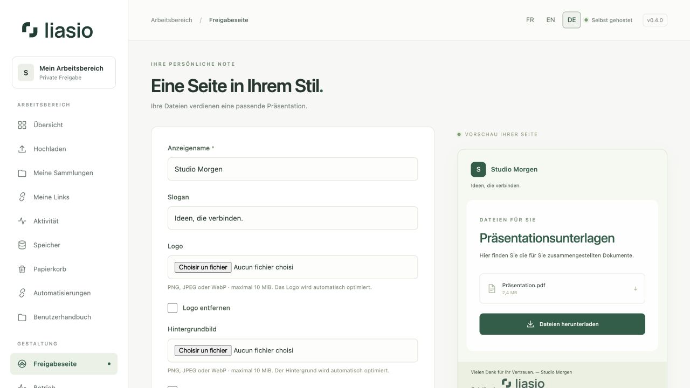

# Die Freigabeseite gestalten

Öffnen Sie **Freigabeseite** in der Seitenleiste. Ihre Gestaltung gilt für alle Ihre Empfängerseiten, auch unter bestehenden Links. Andere Mitglieder behalten ihre eigenen Einstellungen.

1. Geben Sie **Anzeigename** und einen kurzen **Slogan** ein.
2. Ergänzen Sie ein **Logo** und optional ein **Hintergrundbild**. PNG, JPEG und WebP werden bis 10 MiB pro Bild vor der Optimierung angenommen. Der Browser erhält die Proportionen, optimiert die Abmessungen und erstellt ein PNG. Warten Sie auf **Bild bereit**.
3. Wählen Sie **Wald**, **Ozean**, **Pflaume** oder **Tinte**. Eigene **Hauptfarbe** und **Hintergrundfarbe** wählen Sie über das Farbfeld oder einen Hexadezimalcode wie `#285b73`. Ein leerer Code stellt die Palette wieder her. Die Button-Schrift wechselt für lesbaren Kontrast die Farbe.
4. Ergänzen Sie einen **Text in der Fußzeile**, etwa einen Hinweis zur Lieferung.
5. Wählen Sie **Änderungen speichern**. Änderungen in der Vorschau allein werden nicht gespeichert.

Zum Ersetzen wählen Sie ein neues Bild. Zum Entfernen aktivieren Sie **Logo entfernen** oder **Hintergrundbild entfernen** und speichern. Ohne Logo erscheint wieder das Monogramm.

Die Einstellungsvorschau verwendet fiktiven Inhalt. Titel, Beschreibung, Empfängernachricht und Dateien der echten Seite stammen aus der jeweiligen [Sammlung](collections.md). Dateivorschauen werden [pro Link](sharing.md) gesteuert.

Gespeicherte Logos sind auf 512 × 512 Pixel und 512 KiB begrenzt, Hintergründe auf 1.600 × 1.600 Pixel und 2 MiB. Die Bilder werden validiert, von Metadaten befreit, im Produktionsbetrieb auf Viren geprüft und in der gesicherten Datenbank gespeichert. Ihr Umfang erscheint unter [Speicher](storage.md), getrennt vom Dateikontingent. Ohne JavaScript benötigen Sie ein nicht-interlaced 8-Bit-RGB-/RGBA-PNG innerhalb dieser Grenzen.

Gestaltungsbilder beachten Passwort, Ablaufdatum, Widerruf, Download-Limit und Kontosperren. Das Ansehen verbraucht keinen Download. Sie bleiben verfügbar, wenn Dokumentvorschauen auf dem Server deaktiviert sind. Textfelder akzeptieren keine HTML-Ausführung oder Skripte. Ihre eigenen Texte bleiben in der Sprache, in der Sie sie verfasst haben.
