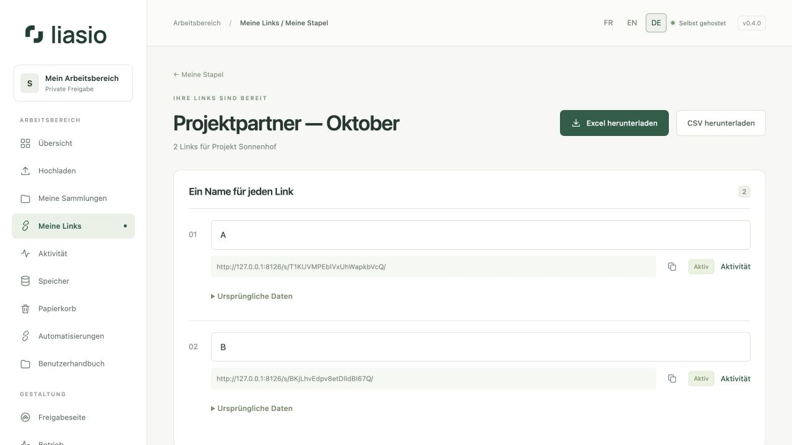
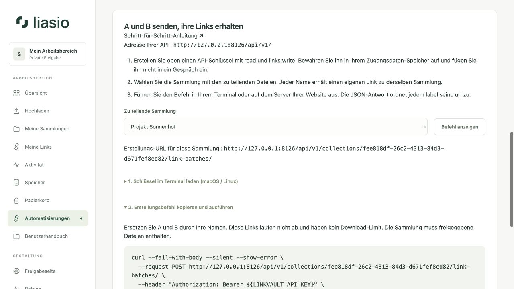

# Stapel per API erstellen und exportieren

Senden Sie aus Codex, einem Terminal, n8n oder dem Server Ihrer Website Namen an Liasio und erhalten Sie die zugehörigen Links. Der Stapel erscheint sofort unter **Meine Links → Meine Stapel**, genauso wie ein Stapel aus der Oberfläche. Alle Links teilen **dieselbe Sammlung**.



## Ohne Adresssuche beginnen

Öffnen Sie **Automatisierungen → Meinen Befehl vorbereiten**, wählen Sie eine Sammlung und klicken Sie auf **Befehl anzeigen**. Die URL enthält bereits Domain und Sammlungs-ID. Die Seite erklärt, wie Sie den Schlüssel in einem macOS-/Linux-Terminal laden, ohne ihn im Befehlsverlauf zu speichern, und anschließend den Befehl kopieren. Ersetzen Sie A und B durch Ihre Namen. Ein Webhook ist nicht nötig.

Für einen dauerhaften API-Schlüssel wählen Sie bei dessen Erstellung **Ohne Ablaufdatum**. Die Gültigkeit des Schlüssels ist unabhängig vom Ablauf der erzeugten Links. Deren Bedingungen stehen unter `conditions`. Das Beispiel in der Oberfläche lässt diese Bedingungen weg: Die Links laufen nicht ab und erlauben unbegrenzte Downloads.

Die Antwort ordnet `items[].label` jeweils `items[].url` zu. Für einen Browserexport öffnen Sie den Stapel unter **Meine Stapel** und wählen **Excel herunterladen** oder **CSV herunterladen**. Eine Exportadresse unter `/api/v1/…` verlangt immer den Bearer-Header; Anmelde-Cookies reichen nicht aus.



## 1. Zugang vorbereiten

Erstellen Sie unter **Automatisierungen** einen API-Schlüssel mit `links:write` zum Erstellen und `read` zum Lesen und Exportieren. Bewahren Sie ihn in der privaten Umgebungsvariablen `LINKVAULT_API_KEY` auf. Dieser Name bleibt für API-v1-Kompatibilität erhalten. Der Schlüssel gehört weder in Git noch in URLs oder JavaScript, das Ihre Website an Besucher ausliefert.

Die Sammlung muss bereits freigegebene Dateien enthalten. Ihre UUID finden Sie in `/collections/UUID/` in der Oberfläche oder mit `GET /api/v1/collections/`. Für Datei-Uploads lesen Sie [Automatisierungen](automation.md).

## 2. A und B senden und ihre Links erhalten

Erstellen Sie eine private Datei `request.json`:

```json
{
  "name": "Kunden — Oktober",
  "names": ["A", "B"],
  "conditions": {"expires_in_days": 7, "max_downloads": 1}
}
```

Rufen Sie `POST /api/v1/collections/UUID/link-batches/` mit `Content-Type: application/json`, `Authorization: Bearer YOUR_KEY` und einem eindeutigen `Idempotency-Key` für diesen Vorgang auf. Mit dem [mitgelieferten Python-Client](../../../examples/batches.py), aus einer Kopie des Repositorys:

```sh
# LINKVAULT_API_KEY ist bereits in Ihrer privaten Umgebung gesetzt.
umask 077
python3 examples/batches.py --url https://files.example.com create \
  --collection COLLECTION_UUID --request request.json \
  --idempotency-key kunden-oktober-001 > batch.json
```

Ersetzen Sie Domain und UUID durch Ihre Werte. Python 3.12+ genügt; der Client benötigt keine zusätzlichen Bibliotheken. Die Ausgabe enthält unter anderem:

```json
{
  "id": "BATCH_UUID",
  "name": "Kunden — Oktober",
  "state": "complete",
  "items": [
    {"position": 1, "label": "A", "url": "https://files.example.com/s/LINK_A/"},
    {"position": 2, "label": "B", "url": "https://files.example.com/s/LINK_B/"}
  ]
}
```

Jeder Eintrag enthält außerdem Link-ID, Status, Zähler und Bedingungen. Die Reihenfolge entspricht `names`; Positionen beginnen bei 1. Doppelte Namen erzeugen unterschiedliche Links. Unterscheiden Sie diese anhand der Position oder ID. Leerzeichen am Anfang und Ende der Namen werden entfernt. Freigabe-URLs sind privat: Schützen Sie `batch.json` und schreiben Sie sie nicht in öffentliche Protokolle.

Für eine Anzahl ersetzen Sie `names` durch `"count": 20`. Genau eines der beiden Felder ist erlaubt. Ein Stapel enthält 1–200 Links; Stapel- und Linknamen dürfen höchstens 80 Zeichen in einer Zeile enthalten.

`conditions` ist optional und akzeptiert `expires_in_days` **oder** `expires_at` mit Zeitzone, außerdem `max_downloads`, `password` und `allow_previews`. Ohne Bedingungen gelten: kein Ablauf, unbegrenzte Downloads, kein Passwort und keine Vorschauen. Limit `1` bedeutet einen Download **pro Link**. Die Laufzeit beginnt bei Erstellung. Das Passwort wird nie zurückgegeben oder exportiert; schützen Sie auch die Anfragedatei, wenn sie eines enthält.

## 3. Lesen und exportieren

```sh
python3 examples/batches.py --url https://files.example.com list
python3 examples/batches.py --url https://files.example.com get BATCH_UUID
python3 examples/batches.py --url https://files.example.com export BATCH_UUID \
  --format xlsx --output links.xlsx
python3 examples/batches.py --url https://files.example.com export BATCH_UUID \
  --format csv --output links.csv
```

Verwendete Endpunkte: `GET /api/v1/link-batches/`, `GET /api/v1/link-batches/UUID/` und `GET /api/v1/link-batches/UUID/export/xlsx/` beziehungsweise `/csv/`. Listen liefern 50 Einträge pro Seite. Verwenden Sie `--offset 50` entsprechend dem zurückgegebenen `next_offset`; `--collection UUID` filtert. `api_url` und `exports` benötigen den API-Schlüssel. `view_url` öffnet den Stapel nach Anmeldung in der Oberfläche.

Exporte enthalten ursprünglichen und aktuellen Namen, URL, Datum, Status und Zähler. Namen wie `00127` bleiben Text; mögliche Formeln werden neutralisiert. Der Client schreibt Exporte mit privaten Dateirechten und überschreibt keine vorhandenen Dateien. Wählen Sie bei einem erneuten Export einen neuen Namen.

Auch Stapel aus der Oberfläche samt ursprünglichen Excel-/CSV-Spalten sind über die API lesbar und exportierbar. Entwürfe (`draft` oder `expired`) sind lesbar, enthalten aber keine Links und lassen sich nicht exportieren. Die API erstellt vollständige Stapel direkt aus JSON. Für den Import einer Excel-Arbeitsmappe verwenden Sie die [Oberfläche](bulk-links.md).

## 4. Von einer Website oder einem Webhook aus

Der Server Ihrer Website ruft die API mit seinem privaten Schlüssel auf. Beispiel für **serverseitiges** JavaScript, nachdem Ihr Benutzer authentifiziert und autorisiert wurde:

```javascript
const response = await fetch(`${process.env.LIASIO_URL}/api/v1/collections/${collectionId}/link-batches/`, {
  method: "POST",
  redirect: "error",
  headers: {
    "Authorization": `Bearer ${process.env.LINKVAULT_API_KEY}`,
    "Content-Type": "application/json",
    "Idempotency-Key": operationId
  },
  body: JSON.stringify({name: "Kunden", names: ["A", "B"]})
});
if (!response.ok) throw new Error(`Liasio HTTP ${response.status}`);
const batch = await response.json();
// batch.items ordnet jedem label seine URL zu. batch.id dauerhaft speichern.
```

Speichern Sie `operationId` und JSON-Inhalt für Wiederholungen, danach die erfolgreiche Stapel-ID. Bestimmen Sie die Sammlung serverseitig anhand der Rechte Ihres Benutzers; der Liasio-Schlüssel handelt mit den Rechten seines Eigentümers. Begrenzen Sie Aufrufraten und geben Sie nur berechtigte Links zurück. Direkte Browseraufrufe einer fremden Website werden nicht unterstützt. Legen Sie den Schlüssel dafür nicht offen.

Ein bei Ihrem Automatisierungswerkzeug eingehender Webhook kann diesen API-Aufruf auslösen. Liasio sendet `link.created` für jeden neuen Link, ohne Namen, Freigabe-URLs oder Passwörter. Es werden keine E-Mails versendet. Vermeiden Sie Schleifen, die auf eigene `link.created`-Ereignisse mit weiteren Stapeln reagieren.

## 5. Wiederholungen und Grenzen

Erstellung ist atomar: Stapel, Links und Ereignisse werden vollständig gespeichert oder gar nicht. Nach einer Unterbrechung wiederholen Sie **dieselbe Anfrage mit demselben API-Schlüssel und Idempotency-Key**. Innerhalb von 24 Stunden erhalten Sie die ursprüngliche Antwort ohne Duplikate, auch nach Ablauf der Linkbedingungen oder Erreichen des Stapellimits. Ein anderer Inhalt mit demselben Vorgangsschlüssel ergibt HTTP 409.

Bewahren Sie die Stapel-ID auf. Nach 24 Stunden verwenden Sie den Leseendpunkt; eine erneute Erstellung kann neue Links erzeugen. Wiederholte Erstellungsantworten spiegeln den ursprünglichen Stand wider, Leseaufrufe und neue Exporte den aktuellen. Umbenennen unter **Meine Stapel** erhält URLs. Widerruf und Listenlöschung stehen in der Oberfläche zur Verfügung.

Gemeinsame Grenzen mit der Oberfläche: zehn Vorbereitungen pro Stunde und Konto, 100 gespeicherte Stapel und 60 Exporte pro Stunde; zusätzliche IP-Grenzen gelten. Erstellungs-JSON ist auf 256 KiB begrenzt. Erfolgreiche Wiederholungen verbrauchen kein weiteres Vorbereitungskontingent, aber allgemeine API-Grenzen gelten. Beachten Sie bei HTTP 429 `Retry-After` und behalten Sie den Vorgangsschlüssel. Fehler 400/403/404 erfordern eine Korrektur statt automatischer Wiederholung.

[API-Referenz (Englisch)](../../API.md) · [Stapel in der Oberfläche](bulk-links.md) · [Automatisierungen](automation.md) · [Zum Benutzerhandbuch](README.md)

## Eine freigegebene Sammlung verwenden

Verwenden Sie Ihren eigenen API-Schlüssel. Schlüsselrechte und Sammlungsrolle gelten gemeinsam: Leser können Sammlungsmetadaten lesen; Mitwirkende können mit `files:write` hochladen, mit `links:write` Links und Stapel erstellen und mit `read` Links und Stapel lesen und exportieren. Kontingent und Webhooks bleiben beim Eigentümer. Upload-Sitzungen sind nur für den Initiator oder Eigentümer zugänglich. Ein Zugriffsverlust blockiert auch die API-Fortsetzung und wiederholte Erstellungsantworten für diese Sammlung. Siehe [Mitglieder](team.md).

## Namen und Adressen gemeinsam (0.5)

Senden Sie anstelle von `names` oder `count` die Liste `"recipients": [{"name":"Alice","email":"alice@example.test"},{"name":"Bob","email":"bob@example.test"}]`. Die Namens- und E-Mail-Spalten bleiben in **Meine Stapel** sowie Excel-/CSV-Exporten erhalten. Mit `"verify_recipients": true` wird ein eigener E-Mail-Code für jeden Empfänger verlangt. Dies erfordert SMTP und ist nicht mit einer gemeinsamen `allowed_emails`-Liste kombinierbar. Versand-E-Mails werden nicht automatisch gesendet. Die Bedingungen unterstützen außerdem `preset_id`, `follow_updates`, `revision_id` und `allowed_emails`; siehe [API-Referenz](../../API.md) und [interaktiver Explorer](api-explorer.md).
