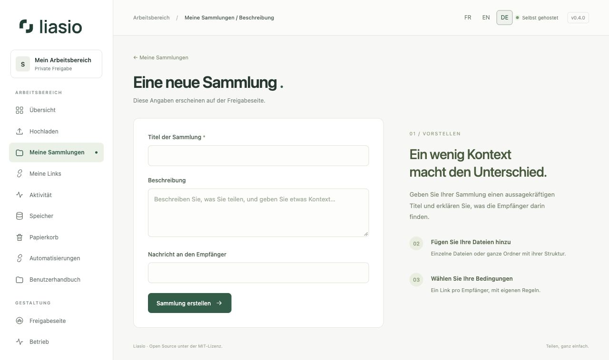
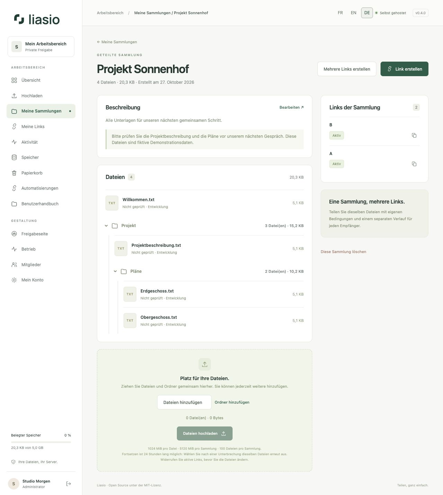

# Sammlungen organisieren

Eine Sammlung verbindet Dateien, eine Beschreibung für Empfänger und einen oder mehrere Freigabelinks. Jedes Mitglied besitzt eine eigene Bibliothek. Eine Sammlung kann einzelne Dateien und mehrere Ordner enthalten.

## Sammlung erstellen

1. Öffnen Sie **Meine Sammlungen → Neue Sammlung**, auch über die Übersicht erreichbar.
2. Geben Sie einen eindeutigen **Titel der Sammlung** ein. Er wird zur Überschrift der Freigabeseite.
3. Ergänzen Sie bei Bedarf eine **Beschreibung** und eine **Nachricht an den Empfänger**. Beide Felder sind optional. Ihr Text wird sicher angezeigt und nicht als HTML ausgeführt.
4. Wählen Sie **Sammlung erstellen** und [laden Sie Ihre Dateien hoch](uploads.md).

## Finden und bearbeiten

Suchen Sie unter **Meine Sammlungen** nach einem Titel und öffnen Sie die Sammlung. Die Detailseite zeigt Beschreibung, Dateipfade, Größen, Virenprüfstatus und Links. **Bearbeiten** ändert die Beschreibung. Diese Textänderungen erscheinen auch unter bestehenden Links.

Widerrufen Sie alle aktiven Links, bevor Sie Dateien ergänzen oder ändern. So bleibt eine bereits geteilte Zusammenstellung konsistent. Eine Sammlung enthält höchstens 100 Dateien, einschließlich ihrer Dateien im Papierkorb. Größenlimits hängen von der Serverkonfiguration ab.

## Löschen und wiederherstellen

Wählen Sie **Diese Sammlung löschen**, prüfen Sie die Bestätigung und verschieben Sie die Sammlung in den Papierkorb. Alle Links werden widerrufen und ausstehende Uploads abgebrochen. Dateien bleiben während der eingestellten Aufbewahrungszeit, standardmäßig 30 Tage, wiederherstellbar und zählen weiterhin zum Kontingent. [Speicher und Papierkorb](storage.md) erklärt Wiederherstellung und endgültiges Löschen.

## Weitere Links erstellen

Sobald die Dateien bereit sind, wählen Sie **Link erstellen** oder **Mehrere Links erstellen**. Verschiedene Links können eigene Namen, Passwörter, Ablaufdaten und Download-Limits haben, ohne die Dateien zu duplizieren. Siehe [Teilen](sharing.md) und [Linkstapel](bulk-links.md).

## Ordnerstruktur

Hochgeladene Ordner lassen sich aufklappen und zeigen Dateien und Unterordner. Jeder Ordner zeigt Dateianzahl und Größe. Einzelne Dateien bleiben auf ihrer ursprünglichen Ebene. Die Reihenfolge der Ordner richtet sich nach ihrem ersten Auftreten; spätere Uploads folgen früheren. ZIP-Archiv und Empfängerseite behalten diese Pfade. Leere Ordner werden nicht gespeichert.

## Sammlungen im Team teilen

Eine Einladung allein gewährt keinen Sammlungszugriff. Der Eigentümer vergibt Leser oder Mitwirkender unter **Zugriff verwalten**. Freigegebene Sammlungen erscheinen unter **Meine Sammlungen**; nur Mitwirkende können Dateien hinzufügen und Links verwalten. Löschen und Zugriffsverwaltung bleiben dem Eigentümer vorbehalten. Siehe [Mitglieder und Zugriffsstufen](team.md).
