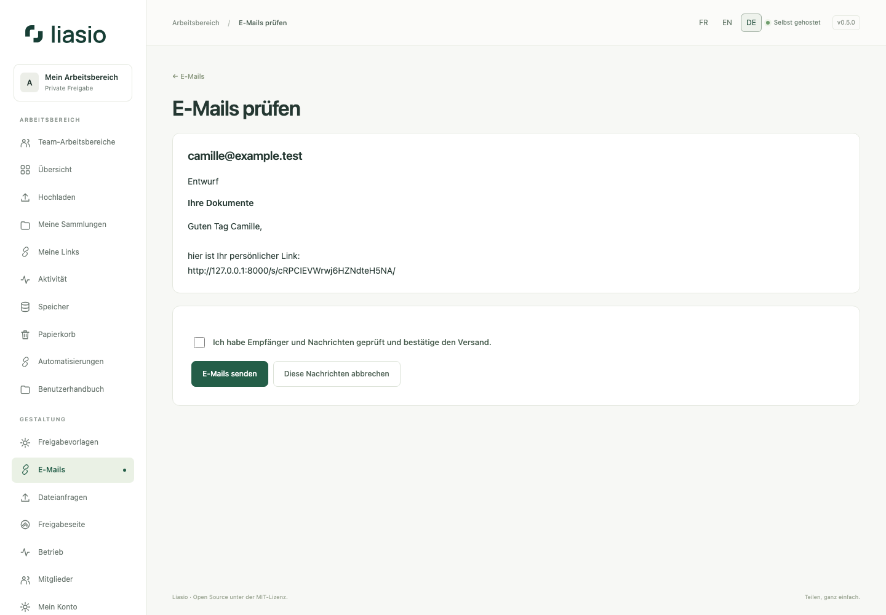

# Geprüfte E-Mails und bestätigte Empfänger

## Vorbereiten und senden

1. Konfigurieren Sie SMTP und starten Sie den Dienst `mail`. Administratoren können unter **Betrieb → Konfigurationsdiagnose** eine Testnachricht an ihre eigene Adresse anfordern und den Status unter **E-Mails** prüfen.
2. Wählen Sie bei einem Link, einer fertigen Link-Sammlung oder einer Einladung **E-Mail(s) vorbereiten**. Eine Spalte `Email`/`E-mail`/`Courriel` übernimmt die Empfänger vorab; prüfen Sie jede Adresse. Einladungen bleiben an die ursprüngliche Adresse gebunden.
3. Wählen Sie eine Vorlage oder schreiben Sie Betreff und Nachricht. Variablen: `$name`, `$link`, `$collection`; `$$` ergibt ein Dollarzeichen. Link-Passwörter werden niemals automatisch eingefügt. Übermitteln Sie sie separat.
4. Öffnen Sie **Nachrichten in der Vorschau**, prüfen Sie jede personalisierte Nachricht, bestätigen Sie das Kontrollkästchen und senden Sie. Das Erstellen von Links oder Anzeigen von Entwürfen versendet nichts. Entwürfe verfallen nach 24 Stunden.
5. **E-Mails** zeigt Warteschlange, Versand, SMTP-Annahme, Fehler und Abbruch. Entwürfe und noch wartende Nachrichten können auf ihrer Prüfseite abgebrochen werden; bereits laufende oder angenommene Nachrichten lassen sich nicht zurückrufen.

Pro Absender sind 1.000 aktive Nachrichten erlaubt, mit einem gleichzeitigen Versand je Konto, begrenzten Wiederholungen und fairer Verteilung. Rechte und Linkstatus werden vor dem Versand erneut geprüft. SMTP-Annahme belegt weder Empfang noch Lesen. Ein Ausfall nach der Annahme kann eine Wiederholung mit derselben Message-ID verursachen. Metadaten bleiben 30 Tage; private Inhalte werden verschlüsselt gespeichert und nach Abschluss/Abbruch gelöscht.

Vorlagen und optionale Benachrichtigungen finden Sie unter **E-Mails**. Download-Hinweise melden die Freigabe, nicht den vollständigen Empfang. Sie sind standardmäßig aus und auf zehn pro Stunde begrenzt.

## E-Mail-Adresse bestätigen lassen

Tragen Sie beim neuen Link unter **Zugelassene Empfänger** bis zu 100 Adressen ein, eine pro Zeile. Besucher müssen einen sechsstelligen E-Mail-Code anfordern und eingeben, bevor Seite, Vorschau oder Download zugänglich sind. SMTP muss eingerichtet sein. Der Code gilt zehn Minuten, erlaubt fünf Versuche und ist an Browser und Link gebunden. Die Bestätigung gilt eine Stunde; ein zusätzliches Link-Passwort bleibt erforderlich.

Bei importierten Listen wählen Sie die E-Mail-Spalte und die Prüfung jeder Zeile: Jeder Link wird seinem eigenen Empfänger zugeordnet. Die API akzeptiert `recipients: [{"name":"A","email":"alex@example.test"}]` und `verify_recipients: true`. Ohne Prüfung dient die E-Mail-Spalte nur zur Nachrichtenvorbereitung und beschränkt den Zugriff nicht. Siehe [Stapel-API](bulk-links-api.md).
