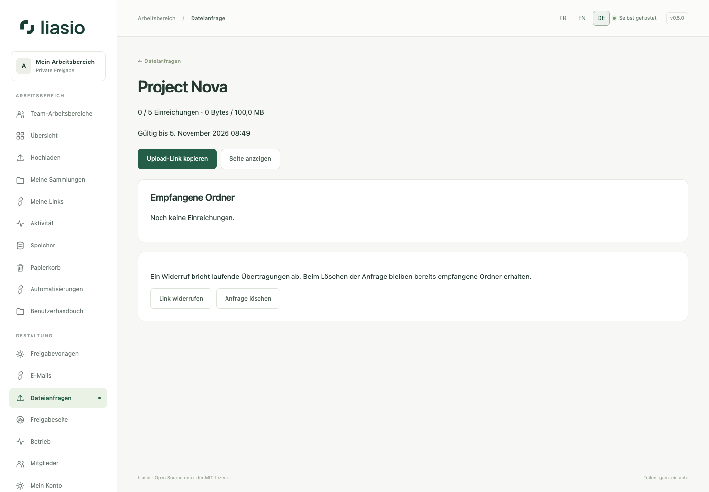

# Dateien von Kunden empfangen

1. Öffnen Sie **Dateianfragen** und geben Sie Titel, Hinweise, Gültigkeit (1–365 Tage), Gesamtvolumen in MiB und maximale Einreichungen (1–200) an. Das Volumen darf Ihr Kontingent nicht überschreiten. Ein Konto kann 100 Anfragen aufbewahren.
2. Erstellen und kopieren Sie den privaten Upload-Link. Geben Sie ihn nur an vorgesehene Absender weiter: Jeder Inhaber kann das verbleibende Volumen nutzen. Der Link gewährt keinen Kontozugriff und zeigt keine anderen Einreichungen.
3. Der Kunde fügt Dateien und/oder Ordner hinzu und startet den Upload. Es gelten derselbe echte Byte-Fortschritt, Pause/Fortsetzung, Prüfsummen und Virenscan. JavaScript ist erforderlich. Zur Fortsetzung müssen dieselben Dateien im selben Browser innerhalb von 24 Stunden ausgewählt werden, solange die Anfrage aktiv ist.
4. Jede Einreichung erstellt einen getrennten privaten Ordner in Ihrem Besitz. Fertige Einreichungen stehen unter **Empfangene Ordner**. Prüfen Sie die Dateien und erstellen Sie bei Bedarf normale Freigabelinks. Nach einem Abbruch kann ein leerer Ordner verbleiben; er lässt sich regulär löschen.
5. **Widerrufen** verhindert neue Uploads und bricht wartende Übertragungen ab; Reservierungen werden freigegeben. **Anfrage löschen** entfernt zusätzlich den Eintrag, behält aber empfangene Ordner. Ablauf verhindert weitere Schreibzugriffe; die Wartung löst abgelaufene Upload-Reservierungen auf.

Die lebenslangen Byte- und Einreichungsgrenzen zählen abgeschlossene Uploads und laufende Reservierungen. Das Löschen empfangener Dateien füllt diese Grenzen nicht wieder auf. Kontingent, Datei-/Ordnergrößen, maximal fünf wartende Uploads und freier Speicher gelten weiterhin. Dateinamen stammen vom Kunden; die Identität des Absenders wird nicht bestätigt. Besucher können keine Einreichung eines anderen Browsers ansehen oder fortsetzen. Ein fehlgeschlagener Virenscan verhindert die Freigabe; schalten Sie den Scan nicht zur Umgehung einer Ablehnung aus.

Optionale Upload-Hinweise: [E-Mails](email.md). Bereinigung: [Speicher](storage.md).
