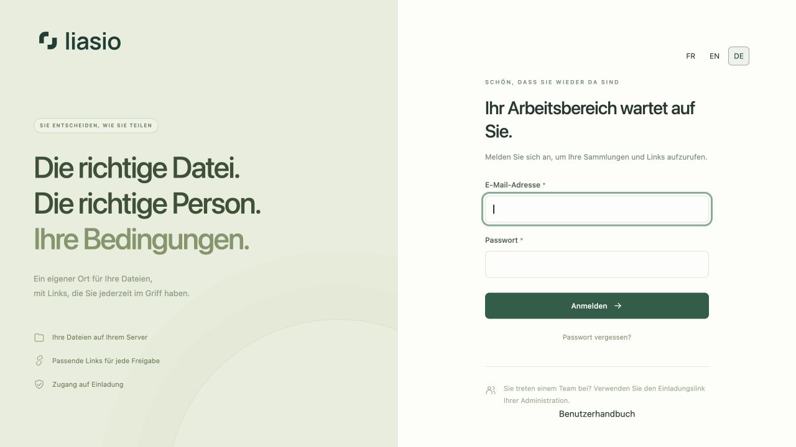
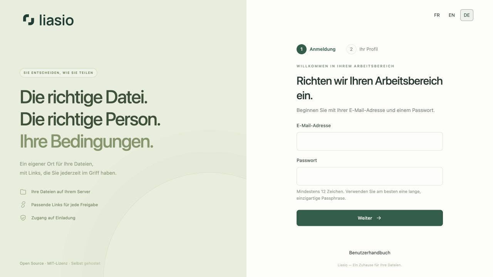

# Erste Schritte mit Liasio

Liasio läuft auf Ihrem eigenen Server. Öffnen Sie dessen HTTPS-Adresse, um auf einer neuen Instanz das erste Konto anzulegen. Danach können weitere Personen nur mit einer persönlichen Einladung beitreten. Ein Freigabelink führt zu einer Sammlung und ist keine Kontoeinladung.

## Installation und erstes Administratorkonto

1. Folgen Sie der [Installationsanleitung (Englisch)](../../../README.md) auf einem Server mit Domain und HTTPS. Der [Betriebsleitfaden (Französisch)](../../OPERATIONS.md) beschreibt die Produktionsanforderungen.
2. Öffnen Sie Ihre Instanz. Bei einer neuen Installation erscheint automatisch die **Ersteinrichtung**.
3. Geben Sie Ihre E-Mail-Adresse und ein einzigartiges Passwort mit mindestens zwölf Zeichen ein. Wählen Sie **Weiter**. Ein Installationsschlüssel ist nicht erforderlich.
4. Tragen Sie Ihren Namen ein, bestätigen Sie das Passwort und wählen Sie **Mein Konto erstellen**. Mit **Zurück** können Sie E-Mail-Adresse und Passwort ändern. Das Konto entsteht erst nach dem endgültigen Absenden.
5. Die erste Person, die diesen Vorgang abschließt, wird Administrator. Schließen Sie die Einrichtung deshalb ab, bevor Sie die Instanzadresse weitergeben. Anschließend ist die Einrichtung geschlossen; weitere Konten benötigen Einladungen.

Die zwei kurzen Schritte passen auf übliche Computer- und Smartphone-Bildschirme. Bei kleinen Fenstern, vergrößertem Text oder Fehlermeldungen bleibt Scrollen möglich, damit alle Felder erreichbar sind. Ohne JavaScript erscheinen alle Felder zusammen. Nach einem serverseitigen Validierungsfehler müssen Sie Passwörter erneut eingeben; sie werden niemals in der Antwortseite zurückgesendet. Bewahren Sie Serverkonfiguration und Wiederherstellungsmaterial sicher auf.

## Einladung annehmen

Öffnen Sie den persönlichen Einladungslink Ihrer Administration. Prüfen Sie die angezeigte E-Mail-Adresse und wählen Sie Namen und Passwort. Einladungen sind sieben Tage lang und einmalig gültig. Bei Ablauf ist eine neue Einladung erforderlich. Mehr dazu unter [Mitglieder](team.md).

## Automatische Sprache und eigene Auswahl

Anmeldung, Arbeitsbereich und **öffentliche Download-Seiten** erkennen die vom Browser bevorzugte unterstützte Sprache automatisch: Deutsch, Englisch oder Französisch. Auch regionale Angaben wie `de-DE`, `de-AT` und `de-CH` werden als Deutsch erkannt. Sind keine unterstützten Sprachen angegeben, erscheint Französisch.

Über **FR / EN / DE** können Sie jederzeit wechseln. Diese manuelle Auswahl wird in einem Browser-Cookie gespeichert und hat Vorrang vor der Browsersprache. Ohne dieses Cookie gilt wieder die automatische Erkennung. Der Freigabelink bleibt derselbe; der Empfänger braucht keinen eigenen Sprachlink. Spracheinstellungen ändern weder Passwortschutz noch Ablaufdatum oder Download-Limit. Dateinamen, Sammlungsbeschreibungen und selbst verfasste Texte bleiben in ihrer ursprünglichen Sprache.

## Anmelden und abmelden

Verwenden Sie E-Mail-Adresse und Passwort. Ist die Zwei-Faktor-Authentifizierung aktiviert, geben Sie danach einen neuen App-Code oder einen Wiederherstellungscode ein. Wählen Sie auf gemeinsam genutzten Geräten am Ende **Abmelden** in der Seitenleiste.

Bei einem vergessenen Passwort hilft **Passwort vergessen?**. Der E-Mail-Versand muss eingerichtet sein. Lesen Sie die [Anleitung zur Kontowiederherstellung](account.md).

## Ihre erste Freigabe

[Sammlung erstellen](collections.md) → [Dateien hochladen](uploads.md) → [Link erstellen](sharing.md). Gestalten Sie bei Bedarf vorher Ihre [Freigabeseite](branding.md).
