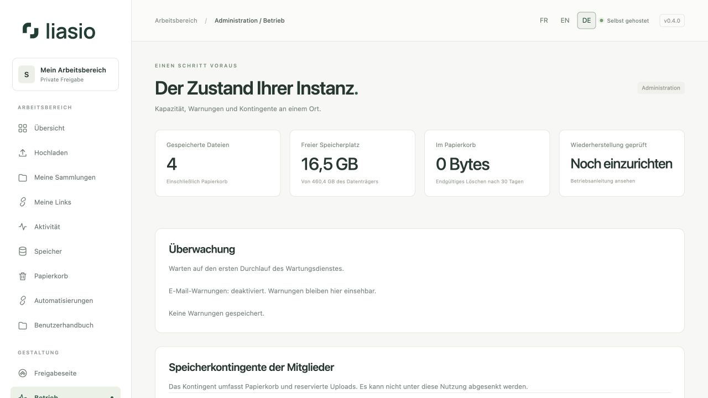

# Die Instanz verwalten

**Betrieb** ist nur für Administratoren zugänglich. Die Seite fasst gespeicherte Dateien, freien Festplattenspeicher, Papierkorb, geprüfte Backup-Wiederherstellung, Datenbank-/Virenprüfungen und Warnungen zusammen.

## Kontingent eines Mitglieds festlegen

Tragen Sie unter **Speicherkontingente der Mitglieder** einen Wert in GiB ein und wählen Sie **Aktualisieren**. Ein GiB entspricht 1.073.741.824 Bytes. Das Kontingent darf nicht unter der Summe aus Dateien, Papierkorb und reservierten Uploads liegen. Eine Erhöhung schafft keinen physischen Speicherplatz; prüfen Sie vorher die Kapazität.

## Auf Warnungen reagieren

- **Datenträgerkapazität:** Entfernen Sie unnötige Dateien, leeren Sie nach Prüfung den Papierkorb oder vergrößern Sie den Datenträger. Lassen Sie Platz für laufende Uploads und ZIP-Downloads.
- **Virenschutz nicht verfügbar:** Prüfen Sie ClamAV und Signaturaktualisierungen. Produktionsuploads werden bei fehlendem Virenschutz nicht freigegeben.
- **Wartung fehlt:** Prüfen Sie den Wartungscontainer. Er bereinigt abgelaufene Uploads, Papierkorb, Sitzungen und Ereignisse.
- **Backup-Prüfung überfällig:** Erstellen Sie ein echtes Backup und führen Sie eine Wiederherstellung in einer isolierten Umgebung durch. Eine Erfolgsmeldung ohne Wiederherstellung genügt nicht.

E-Mail-Warnungen benötigen SMTP und `MONITOR_EMAIL`. Sie bleiben auch ohne E-Mail-Versand in der Oberfläche sichtbar. API-Uploads beachten dieselben Reservierungen und die Mindestreserve des Datenträgers. Hintergrund-E-Mails verwenden die konfigurierte Standardsprache der Instanz; sie haben keine Browsersitzung.

## Backups, Updates und Webhooks

Der [Betriebsleitfaden (Französisch)](../../OPERATIONS.md) beschreibt Backup, Wiederherstellungsprüfung, Updates, Überwachung und Kontolöschung. Sichern Sie die Verschlüsselungsschlüssel der `.env` zusammen mit Datenbank und Dateien. Ihr Verlust oder Austausch kann MFA- und Integrationsschlüssel ungültig machen.

Der Compose-Stack enthält einen `webhooks`-Dienst mit zwei überwachten Prozessen. Starten oder aktualisieren Sie den gesamten Stack mit `docker compose up -d --build`. Bei manueller Installation führen Sie `python manage.py deliver_webhooks --loop --workers 2` unter einer Prozessüberwachung aus; unterstützt werden ein bis vier Prozesse. Der Dienst benötigt Datenbankzugriff und ausgehendes öffentliches HTTPS. Fehlende Lebenszeichen werden unter **Automatisierungen** angezeigt.

Konten kommen reihum an die Reihe und dürfen jeweils nur eine Zustellung gleichzeitig belegen. Mehr Prozesse erhöhen Speicher- und Datenbankbedarf, nicht die Parallelität eines einzelnen Kontos. Bei einem Prozessabbruch laufen Reservierungen nach fünf Minuten ab. Pausieren, eine volle Warteschlange oder Kontosperrung annullieren ausstehende Zustellungen; Reaktivierung entfernt auch ältere pausierte Rückstände.

Beim Sicherheitsupdate von 0.4.0 stoppen Sie den Webhook-Dienst vor Migration `0006` und starten danach den vollständig aktualisierten Stack. Betreiben Sie keine alten und neuen Zusteller gleichzeitig.

Produktionsvorschauen benötigen Linux Landlock ABI 3+, normalerweise Linux 6.2+ mit aktiviertem Landlock. Fehlt dies, verweigert der Decoder das Rendern und zeigt stattdessen eine Dateikarte. Originaldownloads bleiben möglich. Siehe [Vorschau-Deployment (Englisch)](../../PREVIEWS.md). Container-Images sind über Digests festgelegt; prüfen und testen Sie Aktualisierungen regelmäßig. Derselbe Digest lädt keine neueren Sicherheitskorrekturen.

Die Wartung bereinigt den Zustellverlauf nach 30 Tagen. Vor einer öffentlichen Bereitstellung richten Sie Domain, HTTPS, ausreichende Kapazität und Backups ein. [Serveranforderungen im README (Englisch)](../../../README.md) beschreiben CPU, RAM, Festplattenspeicher und Swap.

## Konfiguration, E-Mails und Wiederherstellung

Der [Leitfaden zum erweiterten Betrieb](advanced-operations.md) beschreibt Diagnose, SMTP-Test ausschließlich an die eigene Administratoradresse, Sitzungen, OIDC, privaten S3-Speicher und verschlüsselte externe Sicherung/Wiederherstellung. Prüfen Sie **E-Mails** auf Fehler: Die SMTP-Übergabe bestätigt weder Empfang noch Lesen. Optionale Dienste müssen vom Betreiber konfiguriert werden.
