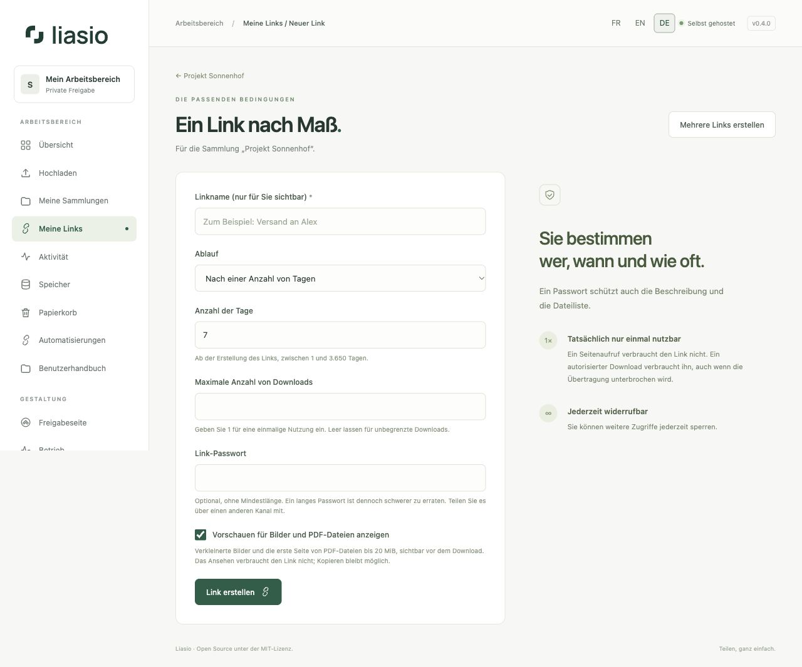
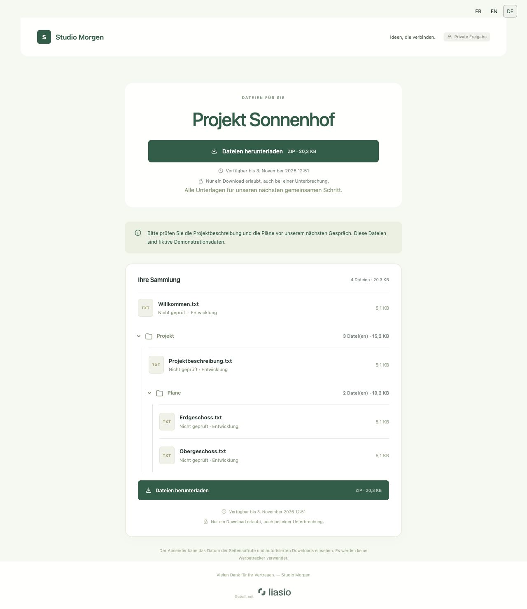
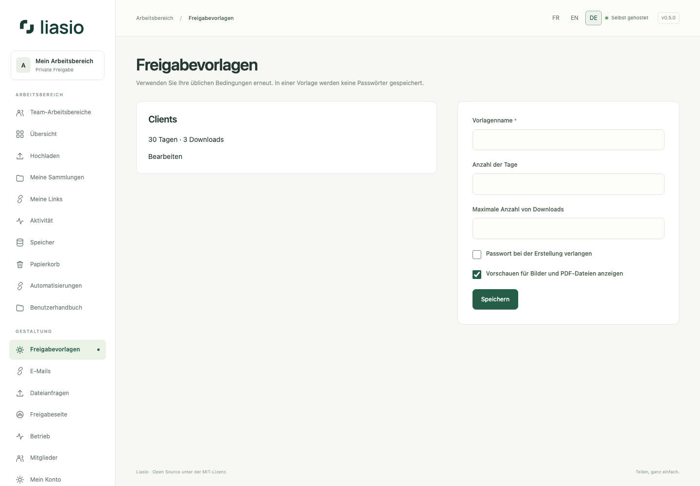

# Freigabelinks und Vorschauen

Für mehrere Links nach Anzahl oder aus einer Excel-/CSV-Liste nutzen Sie [Linkstapel](bulk-links.md). **Umbenennen** ändert nur den privaten Linknamen, nicht URL oder Bedingungen.

## Link erstellen

Öffnen Sie eine Sammlung mit Dateien und wählen Sie **Link erstellen**.

| Feld | Verwendung |
| --- | --- |
| Linkname | Private Bezeichnung zur Zuordnung von Empfänger oder Workflow. |
| Ablauf | **Ohne Ablaufdatum**, **An einem bestimmten Datum** oder **Nach einer Anzahl von Tagen** zwischen 1 und 3.650 ab Erstellung. Datumsangaben verwenden die Instanzzeitzone, standardmäßig Europe/Berlin. |
| Maximale Anzahl von Downloads | `1` für einmalige Nutzung; leer für unbegrenzt. Höchstens 100.000. Das Mausrad ändert diesen Wert nicht. |
| Link-Passwort | Optional, ohne Mindestlänge, höchstens 128 Zeichen. Eine längere Passphrase ist schwerer zu erraten. Übermitteln Sie sie über einen separaten Kanal. |
| Vorschauen für Bilder und PDF-Dateien | Optional. Im Erstellungsformular standardmäßig aktiviert, bei der API standardmäßig deaktiviert. |

Wählen Sie **Link erstellen**. Kopieren Sie die URL unter **Meine Links** und geben Sie sie an den Empfänger weiter. Ein Passwort schützt auch Beschreibung und Dateiliste. Der Empfänger benötigt kein Liasio-Konto.

Freigabe-URLs enthalten nach `/s/` einen nicht vorhersagbaren Code mit 22 Zeichen. Die früheren URLs mit 43 oder 97 Zeichen bleiben gültig. Beim erneuten Kopieren bestehender Links erhalten Sie die kurze Form. Alle Varianten verweisen auf denselben Link und teilen Passwort, Ablauf, Widerruf, Verlauf und Download-Kontingent. Neue Exporte und API-Antworten verwenden ebenfalls die kurze URL; exportieren Sie ältere Tabellen erneut. Eine API-Wiederholung kann noch die ursprüngliche längere, weiterhin gültige URL zurückgeben. Siehe [Linkformat und Kompatibilität (Englisch)](../../SHARE_LINKS.md).

## Was der Empfänger sieht

**Dateien herunterladen** steht direkt unter dem Titel, vor der Dateiliste. ZIP-Größe, Ablauf und Download-Limit stehen dabei. Ein zweiter Button unter den Dateien lädt dasselbe ZIP mit denselben Regeln herunter.

Die Seite erkennt die bevorzugte unterstützte **Browsersprache** automatisch, einschließlich `de-DE`, `de-AT` und `de-CH`. **FR / EN / DE** erlaubt eine manuelle, gespeicherte Auswahl. Das gilt auch für Passwortabfrage und abgelaufene Links. Mehr dazu unter [Sprache](getting-started.md). Ihre selbst verfassten Beschreibungen und Dateinamen werden nicht übersetzt.

Die Dateiliste zeigt aufklappbare Ordner in ihrer ursprünglichen Reihenfolge. Bei aktivierten Vorschauen öffnen Sie **Dateivorschauen anzeigen**. JPEG, PNG, WebP und GIF (erstes Bild) sowie PDF (erste Seite) lassen sich vor dem Download betrachten. Originale dürfen höchstens 20 MiB groß sein; Bilder sind auf 24 Megapixel begrenzt. Vorschauen sind verkleinerte JPEGs ohne Metadaten. Andere Dateitypen zeigen Name, Typ und Größe. Fehlende Vorschauen verhindern keinen erlaubten Download.

Klicken Sie zum Vergrößern auf eine Vorschau. Navigieren Sie mit den Buttons oder Pfeiltasten; Escape schließt die Ansicht. Vorschauen benötigen denselben gültigen Link und gegebenenfalls dasselbe Passwort. Sie verbrauchen keinen Download und können kopiert werden. Die [technische Vorschau-Dokumentation (Englisch)](../../PREVIEWS.md) beschreibt den isolierten Renderer. Ist dieser auf dem Server deaktiviert, bleiben die Originaldownloads verfügbar.

## Links verwalten und widerrufen

Unter **Meine Links** können Sie suchen, nach aktiven Links filtern, Vorschauen ein- oder ausschalten, Zähler prüfen und Links **widerrufen**. Bestätigen Sie den Widerruf, um zukünftige Zugriffe zu sperren. Für ein anderes Passwort, Ablaufdatum oder Download-Limit erstellen Sie einen Ersatzlink und widerrufen den alten.

Ein Seitenaufruf verbraucht keinen einmaligen Link. Ein autorisierter ZIP-Download verbraucht ihn, auch wenn die Übertragung abbricht. Widerrufene, abgelaufene oder aufgebrauchte Links erlauben keinen neuen Download; eine laufende Übertragung kann noch enden. Bereits heruntergeladene Kopien lassen sich durch Widerruf nicht zurückholen.

## Vorlagen, Versionen und Empfängerprüfung

Unter **Freigabevorlagen** speichern Sie Name, Gültigkeitsdauer, Downloadlimit, Vorschauen und eine optionale Passwortpflicht. Das Passwort selbst wird niemals in der Vorlage gespeichert. Wählen Sie die Vorlage für einen Link oder Stapel und prüfen Sie die endgültigen Werte. Änderungen der Vorlage wirken nicht auf bestehende Links. Unter [Versionen](versions.md) erfahren Sie, wie Sie Dateien festlegen oder Aktualisierungen übernehmen. [Bestätigte Empfänger](email.md) erklärt den E-Mail-Code zusätzlich zu einem möglichen Passwort. Empfänger können auch gezielt einzelne Dateien herunterladen.

