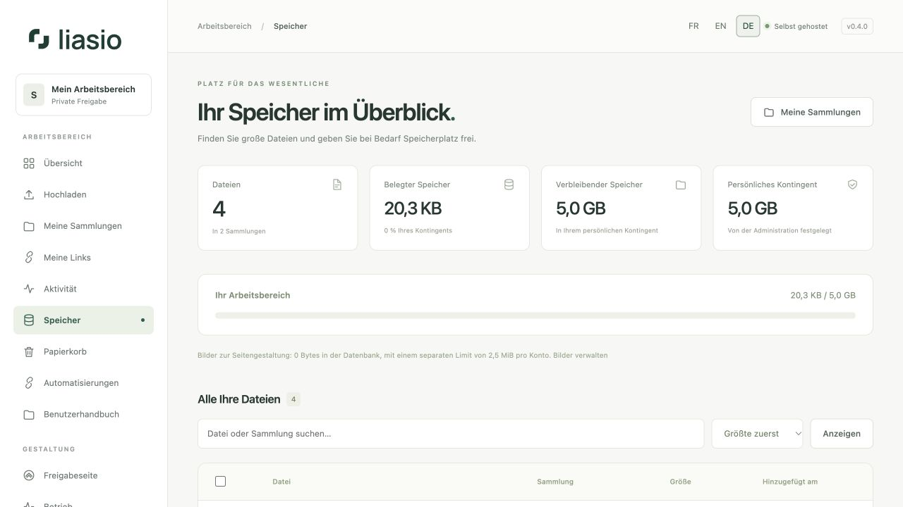
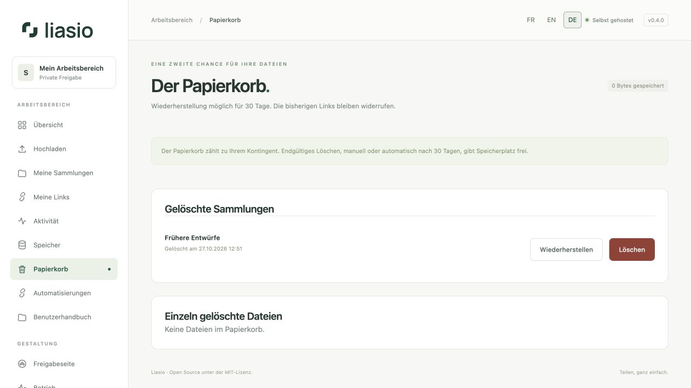

# Speicher, Papierkorb und Löschen

## Nutzung verstehen

Unter **Speicher** sehen Sie Dateianzahl, belegten Speicher, verbleibendes Kontingent und eine durchsuchbare Dateiliste. Sortieren Sie nach Größe, Datum oder Name. Administratoren sehen zusätzlich die Datenträgerauslastung und die Nutzung pro Konto.

Dies ist **Festplattenspeicher**, keine Messung des aktuellen RAM-Verbrauchs. Ihr Kontingent umfasst gespeicherte Dateien und den Papierkorb. Ausstehende Uploads reservieren weiteren Platz. Der freie Speicher des Servers berücksichtigt auch andere Anwendungen und temporäre ZIP-Archive und kann deshalb von den Liasio-Dateisummen abweichen.

## Ausgewählte Dateien entfernen

1. Suchen oder sortieren Sie die Liste. Wählen Sie einzelne Zeilen oder alle Zeilen **der aktuellen Seite** aus, nicht aller Suchergebnisse.
2. Wählen Sie **Löschen überprüfen** und prüfen Sie Dateianzahl, Gesamtgröße und betroffene Links.
3. Bestätigen Sie **In den Papierkorb verschieben**. Links betroffener Sammlungen werden widerrufen. Die übrigen Dateien bleiben für Sie verfügbar; erstellen Sie neue Links, wenn Sie sie weiter teilen möchten.

## Wiederherstellen oder endgültig löschen

Unter **Papierkorb** erscheinen vollständig gelöschte Sammlungen und einzeln gelöschte Dateien getrennt. **Wiederherstellen** bringt ein Element in Ihre Bibliothek zurück. Seine alten Links bleiben widerrufen. Eine Datei innerhalb einer gelöschten Sammlung stellen Sie über die Sammlung wieder her.

Um Kontingent sofort freizugeben, wählen Sie **Löschen**, prüfen die Bestätigungsseite und bestätigen **Endgültig löschen**. Die Originale werden entfernt und lassen sich über Liasio nicht wiederherstellen. Andernfalls leert die Wartung den Papierkorb nach der konfigurierten Aufbewahrungszeit, standardmäßig 30 Tagen. Beim Wiederherstellen einer Sammlung kehren nur Dateien zurück, die zusammen mit ihr gelöscht wurden; zuvor gelöschte Dateien bleiben im Papierkorb.

Ein größeres Kontingent kann die Administration unter [Betrieb](operations.md) einstellen. Das Leeren des Papierkorbs behebt keinen Speicherverbrauch anderer Anwendungen auf dem VPS; dafür ist Serveradministration erforderlich.

## Versionen und Objektspeicher

Aufbewahrte [Versionen](versions.md) zählen ebenfalls zum Kontingent. Das Ersetzen eines Dokuments kann deshalb den Verbrauch erhöhen, ohne die aktuelle Dateianzahl zu ändern. Löschen Sie nicht mehr benötigte Versionen, bevor Sie deren referenzierte Dateien endgültig entfernen. Nicht mehr referenzierte ältere Kopien werden nach der Aufbewahrungsfrist gelöscht. Bei [S3-Speicher](advanced-operations.md) zählt das Kontingent die gespeicherten Originale, während Datenträgerwerte lokale Uploads und temporäre Archive betreffen: Dies sind unterschiedliche Ressourcen.
