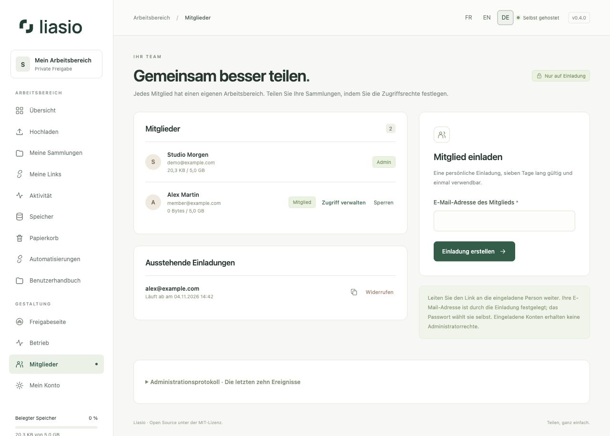
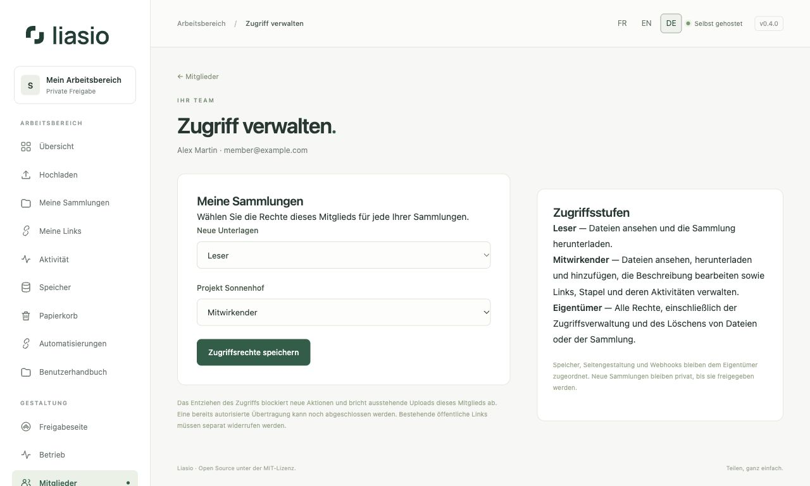

# Mitglieder einladen und verwalten

Eine Einladung erstellt ein persönliches Konto. **Sie gibt Ihre Sammlungen nicht automatisch frei.** Administratoren können Mitglieder einladen und sperren. Diese Rolle gewährt jedoch keinen Zugriff auf private Dateien anderer Konten.

## Ein Mitglied einladen

1. Geben Sie unter **Mitglieder** die E-Mail-Adresse ein und klicken Sie auf **Einladung erstellen**.
2. Kopieren Sie den Einladungslink und senden Sie ihn an die Person. Liasio versendet nicht automatisch eine E-Mail.
3. Die eingeladene Person wählt einen Namen und ein Passwort. Die E-Mail-Adresse ist vorgegeben; eingeladene Konten sind keine Administratoren.
4. Vergeben Sie nach Annahme der Einladung die Zugriffsrechte wie unten beschrieben.

Einladungen gelten sieben Tage und können einmal angenommen werden. Eine bereits registrierte Adresse kann nicht erneut eingeladen werden. **Widerrufen** beendet eine ungenutzte Einladung; ersetzen Sie eine abgelaufene Einladung durch eine neue.

## Zugriff auf Sammlungen gewähren

Klicken Sie unter **Mitglieder** neben dem Mitglied auf **Zugriff verwalten**. Wählen Sie für jede **Ihrer** Sammlungen eine Stufe und anschließend **Zugriffsrechte speichern**. Private Sammlungen anderer Eigentümer werden nicht angezeigt.

| Stufe | Erlaubte Aktionen |
| --- | --- |
| Kein Zugriff | Die Sammlung bleibt unsichtbar. |
| Leser | Beschreibung und Dateibaum ansehen, die Sammlung als ZIP herunterladen. Empfängerlinks, Stapel und deren Aktivitäten sind nicht zugänglich. |
| Mitwirkender | Leserrechte sowie Dateien hinzufügen, Beschreibung bearbeiten, Links und Stapel erstellen und verwalten, Listen exportieren und deren Aktivitäten einsehen. |
| Eigentümer | Alle Rechte, einschließlich Zugriffsverwaltung, Löschen von Dateien oder Sammlungen und Papierkorbverwaltung. Eigentümer ist der Ersteller; diese Rolle kann im Menü nicht vergeben werden. |

Jeder Eigentümer kann auch eine Sammlung öffnen, **Zugriff verwalten** wählen, die E-Mail-Adresse eines aktiven Mitglieds eingeben und eine Rolle festlegen. **Kein Zugriff** entzieht die Berechtigung. Nur der Eigentümer verwaltet diese Rechte; Mitwirkende können anderen Konten keinen Arbeitsbereichszugriff gewähren.

Mitglieder finden freigegebene Sammlungen unter **Meine Sammlungen** und in der Übersicht, gekennzeichnet mit **Geteilt von**. In der Sammlung wird ihre Rolle angezeigt. Sie verwenden ihr eigenes Konto und für Automatisierungen ihren eigenen API-Schlüssel.

**Dateien herunterladen** ist für angemeldete Mitglieder vorgesehen und verbraucht keine Downloads von Empfängerlinks. Hochgeladene Dateien zählen zum Kontingent des Eigentümers. Virenschutz, Kapazitätsgrenzen und der notwendige Widerruf aktiver Links vor Dateiänderungen gelten weiterhin. Seitengestaltung und Webhooks bleiben dem Eigentümer zugeordnet; Aktionen werden dem ausführenden Mitglied zugeschrieben.

## Zugriff entziehen oder Rolle ändern

Änderungen gelten für nachfolgende Anfragen, auch mit bestehenden API-Schlüsseln. Der Wechsel von Mitwirkender zu Leser oder das Entziehen des Zugriffs bricht ausstehende Uploads dieses Mitglieds in die Sammlung ab und gibt reservierten Speicher frei. Eine bereits autorisierte Übertragung kann noch abgeschlossen werden.

**Bestehende öffentliche Links werden nicht automatisch widerrufen.** Widerrufen Sie nicht mehr gewünschte Links unter **Meine Links**. Der Entzug löscht weder Dateien noch bereits heruntergeladene Kopien. Neue Sammlungen bleiben privat, bis sie ausdrücklich freigegeben werden.

## Sperren und reaktivieren

Wählen Sie unter **Mitglieder** die Aktion **Sperren** und bestätigen Sie. Die Sperre beendet Sitzungen, widerruft eigene Links und API-Schlüssel des Mitglieds und pausiert seine Webhooks. Dateien bleiben gespeichert und zählen zum Kontingent. Freigegebene Sammlungen sind während der Kontosperre nicht zugänglich. Links von Sammlungen anderer Eigentümer bleiben gültig.

**Reaktivieren** ermöglicht eine neue Anmeldung und die Nutzung weiterhin vorhandener Sammlungsrechte. Widerrufene Links und Schlüssel bleiben widerrufen, Webhooks bleiben pausiert. Administratorkonten können auf dieser Seite nicht gesperrt werden.

## Protokoll und Kontingente

Die Seite zeigt die zehn letzten Verwaltungsereignisse einschließlich Zugriffsänderungen. Speichergrenzen ändern Sie unter **Betrieb → Mitgliedskontingente**. Das endgültige Löschen eines Kontos ist ein Serverbefehl im [Betriebshandbuch (Französisch)](../../OPERATIONS.md).
