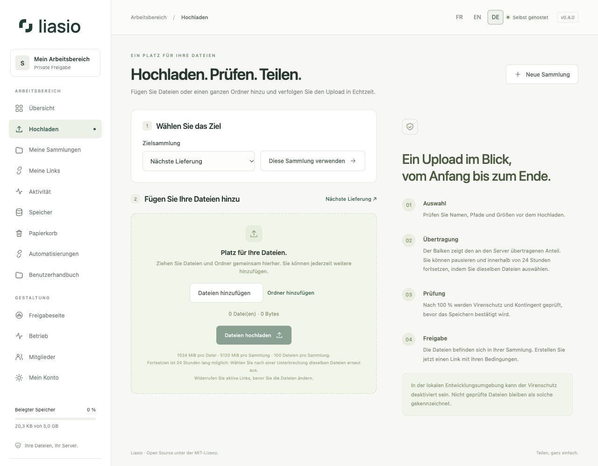

# Dateien und Ordner hochladen

## Ziel und Auswahl vorbereiten

1. Öffnen Sie **Hochladen**, wählen Sie eine vorhandene Sammlung und klicken Sie auf **Diese Sammlung verwenden**. Ist die Liste leer, erstellen Sie zuerst eine Sammlung.
2. Ziehen Sie Dateien und Ordner gemeinsam in den Ablagebereich. Unterordner werden automatisch gelesen. Alternativ verwenden Sie **Dateien hinzufügen** oder **Ordner hinzufügen**; der native Dateidialog des Browsers unterscheidet diese Auswahlarten.
3. Weitere Elemente ergänzen die bestehende Auswahl. Ein bereits ausgewählter Pfad wird nicht ersetzt. **×** entfernt eine Datei aus der Auswahl. **Auswahl leeren** beginnt neu, ohne gespeicherte Dateien zu löschen.
4. Prüfen Sie Struktur, Größen und Gesamtumfang und wählen Sie **Dateien hochladen**. Der Browser kann den Zugriff auf den ausgewählten Ordner bestätigen lassen.

Pfade bleiben in der eigenen Ansicht, auf der Empfängerseite und im ZIP erhalten. Versteckte Dateien wie `.DS_Store` und leere Ordner werden ausgelassen. Unterstützt Ihr Browser das Ablegen von Ordnern nicht, verwenden Sie **Ordner hinzufügen**.

Standardlimits: 1 GiB pro Datei, 5 GiB pro Sammlung und 100 Dateien, einschließlich Papierkorb und ausstehender Uploads. Die tatsächlichen Instanzlimits stehen auf der Seite. Unsichere relative Pfade, Datei-/Ordnerkollisionen und verbotene Dateiendungen werden abgelehnt. Pfade dürfen höchstens 20 Komponenten enthalten.

## Tatsächlichen Fortschritt verfolgen

Die Anzeige folgt den vom Browser tatsächlich übertragenen Bytes, auch innerhalb des aktuellen 4-MiB-Datenblocks. Sie unterscheidet **übertragene** Bytes von den nach Integritätsprüfung **vom Server bestätigten** Bytes. Geschwindigkeit und Restzeit sind Schätzungen anhand Ihrer Verbindung. Kein Timer simuliert den Fortschritt.

**100 % bedeutet, dass die Übertragung beendet ist.** Danach folgen Virenprüfung und Speichern als eigener Schritt. Lassen Sie die Seite geöffnet, besonders bei großen Sammlungen. Nach dem erfolgreichen Abschluss erscheinen die Dateien in der Sammlung. Im Produktionsbetrieb wird nichts gespeichert, wenn der Virenschutz eine Datei ablehnt oder nicht erreichbar ist.

## Pausieren, fortsetzen und abbrechen

**Pausieren** unterbricht die aktuelle Blockanfrage. Bestätigte Blöcke bleiben erhalten. **Dateien hochladen** setzt fort. Nach Neuladen oder Verbindungsverlust wählen Sie dieselben Dateien und Ordner erneut aus; der Server behält bestätigte Positionen 24 Stunden lang. Ein unbestätigter Block kann erneut übertragen werden, wird aber nicht doppelt gezählt.

Mit **Diesen Upload abbrechen** geben Sie reserviertes Kontingent frei. Die Wartung entfernt abgelaufene Uploads. Pro Konto sind fünf ausstehende Uploads erlaubt. Widerrufen Sie aktive Links, bevor Sie Dateien einer bereits geteilten Sammlung ändern.

Bei fehlendem Kontingent hilft [Speicher](storage.md); bei fehlendem Serverspeicher wenden Sie sich an die Administration. Prüfen Sie eine Virenschutz-Ablehnung, statt den Schutz auszuschalten.

Ohne JavaScript bleibt ein einfaches Formular für einzelne Dateien bis 500 MiB pro Anfrage verfügbar. Ordner, Fortschrittsanzeige und Fortsetzen benötigen JavaScript. Für automatische Uploads lesen Sie [API und Webhooks](automation.md).
