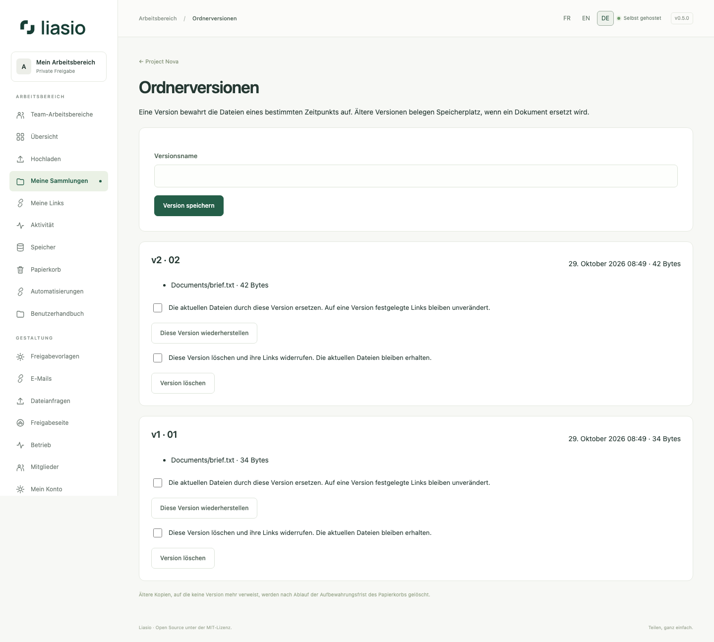

# Versionen und ausgewählte Downloads

Öffnen Sie im Ordner **Versionen**. Eine Version hält die Dateien und ihre unveränderlichen Bytes fest, nicht die Gestaltung oder den Beschreibungstext. Pro Ordner sind 100 Versionen möglich. Identische automatische Aufnahmen verwenden die letzte Version erneut; eine benannte Version kann ausdrücklich gespeichert werden.

Lassen Sie beim Erstellen eines Links **Künftigen Änderungen folgen** ausgeschaltet, um Dateien festzuschreiben. Wählen Sie eine vorhandene Version oder die aktuellen Dateien. Aktivieren Sie die Aktualisierung nur, wenn Empfänger spätere Ergänzungen und Ersetzungen sehen sollen. Eine feste Version und automatische Aktualisierung schließen sich aus.

Wählen Sie beim Hochladen **Dateien mit gleichem Pfad ersetzen und vorherige Version behalten**. Der Pfad einschließlich Unterordnern bestimmt, welche Datei ersetzt wird. Feste Links behalten die alten Bytes; dynamische Links zeigen den Ersatz. Neue und aufbewahrte alte Dateien zählen zum Kontingent. Lösen Sie gleichnamige Dateien im Papierkorb zuerst auf.

Bei Links vor 0.5 verwenden Sie zunächst **Bestehende Links festschreiben**. URLs, Bedingungen und Zähler bleiben erhalten. Bis dahin verhindern aktive ältere Links weiterhin Änderungen an den Dateien.

Eigentümer können Versionen nach Abschluss laufender Uploads wiederherstellen. Der aktuelle Zustand wird vorher gespeichert; feste Links ändern sich nicht. Beim Löschen einer Version werden ihre Links widerrufen, aktuelle Dateien bleiben erhalten. Alte Kopien ohne Versionsreferenz werden nach der Papierkorb-Aufbewahrungsfrist entfernt. Referenzierte Dateien lassen sich nicht einzeln endgültig löschen: Entfernen Sie zuerst die Version oder den gesamten Ordner.

Auf der Empfängerseite lädt **Dateien herunterladen** das gesamte Archiv. Mit Kontrollkästchen wählen Sie einzelne Dateien: eine Datei wird als Original, mehrere als ZIP mit Ordnerstruktur geliefert. Jede Aktion verbraucht eine Download-Freigabe. Seitenaufrufe/Vorschauen verbrauchen keine; ein abgebrochener Download kann seine Freigabe trotzdem verbrauchen.
