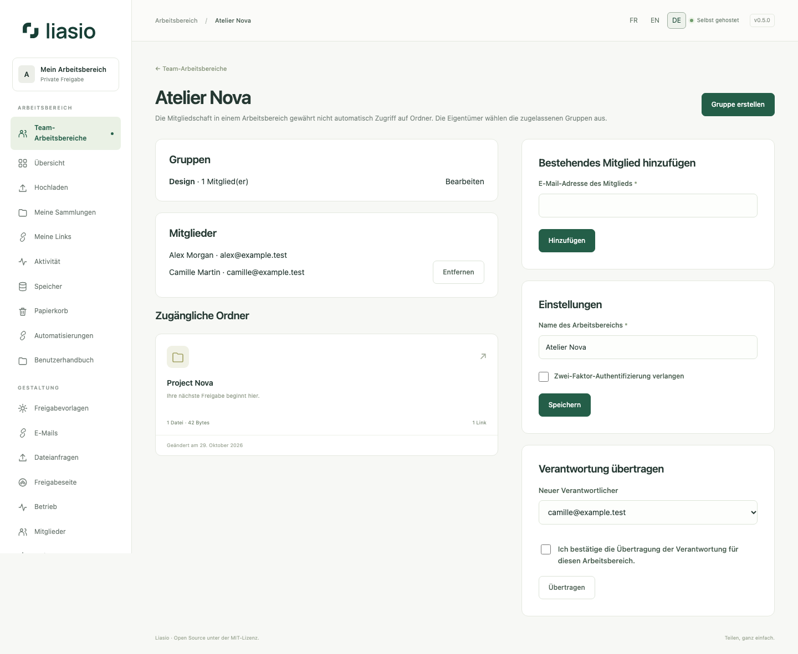

# Team-Bereiche, Gruppen und Eigentum

1. Öffnen Sie **Team-Bereiche**, vergeben Sie einen Namen und erstellen Sie den Bereich. Sie werden dessen Verwalter. Fügen Sie aktive Mitglieder per E-Mail hinzu; neue Konten werden zunächst unter **Mitglieder** eingeladen.
2. Erstellen und benennen Sie eine Gruppe und wählen Sie ihre Mitglieder aus. Nur der Bereichsverwalter darf Gruppen und Mitgliedschaften ändern. Grenzen: 200 Mitglieder und 100 Gruppen je Bereich, 20 verwaltete Bereiche je Konto.
3. Öffnen Sie in einem eigenen Ordner **Team und Eigentum**, ordnen Sie ihn dem Bereich zu und vergeben Sie pro Gruppe **Leser**, **Mitarbeiter** oder keinen Zugriff. Die Mitgliedschaft allein macht keine Ordner sichtbar.
4. Leser dürfen ansehen und herunterladen. Mitarbeiter dürfen zusätzlich die Präsentation bearbeiten, Dateien hochladen, Links/Link-Sammlungen/Exporte verwalten und Versionen erstellen. Löschen von Dateien, Zugriffsverwaltung, Wiederherstellen/Löschen von Versionen und Eigentumsübertragung bleiben dem Ordnereigentümer vorbehalten.
5. Geben Sie für eine Übertragung die E-Mail-Adresse eines aktiven Kontos ein und bestätigen Sie. Bei einem Team-Ordner muss es Mitglied desselben Bereichs sein. Dateien und URLs bleiben erhalten; alle Bytes einschließlich Papierkorb und Historie werden dem Kontingent des neuen Eigentümers zugerechnet. Ein unzureichendes Kontingent verhindert die Übertragung. Laufende Uploads werden abgebrochen. Der frühere Eigentümer behält nur separat vergebene Rechte.

Wer einer Gruppe Zugriff gibt, vertraut dem Verwalter bei der Auswahl ihrer Mitglieder. Individuelle Rechte bleiben unabhängig. Ein Entzug blockiert künftige Aktionen und beendet Uploads, sofern kein anderer Mitarbeiterzugriff besteht. Empfängerlinks müssen bei Bedarf separat widerrufen werden. Das Entfernen eines Ordners aus dem Bereich entfernt Gruppenrechte, erhält aber direkte Freigaben.

Aktivieren Sie zuerst eigenes TOTP und danach die MFA-Pflicht im Bereich. Mitglieder ohne MFA müssen sie vor weiterer Konto-/API-Nutzung einrichten. Die Bereichsverwaltung kann an ein bestehendes Mitglied übertragen werden; das Eigentum an Ordnern ändert sich dadurch nicht automatisch.

Siehe [Kontoschutz](account.md) und [Versionen](versions.md).

Zum Löschen einer Gruppe öffnen Sie ihre Bearbeitung, bestätigen die Löschung und wählen **Gruppe löschen**. Ihre Rechte entfallen; individuelle Rechte und andere Gruppen bleiben wirksam.
