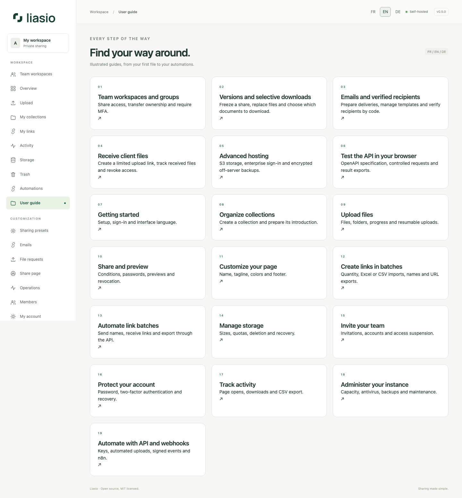

# Liasio user guide

Version 0.4 · The same guides are available inside your instance under **User guide**. Screenshots are actual local application captures with fictional demonstration data, in the matching interface language. They show a local development environment; antivirus and operational services depend on deployment configuration. No real credentials are shown.

1. [Getting started](getting-started.md)
2. [Collections](collections.md)
3. [Uploads and resume](uploads.md)
4. [Links and previews](sharing.md)
5. [Share-page branding](branding.md)
6. [Storage and trash](storage.md)
7. [Members and invitations](team.md)
8. [Account security and recovery](account.md)
9. [Activity and CSV](activity.md)
10. [Operations and quotas](operations.md)
11. [API, webhooks and n8n](automation.md)
12. [Bulk links, Excel and CSV](bulk-links.md)
13. [Create, read and export batches through the API](bulk-links-api.md)

[English](../en/README.md) · [Français](../fr/README.md) · [API reference](../../API.md)
