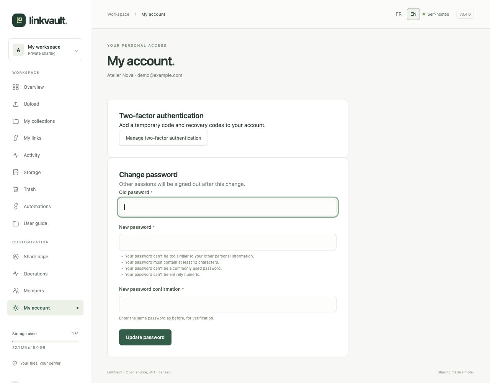
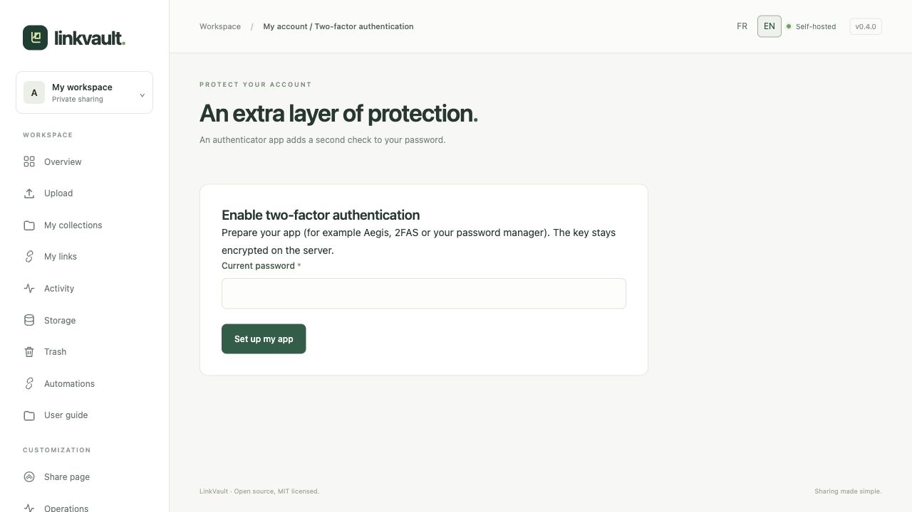

# Protect and recover your account

## Change your password

Open **My account**, enter your current password, a new unique password of at least 12 characters, and confirmation. Choose **Update password**. Other sessions are signed out; the current session is retained. Existing API keys become invalid, so replace them in your automation tools.

## Enable two-factor authentication

1. Open **Manage two-factor authentication** and confirm your current password to begin setup.
2. Scan the QR code in a TOTP app, or enter the key manually. Keep this QR/key private. Setup expires after ten minutes.
3. Enter a fresh six-digit code and choose **Enable and get my codes**.
4. Save the recovery codes in a private password manager. They are only shown once. Each replaces an app code once.

To sign in later, enter your password followed by an app code. A code already used in that time step cannot be reused: wait for the next code. A recovery code is useful if you lose your app.

## Replace recovery codes or disable MFA

On the same page, confirm your password and a valid app/recovery code, then choose **Replace recovery codes** or **Disable**. Replacing invalidates previous recovery codes. Changing MFA disconnects other sessions and invalidates API keys. Do not remove your authenticator until the change is confirmed.

## Forgotten password or lost second factor

Use **Forgot your password?** on sign-in. If SMTP is configured and an active account matches, a personal reset link is sent, valid for one hour. The response is intentionally the same for unknown addresses. Resetting a password does not bypass two-factor authentication.

Use a recovery code for a lost authenticator. If both the app and recovery codes are lost, contact the administrator for a controlled recovery process; there is no public MFA bypass. An expired invitation requires a new invitation, not a password reset.
