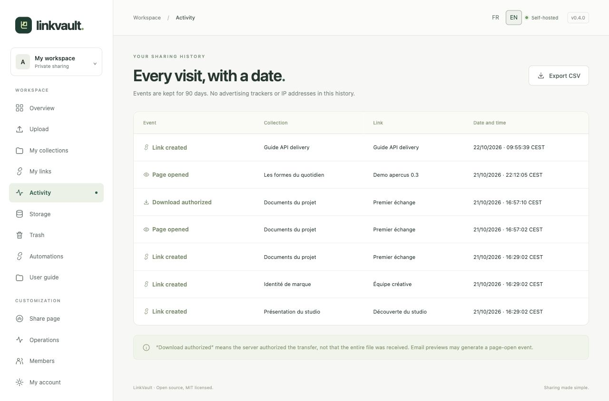

# Understand activity and download counts

Open **Activity** for the dated history of your links. From a collection or **My links**, use a link’s activity control to filter to it; **Show all links** returns to the full history.

| Event | Meaning |
| --- | --- |
| Link created | A new share link was issued. |
| Page opened | The authorized share page was served. Repeated opens within 30 minutes in the same session are deduplicated. |
| Download authorized | The server prepared the ZIP and authorized the transfer. It does not prove the recipient received every byte. |
| Link revoked | Future access through this link was disabled. |

Previews do not increment download counts. Link scanners, mail previews or the owner’s own visit can generate a page-open event. Counts are not unique people or proof of delivery. No advertising tracker or raw visitor IP is stored in this event history.

## Export and retention

Choose **Export CSV** to download up to 10,000 events from the current filter. CSV dates use ISO 8601 with UTC offset; the interface displays the server timezone. Spreadsheet formula-like names are escaped in the export.

Events are retained for 90 days by default (`EVENT_RETENTION_DAYS`). Lifetime download counters can therefore be higher than the currently retained event list. Maintenance removes expired history; export before retention expires if you need to keep your own records.

For automatic notifications, subscribe to **link.opened** or **download.started** in [Automations](automation.md). These events carry identifiers, not recipient addresses or file contents.
