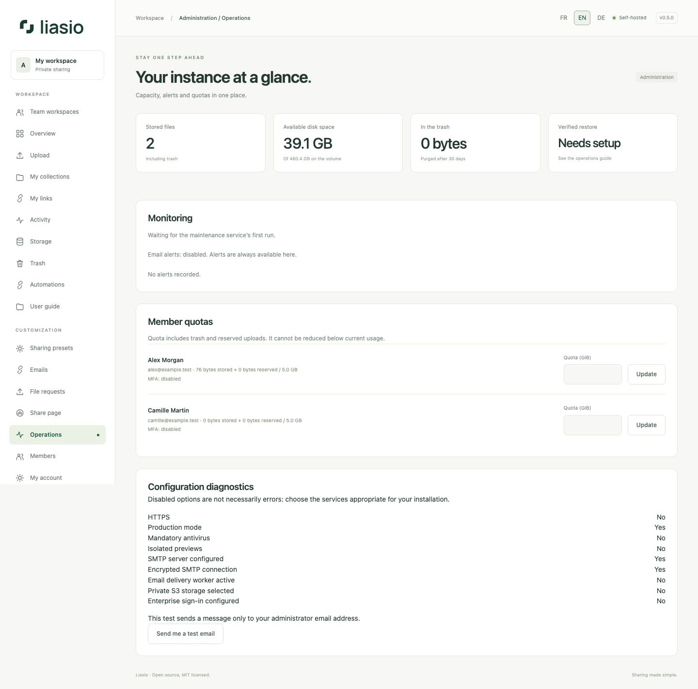

# Advanced hosting and account controls

Open **Operations** as an administrator to review disk, quotas, maintenance, antivirus, backup checks and configuration diagnostics. A disabled optional setting is not automatically a fault. The SMTP test sends only to your own administrator address and records its state under **Emails**. It does not alter SMTP settings.

## Active sessions and enterprise identity

Under **My account → Active sessions**, review the current device and other authenticated sessions, with last activity. Device labels come from browser user-agent strings; no IP address is stored. Disconnect an individual other device or all other devices; the current session remains. Password/MFA changes retain their existing session-invalidation behavior. Old sessions may show an unknown device until used again.

If your operator configures OIDC, **Enterprise sign-in** appears. Authenticate locally, re-enter your password and MFA code if enabled, then explicitly link your provider identity. An identical email never binds accounts automatically. Future provider logins still respect account suspension and local MFA. Password login remains available if the provider is down; local logout does not close its session.

## Storage and backups

Private S3-compatible storage is optional and configured by the server operator. Original URLs never bypass Liasio's permissions. Staging and temporary downloads still require local disk; current files, versions and trash all count toward account quota. Follow [the detailed hosting guide](../../ADVANCED_HOSTING.md) for credential scope and a hash-verified migration.

Encrypted off-server backups use restic with configurable retention. The export includes database, original file versions, pending blocks and encrypted configuration; restore targets must be empty. Test the complete recovery on a separate host and keep the repository password outside the VPS. See [backup instructions](../../OFFSITE_BACKUPS.md) and the [0.5 upgrade guide](../../UPGRADING_0_5.md).

SMTP, OIDC, S3 and remote backup credentials are operator configuration, not silently activated services. An independent human security audit remains pending; see [the review brief](../../INDEPENDENT_AUDIT.md).
