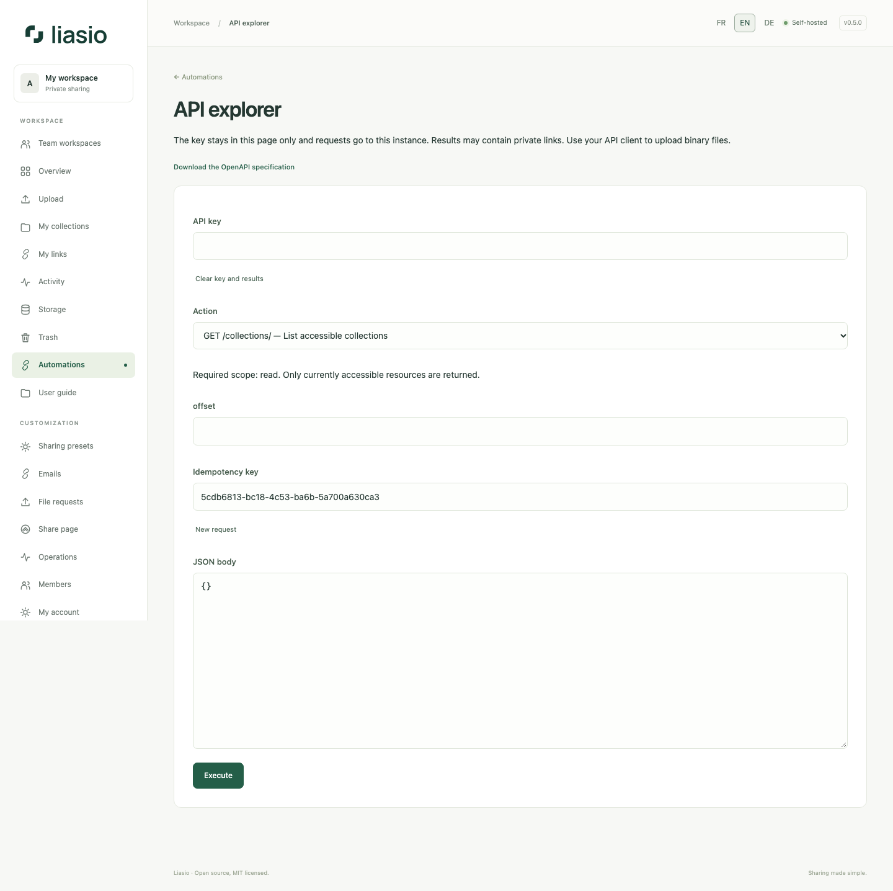

# Test the API in the browser

1. Create an API key under **Automations**, with only the required scopes. Keep it private and note its expiration. Browser login alone is not an API credential.
2. Choose **Open API explorer**. Paste your key in the password field; it stays in page memory, never browser storage or query strings. All calls target this instance; cookies are omitted from API requests.
3. Select an operation. Start with `GET /collections/` to find an accessible folder UUID, then use it in the path field. Read-only calls need `read`; creation needs `files:write` or `links:write`.
4. For a write, review the JSON example, keep the idempotency key, check the modification confirmation and execute. Reuse the same key for a retry of identical creation input after a network failure. Choose **New request** for an intentional new operation.
5. Read the HTTP status and response. Batch creation returns ordered items with each name and URL, a **My batches** URL and Excel/CSV export endpoints. Export operations provide a download button. Binary file chunks use your API client rather than this explorer.
6. Select **Clear key and results** when finished. Do not publish response screenshots containing private capabilities. Closing/leaving the page clears the key; refresh does not retain it.

The [OpenAPI 3.1 contract](../../openapi.json) is also served at `/api/openapi.json`. It covers routes, scopes, fields, status codes, pagination and upload checksums. The explorer uses that checked-in contract, with no external scripts or CDN. See [API reference](../../API.md), [automated batches](bulk-links-api.md) and [uploads](automation.md).
