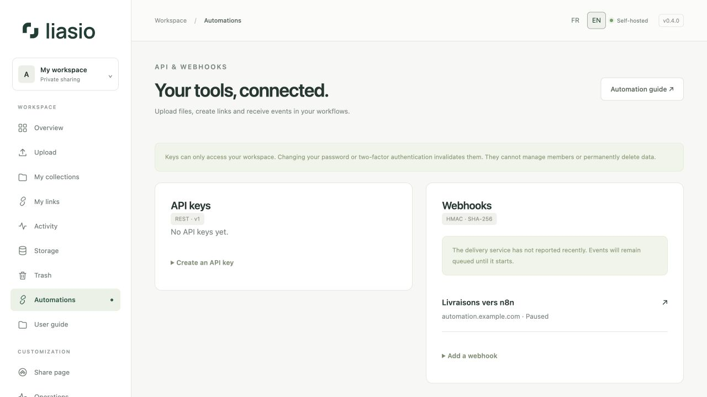
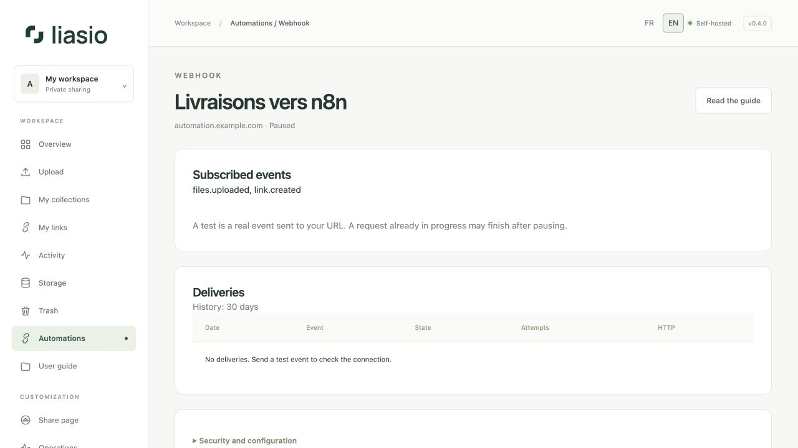

# Automate with the API and webhooks

The **API receives commands** from your tools: create a collection, upload its files and create a link. **Webhooks send notifications** back to your tools when events occur. A webhook URL alone does not authorize uploads.



## 1. Create a scoped API key

Open **Automations → Create an API key**. Give it a recognizable name, choose only the required permissions and a lifetime from 1 to 365 days (90 by default). Confirm your current password and, if enabled, a fresh MFA or recovery code.

| Permission | Access |
| --- | --- |
| `read` | List/read your collections, file metadata, links and upload progress. Link responses include the private share URL. |
| `files:write` | Create collections, start/chunk/finalize/cancel uploads. |
| `links:write` | Create and revoke links. |

Copy the key immediately into your automation tool’s credential store. It is shown once; only a keyed hash is retained. Up to ten unexpired, unrevoked keys are allowed. Keys cannot manage accounts, grant permissions, change branding or delete stored files. **Revoke** ends future use. Password/MFA changes invalidate existing keys; suspension revokes them permanently.

Always send `Authorization: Bearer YOUR_KEY` over HTTPS. Never put a key in a URL, source control, screenshots or a public workflow. Browser cookies do not authenticate the API.

## 2. Upload a file or entire directory and obtain a link

The repository includes a Python 3.12+ client for Linux/macOS requiring no extra libraries. Set `LINKVAULT_API_KEY` through your private environment/secret manager, then run:

```sh
mkdir -p .linkvault-state
chmod 700 .linkvault-state
python3 examples/upload.py ./delivery \
  --url https://files.example.com \
  --title "Client delivery" \
  --state .linkvault-state/delivery.json \
  --max-downloads 1 --hours 168 --previews
```

Keep the state file **outside** the uploaded directory. Run the same command with the same files and state file to resume; use a fresh state file for a new delivery. Do not modify source files during the upload. The client prints the link details to standard output and progress to standard error. The output contains a private share URL: protect logs accordingly. An optional `LINKVAULT_LINK_PASSWORD` adds a link password with no minimum length (128 characters maximum).

The state directory must belong to your account and have mode **0700**; existing state files must be private regular files (0600). Move older state files there before resuming. Only one client may use that directory at a time. State updates use exclusive, unpredictable temporary files and atomic replacement. Use a **trusted source tree** that other accounts cannot modify; copy shared incoming files into private storage first. The client retains opened files and rejects detected changes, but is not a sandbox for an untrusted local writer.

Choose a title of up to 120 characters; its first 80 characters become the link label. Symbolic links are not supported.

The client uses all three permissions, checksums every chunk and reuses durable offsets. Pending uploads expire after 24 hours. Completed collection/link IDs are saved locally; creation receipts last 24 hours, so resume promptly if the connection was lost before an ID was saved. See the [API reference](../../API.md) for all endpoints, fields, limits and error responses.

## 3. Add an outgoing webhook

Choose **Add a webhook**, enter a name and the receiver’s **public HTTPS URL**, select events, then confirm your password/MFA. Only port 443 is allowed. Internal/private IPs, credentials in URLs, query parameters, fragments and redirects are rejected. For n8n on the same VPS, use its public HTTPS domain, not a Docker service name or `localhost`.

Copy the **signing secret** once and configure your receiver to verify it. It is different from the API key. Destinations and signing secrets are encrypted in the database. Payloads contain event/collection/link IDs; they exclude share URLs, passwords, emails and file contents. A receiver can fetch additional information with a separately scoped API key if necessary.

Events: `collection.created`, `files.uploaded`, `link.created`, `link.revoked`, `link.opened`, `download.started`. `files.uploaded` means final storage succeeded, after applicable scanning; `download.started` means an authorized transfer, not proven receipt. Deleting/trashing a collection can produce revocation events. Automatic expiry does not produce `link.revoked`.

## 4. Verify and test deliveries



Open the webhook and choose **Send a test**. This queues a real `webhook.test` event for your URL. Refresh the page to see its state, HTTP status and attempts. The dedicated worker must be running; see [Operations](operations.md).

The receiver must verify the exact raw bytes before parsing:

```text
X-LinkVault-Timestamp: UNIX_SECONDS
X-LinkVault-Signature: v1=HEX_HMAC_SHA256
signed bytes = timestamp + "." + raw HTTP body
HMAC key = the signing secret as UTF-8 bytes
```

Use constant-time comparison and reject timestamps more than five minutes away from your clock. The tested [Python verifier](../../../examples/verify_webhook.py) implements both. Persist the payload’s `id` with your processing result under a unique database constraint: deliveries are **at least once**, may arrive out of order and must be deduplicated. `X-LinkVault-Delivery` identifies a delivery; the payload event ID is shared across subscribed endpoints. Return 2xx promptly after durable acceptance; process long work asynchronously.

Six attempts maximum: immediate, then approximately 1 minute, 5 minutes, 30 minutes, 2 hours and 6 hours after each failure, with small jitter. Network errors and HTTP 408/425/429/5xx retry; redirects and other 4xx fail without retry. Each attempt is bounded to 20 seconds. No receiver response body is stored. History is retained for 30 days. Attempting to add an event to an endpoint with 1,000 pending deliveries pauses it, cancels its pending queue and displays an alert; events while paused are not retained.

Accounts take turns, regardless of their number of endpoints. At most one delivery per account is in flight across all workers. Compose runs two processes, keeping a second send slot available to other accounts when one receiver is slow. Selection state survives restarts; a crashed worker's reservation expires after five minutes. Delivery time still depends on the number of active accounts, receiver latency and database capacity; it is not a delivery-time guarantee.

## 5. Connect n8n

1. Store your API key as a **Header Auth** credential: header `Authorization`, value `Bearer …`.
2. Use **HTTP Request** nodes with the methods and JSON bodies in the [reference](../../API.md). Keep each creation’s `Idempotency-Key` stable when retrying the same operation. Use the resumable chunk protocol for binaries; never send a file as base64 JSON. The supplied Python client is useful in a supervised external upload job.
3. Add an n8n **Webhook** trigger using POST. Use its **production URL** and publish/activate the workflow before registering it in Liasio. Test URLs only listen temporarily.
4. Verify the HMAC against the original raw body and check timestamp/deduplication **before side effects**. If your workflow cannot preserve the raw bytes, put a verifier in front of n8n using the supplied Python function. A secret-looking URL is not signature verification.
5. Send a Liasio test, confirm the received `webhook.test`, then subscribe to your real events. For workflows that create links, avoid looping on their own `link.created` events.

## Pause, rotate or remove

**Pause** cancels queued deliveries; an in-flight request may still finish. **Reactivate** requires password/MFA and only subscribes to future events. **Rotate secret** invalidates the old signing secret immediately; all future attempts, including retries, use the new one. Coordinate the receiver update. To change URL/events, create and test a replacement webhook, then delete the old one. Deletion removes its history. None of these actions deletes your collections or API keys.

n8n references: [Webhook trigger](https://docs.n8n.io/integrations/builtin/core-nodes/n8n-nodes-base.webhook/) · [HTTP Request credentials](https://docs.n8n.io/integrations/builtin/credentials/httprequest/).
