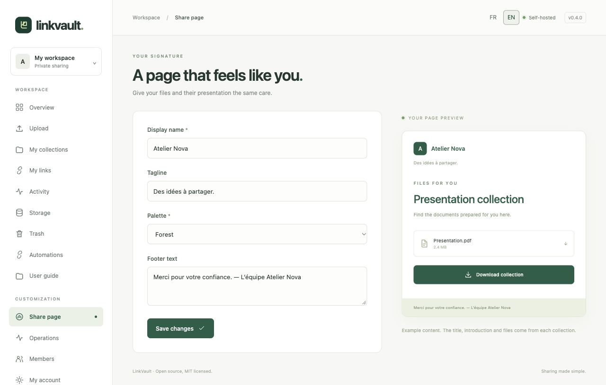

# Customize your share page

Open **Share page** in the sidebar. Your branding applies to all your recipient pages, including existing links; other members keep their own branding.

1. Set the **Display name**: your studio, team or personal name. Its first letter forms the monogram.
2. Add a short **Tagline** to describe your space.
3. Choose **Forest**, **Ocean**, **Plum** or **Ink**. The preview updates as you edit.
4. Add **Footer text**, for example a contact or a simple delivery note.
5. Choose **Save changes**, then open a share link to inspect the result. Opening a real share page may appear in Activity.

The example file in the settings preview is illustrative. The actual title, introduction, recipient message and files come from each [collection](collections.md). Previews of those files are controlled [per link](sharing.md).

These fields accept text, not custom scripts or HTML. The interface can be French or English; your own branding text stays exactly as written. Write bilingual content yourself if recipients need both languages.
