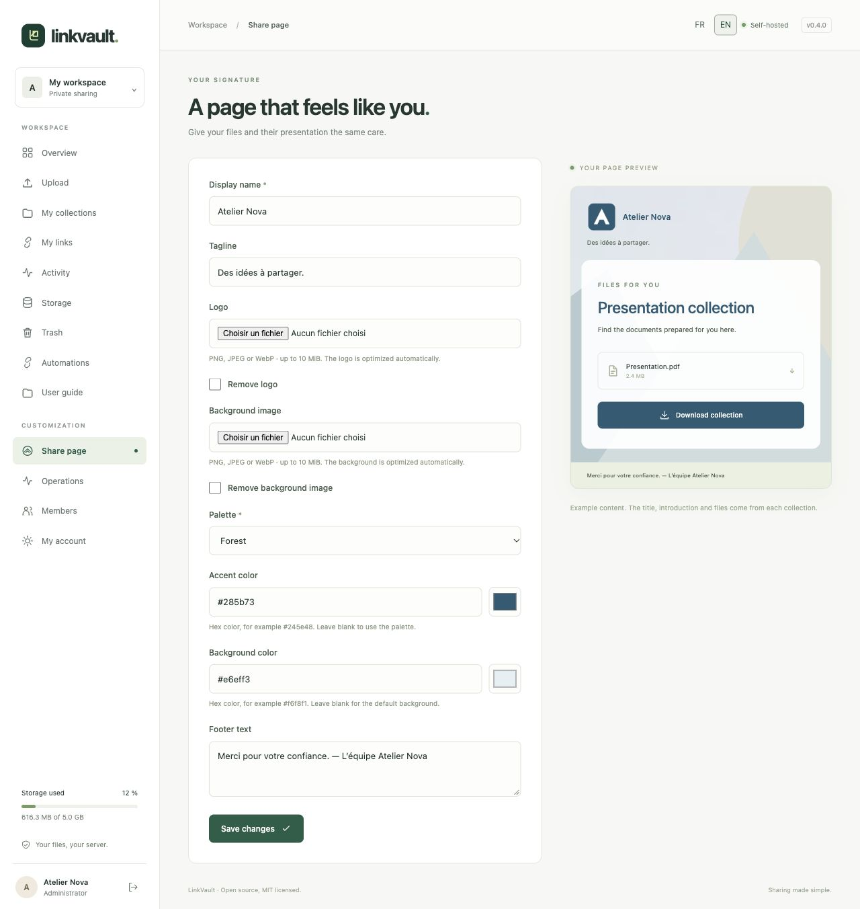
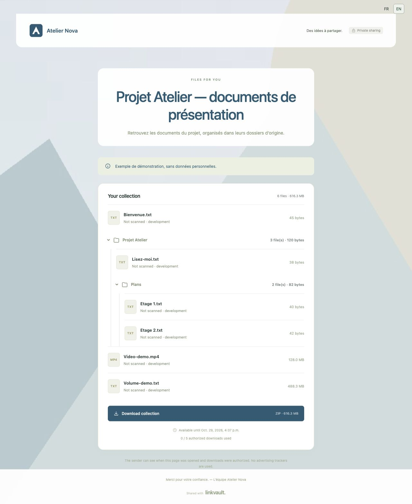

# Customize your share page

Open **Share page** in the sidebar. Branding applies to all your recipient pages, including existing links; other members keep their own settings.

1. Enter your **Display name** and a short **Tagline**.
2. Add a **Logo** and, optionally, a **Background image**. PNG, JPEG and WebP are accepted, up to 10 MiB each before optimization. The browser preserves proportions, optimizes dimensions and prepares a PNG. Wait for “Image ready” in the live preview.
3. Choose **Forest**, **Ocean**, **Plum** or **Ink**. For precise colors, use the **Accent color** and **Background color** pickers, or enter a code such as `#285b73`. Clear the code to return to the palette. Button text switches color for readable contrast.
4. Add **Footer text**, such as a delivery note.
5. Choose **Save changes**. Editing the preview alone does not save your changes.

To replace an image, select a new one. To remove it, check **Remove logo** or **Remove background image**, then save. Removing the logo restores the monogram.

The settings preview uses fictional content. The actual title, introduction, recipient message and files come from each [collection](collections.md). File previews are controlled [per link](sharing.md).

Stored images are limited to 512 × 512 pixels / 512 KiB for the logo and 1,600 × 1,600 pixels / 2 MiB for the background. They are validated, stripped of metadata, antivirus-scanned in production and stored in the backed-up database. Their space appears in [Storage](storage.md), separately from the file quota. Without JavaScript, supply a non-interlaced 8-bit RGB/RGBA PNG within those limits.

Branding images follow the link’s password, expiry, revocation, download limit and active-account checks. Viewing them consumes no downloads. Branding remains available when document previews are disabled on the server. Text fields accept no HTML or scripts. Your own text stays in the language you wrote it in.
