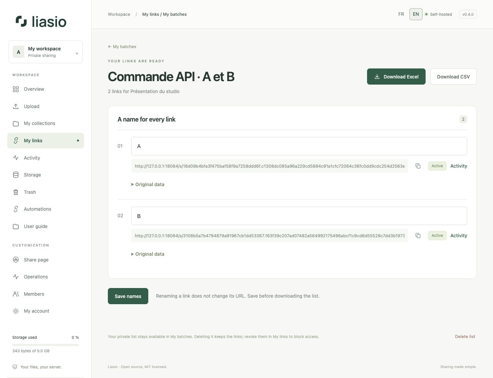

# Create and export batches through the API

From Codex, a terminal, n8n or your website's server, send names to Liasio and receive their links. The batch immediately appears in **My links → My batches**, just like a batch created in the interface. Every link in a batch shares **the same file collection**.



## 1. Prepare access

In **Automations → Create API key**, select `links:write` to create and `read` to consult and export. Keep the key in the private `LINKVAULT_API_KEY` environment variable. This name is retained for API v1 compatibility. Never put the key in Git, a URL or JavaScript delivered to your site's visitors.

The collection must already contain validated files. Find its UUID in the interface's `/collections/UUID/` URL or with `GET /api/v1/collections/`. To upload files through the API, follow the [automation guide](automation.md).

## 2. Send A and B, receive link A and link B

Create a private `request.json` file:

```json
{
  "name": "Clients — October",
  "names": ["A", "B"],
  "conditions": {"expires_in_days": 7, "max_downloads": 1}
}
```

Call `POST /api/v1/collections/UUID/link-batches/` with `Content-Type: application/json`, `Authorization: Bearer YOUR_KEY` and a unique `Idempotency-Key` for this operation. With the [included Python client](../../../examples/batches.py), from a copy of the repository:

```sh
# LINKVAULT_API_KEY is already set in your private environment.
umask 077
python3 examples/batches.py --url https://files.example.com create \
  --collection COLLECTION_UUID --request request.json \
  --idempotency-key clients-october-001 > batch.json
```

Replace the domain and UUID with your instance's values. Python 3.12+ is sufficient; the client uses the standard library. The output includes the following, shown here in abbreviated form:

```json
{
  "id": "BATCH_UUID",
  "name": "Clients — October",
  "state": "complete",
  "items": [
    {"position": 1, "label": "A", "url": "https://your-instance/s/LINK_A/"},
    {"position": 2, "label": "B", "url": "https://your-instance/s/LINK_B/"}
  ]
}
```

Each actual item also contains its link ID, status, counters and conditions. **Order matches `names`**, with positions starting at 1. Duplicate names create distinct links: use positions or IDs to distinguish them. Leading and trailing name whitespace is trimmed. Share URLs are private; protect `batch.json` and keep them out of logs.

For a quantity, replace `names` with `"count": 20`: generated names are `Link 001` through `Link 020`. Supply exactly one of these fields. A batch contains 1–200 links; batch and link names are limited to 80 characters on a single line.

`conditions` is optional. It accepts `expires_in_days` **or** timezone-aware `expires_at`, `max_downloads`, `password` and `allow_previews`. Without conditions: no expiry, unlimited downloads, no password and previews disabled. A limit of 1 allows one download **per link**. Duration starts at creation. The password is never returned or exported; protect the request file as well if it contains a password.

## 3. Read and export

```sh
python3 examples/batches.py --url https://files.example.com list
python3 examples/batches.py --url https://files.example.com get BATCH_UUID
python3 examples/batches.py --url https://files.example.com export BATCH_UUID \
  --format xlsx --output links.xlsx
python3 examples/batches.py --url https://files.example.com export BATCH_UUID \
  --format csv --output links.csv
```

These commands use `GET /api/v1/link-batches/`, `GET /api/v1/link-batches/UUID/` and `GET /api/v1/link-batches/UUID/export/xlsx/` or `/csv/`. Lists have 50 entries per page: use `--offset 50` from the returned `next_offset`; `--collection UUID` filters the results. Response `api_url` and `exports` URLs require the API key; `view_url` opens the batch after signing into the interface.

Exports contain the original name, current name, URL and dates/status/counters. Numeric-looking names such as `00127` remain text. Formula-like cells are neutralized. The client creates exports with private permissions and refuses to overwrite existing files. Choose a new filename when exporting again.

The API can also read and export batches created in the interface, including their original Excel/CSV columns. Drafts are readable (`draft` or `expired`), but have no links and cannot be exported. The API creates completed batches directly; it accepts JSON, not a raw Excel workbook. Use the interface to [import a workbook](bulk-links.md).

## 4. From a website or webhook

Your website's server calls this API with its private key. Example **server-side** JavaScript, after authenticating and authorizing your site's user:

```javascript
const response = await fetch(`${process.env.LIASIO_URL}/api/v1/collections/${collectionId}/link-batches/`, {
  method: "POST",
  redirect: "error",
  headers: {
    "Authorization": `Bearer ${process.env.LINKVAULT_API_KEY}`,
    "Content-Type": "application/json",
    "Idempotency-Key": operationId
  },
  body: JSON.stringify({name: "Clients", names: ["A", "B"]})
});
if (!response.ok) throw new Error(`Liasio HTTP ${response.status}`);
const batch = await response.json();
// batch.items associates each label with its URL; persist batch.id.
```

Persist `operationId` and the JSON body for retries, then the batch ID after success. Choose the collection on your server according to your user's permissions; the Liasio key acts with its owner's access. Rate-limit your site's calls and return only links that user is entitled to receive. Direct calls from another site's browser are not supported; do not expose the key to make them work.

A webhook received by your automation tool can trigger this API call. Liasio already emits `link.created` for each created link, without names, share URLs or passwords. No email is sent. Avoid triggering new batches in response to your own `link.created` events.

## 5. Retries and limits

Creation is atomic: the batch, links and events are all stored, or none are. After an interruption, repeat **the exact request with the same API key and `Idempotency-Key`**. For 24 hours, this returns the original response without duplicates, even if its conditions have since expired or the batch quota has been reached. A different request body using the same operation key receives HTTP 409.

Persist the batch ID: after 24 hours, use the read endpoint, because receipts expire and another create can generate new links. A replay reflects the original creation; a read or a new export reflects current state. Renaming in **My batches** preserves URLs. Link revocation and list deletion remain available in the interface.

Limits shared with the interface: 10 preparations per hour per account, 100 saved batches and 60 exports per hour; additional IP limits apply. Creation JSON is limited to 256 KiB. Retrying a successful creation does not consume the preparation budget, but general API limits still apply. For HTTP 429, honor `Retry-After` and retain the operation key. Errors 400/403/404 require a correction instead of an automatic retry.

[API reference](../../API.md) · [Batches in the interface](bulk-links.md) · [Automations](automation.md) · [Back to the guide](README.md)
