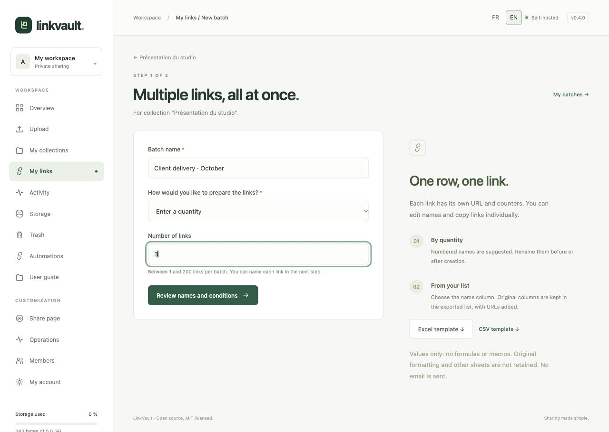
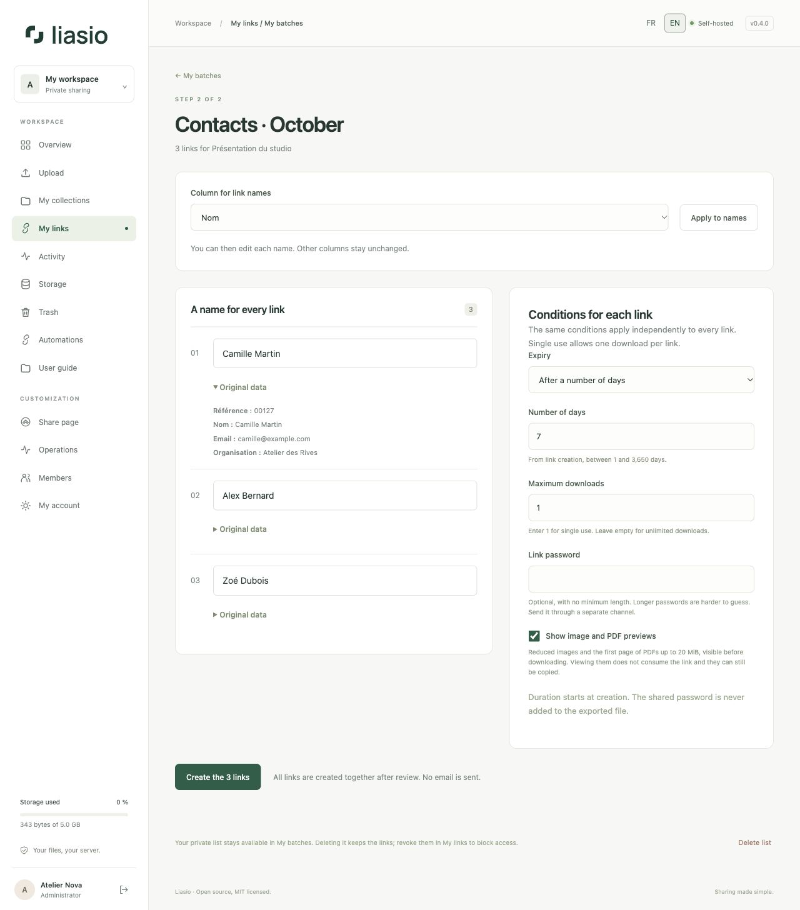
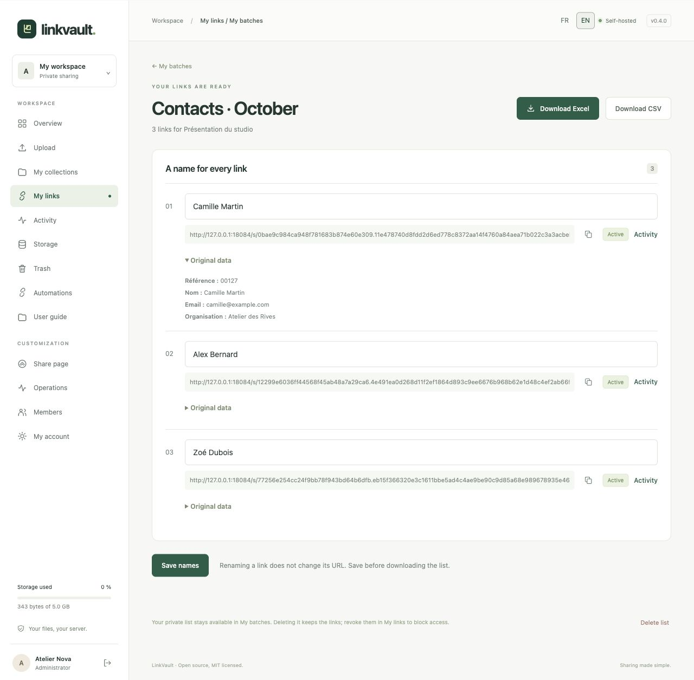

# Create multiple links without the API

A batch creates independent links to **one folder**. Each link has its own URL, counters and activity history. No email is sent: use the links individually or use the exported list in your usual tool.

## 1. Select a folder and prepare your list

Open a folder containing files and click **Create multiple links**. Alternatively, open **My links → My batches**, select a folder and click **Prepare a batch**.

Enter a **Batch name** to identify the list later.

- **Enter a quantity**: choose between 1 and 200. The next step suggests names such as `Link 001`, `Link 002`… The mouse wheel does not change the quantity.
- **Import an Excel or CSV list**: select an `.xlsx` or UTF-8 `.csv` file. **Excel template** and **CSV template** provide sample Name, Email and Reference columns. Replace the examples with your own rows before importing.

Every non-empty row after the header creates one new link. Rows retain their original order, even when names repeat. Extra columns such as email addresses or customer references are retained for export; they do not trigger any messages.

Click **Review names and conditions**. No links have been created yet.

## 2. Review and create

For an imported list, choose the **Column for link names** and click **Apply to names**. You can then edit each name, up to 80 characters. Names are private and visible only to you. Expand **Original data** to check a row's source values.

The selected conditions apply independently to each link: expiry date or number of days, maximum downloads, an optional shared password, and previews. For example, 20 links with a limit of `1` allow one download each, or at most 20 downloads in total. Duration starts when links are created, not when the list is imported.

Click **Create the X links**. Creation is atomic: either every link is created or none is. Repeating submission of the same draft does not create duplicates. Preparing a new batch from the same file does create new links.

## 3. Use the links and download your list

Copy individual URLs, or use **Download Excel** / **Download CSV**. The export contains the original columns followed by the current Liasio name, URL, status, UTC dates and counters. URLs are clickable in Excel.

Cells are exported as values, without the original workbook's formulas, macros, styles or additional sheets. Identifiers entered as text, such as `00127`, remain text. CSV uses UTF-8 with a BOM and semicolons; cells that could be interpreted as formulas receive a protective apostrophe. **The password entered in the conditions is never exported**: communicate it separately.

Edit names in the batch, click **Save names**, then download again. You can also use **Rename** in **My links**. URLs and conditions stay unchanged. Exports reflect the links' state at download time; files already downloaded do not update automatically.

## Find or remove a list

Find batches in **My batches**. Drafts expire after 24 hours. Each account can retain up to 100 batches. **Delete list** removes the source data and associations while keeping the links usable and visible in **My links**. To block access, use **Revoke**. Removing a list does not erase existing backups, which follow their own retention policy.

Lists are private to the folder's owner, never shown to recipients, and included in database backups. Trashing their folder blocks access until restoration; purging the folder deletes its lists.

## Formats and limits

- Up to 1 MiB per file, 200 data rows, 20 columns and 1,000 characters per cell; total text data is limited to 256 KiB.
- Unique, non-empty column headers of up to 80 characters. Entirely empty rows are ignored.
- Only the first Excel worksheet is imported. Prefer a workbook containing just your table: safety limits apply to the entire file.
- `.xls`, `.xlsm`, encrypted files, formulas and references to other workbooks are not supported. In Excel, use **Copy → Paste Special → Values**, then save as `.xlsx`.
- Ten batch preparations per hour per account; request limits also apply per IP address. Try again later if a limit is reached.
- When antivirus is required, it must accept both the imported list and the folder's files. List data has separate database limits and does not count towards file-storage quota.

## Automate this workflow

[Batch creation through the API](bulk-links-api.md) accepts names or a quantity from Codex, a terminal or your website server, then returns links and Excel/CSV exports. These batches appear in **My batches** and remain accessible in the interface.

[Link conditions](sharing.md) · [API and webhook automation](automation.md) · [Back to the guide](README.md)
