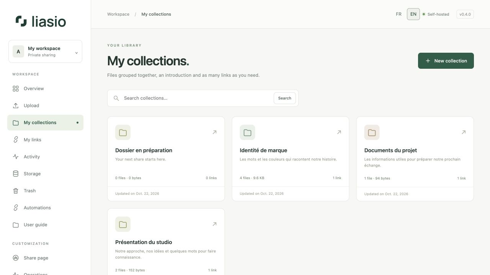
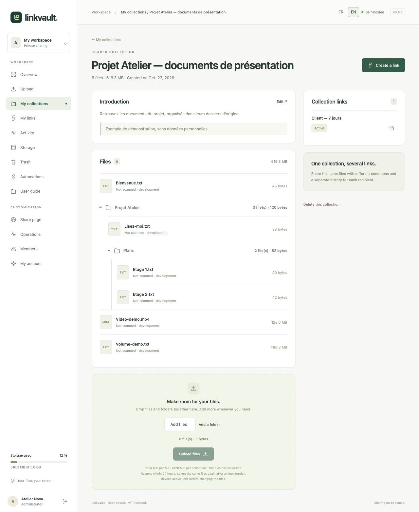

# Organize your collections

A collection groups files, a recipient-facing introduction and one or more share links. Each member owns their own library.

## Create a collection

1. Open **My collections → New collection** (also available from Overview).
2. Enter a clear **Collection title**. This is the recipient page heading.
3. Add an **Introduction** describing the contents and a short **Message for the recipient**, if useful. These fields are optional; ordinary text is displayed safely, not executed as HTML.
4. Choose **Create collection**, then [upload your files](uploads.md).

## Find and edit it

Open **My collections**, search by title and select a collection. Its detail page shows the introduction, file paths, sizes, antivirus status and existing links. Choose **Edit** to update the presentation. These text changes are visible through existing links.

Files are different: revoke every active link before adding or changing the collection’s contents. This keeps an already shared bundle consistent. A collection may contain up to 100 files, including files still in the trash; size limits depend on server configuration.

## Delete a collection

Choose **Delete this collection**, review the confirmation and move it to the trash. All links are revoked and pending uploads canceled. Files remain recoverable for the configured retention period (30 days by default) and still count toward quota. Follow the [storage and trash guide](storage.md) to restore or permanently delete them.

## Create another link

Once files are ready, choose **Create a link**. You can issue multiple links with different names, passwords, expiry dates and download limits without duplicating the files. See [Sharing](sharing.md).

## Directory structure

Imported folders expand to show their files and subfolders. Each folder shows its file count and size; individual files stay at their original level. The same paths are retained in the ZIP and recipient page. Empty folders are not stored.
