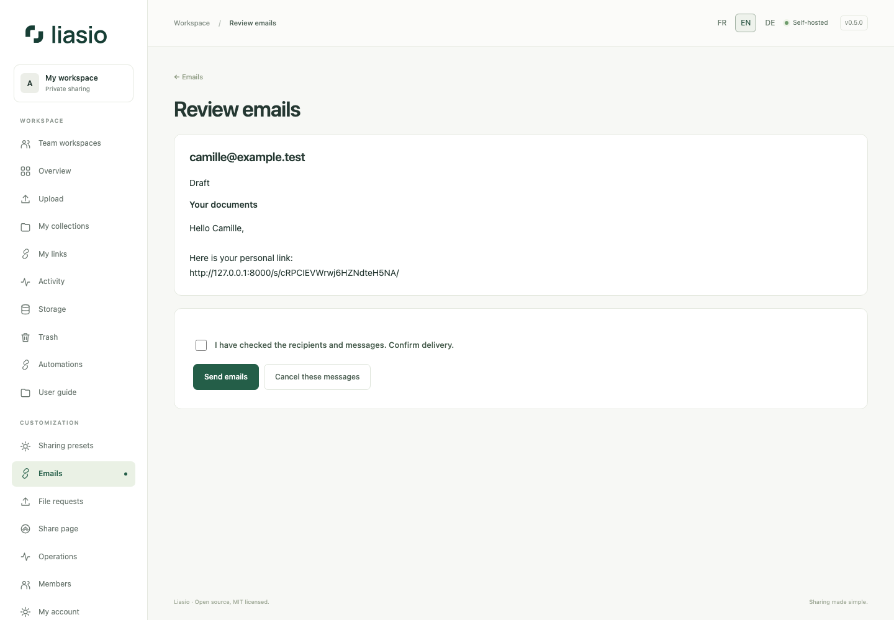

# Reviewed emails and verified recipients

## Prepare and send

1. Configure SMTP on the server and start the `mail` service. Administrators can request a message to their own address from **Operations → Configuration diagnostics**. Check its state under **Emails**.
2. From **My links**, a completed batch or an invitation, choose **Prepare email(s)**. A batch's `Email`/`E-mail`/`Courriel` column pre-fills recipients; review or correct every address. An invitation must use its original address.
3. Choose a saved template or write the subject/body. Variables are `$name`, `$link` and `$collection`; use `$$` for a literal dollar. Link passwords are never automatically included. Communicate them separately.
4. Select **Preview messages**, read each personalized draft, check the confirmation and choose **Send emails**. Nothing is sent merely by creating links or viewing drafts. Drafts expire after 24 hours.
5. **Emails** lists pending, sending, SMTP-accepted, failed and canceled messages. You can cancel a draft or messages still pending from its review page; an in-flight/accepted email cannot be recalled.

The queue is limited to 1,000 active messages per sender, with one in-flight message per account, bounded retries and fair scheduling. Permissions and link availability are checked before dispatch. SMTP acceptance is not proof of receipt or reading; a worker failure after SMTP accepts a message can cause a duplicate retry with the same Message-ID. Delivery metadata is kept for 30 days; private message content is encrypted and cleared after completion/cancellation.

Manage reusable templates and optional self-notifications under **Emails**. Download notifications mean authorization, not completed receipt. Notifications are limited to ten per hour and default to off.

## Require mailbox verification

In a new link's **Allowed recipients**, enter one email per line (up to 100). The visitor must request and enter a six-digit email code before the page, previews or download becomes available. A configured SMTP server is required. Codes expire after ten minutes, allow five attempts, and are bound to that browser and link. Successful verification lasts one hour; a link password, when set, is also required.

For an imported batch, select the email column and **Verify each row's email address** to reserve each link for its own recipient. The API accepts `recipients: [{"name":"A","email":"alex@example.test"}]` and `verify_recipients: true`. Without verification, the email column is only a preparation aid and does not restrict access. See [batch API](bulk-links-api.md).
