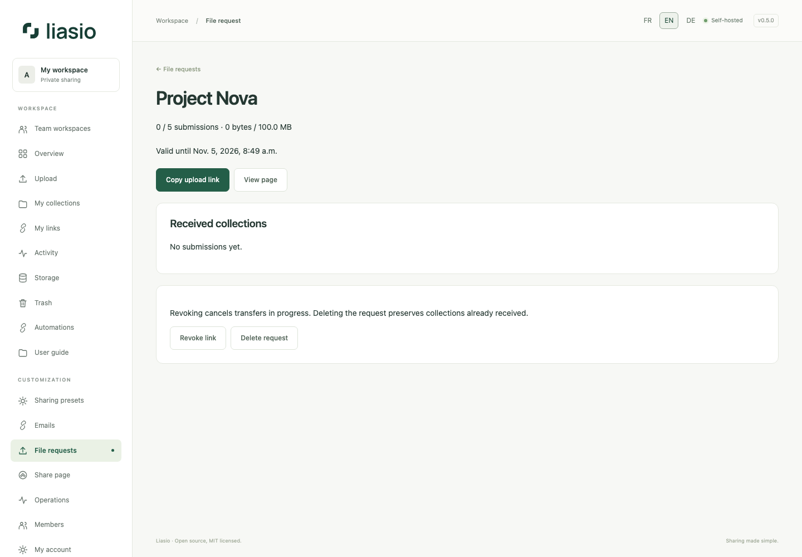

# Receive files from clients

1. Open **File requests**, enter a title and client instructions, then choose validity (1–365 days), total MiB and maximum submissions (1–200). The volume cannot exceed your account quota. An account can keep 100 requests.
2. Create the request and copy its private deposit link. Share it only with intended senders; anyone holding it can use the remaining allowance. It does not grant account access or reveal other deposits.
3. The client opens the link, adds files and/or folders, and starts the upload. The same real byte progress, pause/resume, checksum and antivirus pipeline applies. JavaScript is required; resumption requires the same browser session and selecting the same files within 24 hours, while the request remains active.
4. Each submission creates a separate private folder owned by you. Completed submissions appear under **Received folders**; open them to review and optionally share files through ordinary controlled links. An empty folder can remain after a canceled deposit and may be deleted normally.
5. **Revoke** blocks new requests and cancels pending transfers, releasing reservations. **Delete request** also removes its request entry; received folders remain stored. Expiration blocks further writes, and normal maintenance releases expired upload reservations.

The request's lifetime byte and submission limits include completed deposits plus pending reservations; deleting received files does not replenish those lifetime limits. Your account's quota, maximum file/folder sizes, five-pending-upload limit and disk-admission checks still apply. Folder names and filenames are untrusted client input; a deposit does not verify the sender's identity. No recipient can list or resume another browser's submission. Production scanning failures keep files unavailable; never disable antivirus to accept a rejected file.

To enable email alerts for new uploads, see [Emails](email.md). For account storage and cleanup, see [Storage](storage.md).
