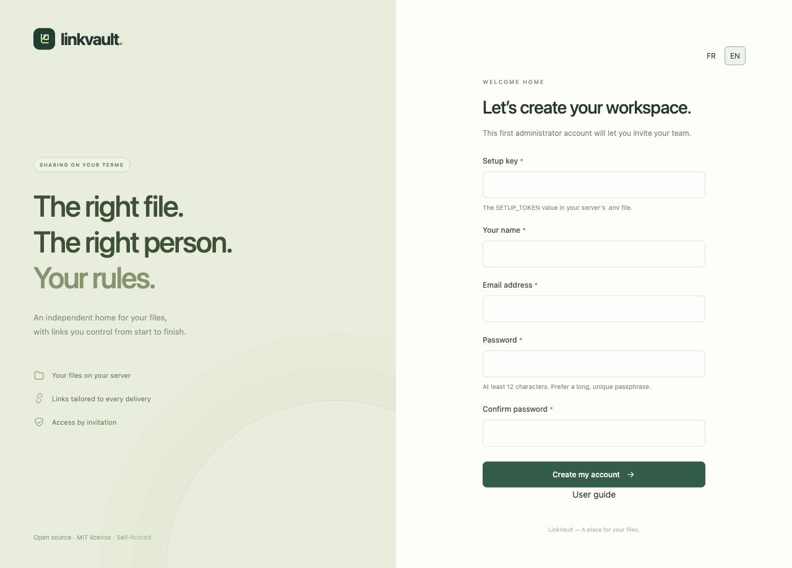

# Get started with LinkVault

LinkVault lives on your server. You need its HTTPS address and either the installation key or a personal invitation. A share link only gives access to its collection; it is not an account invitation.

## Install and create the first administrator

1. Follow the [installation instructions](../../../README.md) on a server with a domain and HTTPS. Use the [operations runbook](../../OPERATIONS.md) for production requirements.
2. Visit your instance. On a new installation, **First-time setup** appears automatically.
3. Enter `SETUP_TOKEN` from the server’s private `.env` file, your name, email and a unique password of at least 12 characters. Confirm it and choose **Create my account**.
4. This first account is an administrator. Setup closes after it is created. Store the server configuration and recovery material securely.

## Accept an invitation

Open the personal invitation supplied by the administrator. Check the email address displayed, choose your name and password, then create your account. Invitations expire after seven days and work once. Request a new invitation if it has expired. See [Members](team.md).

## Sign in, choose a language and sign out

Use your account email and password. If two-factor authentication is enabled, enter a fresh app code or one recovery code. The **FR / EN** selector is available on sign-in, workspace and recipient pages. Your choice is remembered in a browser cookie; without a choice, the browser language is used, with French as fallback. Your file names and written introductions are never automatically translated.

Use **Sign out** at the bottom of the sidebar, especially on a shared computer. Forgotten password? Choose **Forgot your password?** and follow the [account recovery guide](account.md). Email delivery must be configured by the administrator.

## Your first delivery

[Create a collection](collections.md) → [upload files](uploads.md) → [create a link](sharing.md). You can customize your [share page](branding.md) before sending it.
