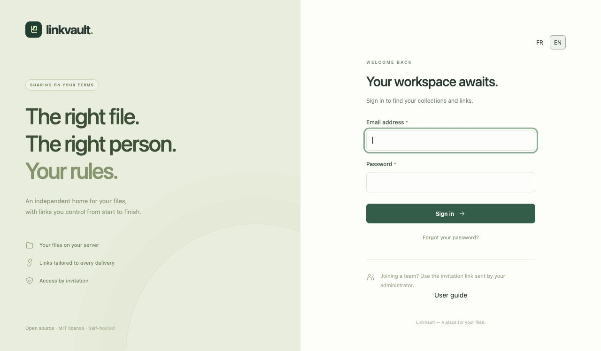
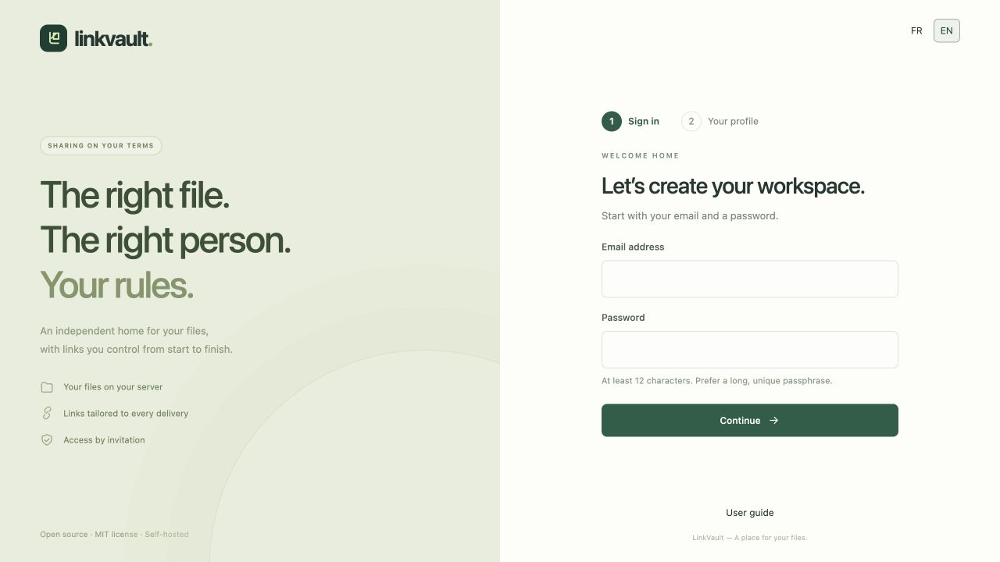
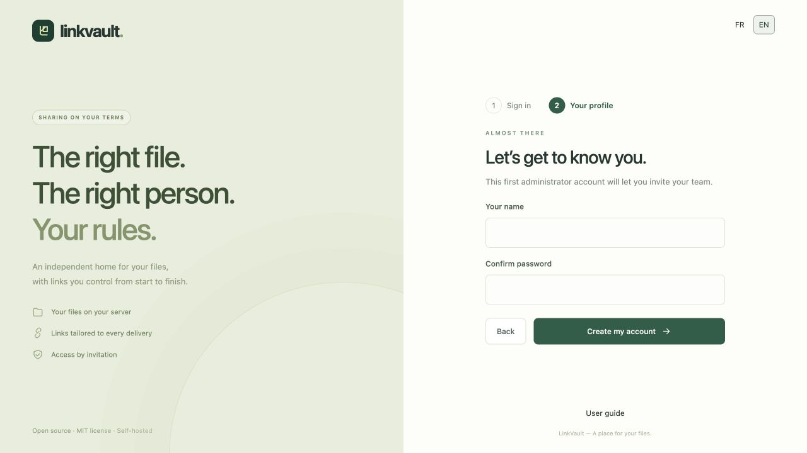

# Get started with LinkVault

LinkVault lives on your server. Open its HTTPS address to create the first account on a new instance. Once installed, you need a personal invitation to join. A share link only gives access to its collection; it is not an account invitation.

## Install and create the first administrator

1. Follow the [installation instructions](../../../README.md) on a server with a domain and HTTPS. Use the [operations runbook](../../OPERATIONS.md) for production requirements.
2. Visit your instance. On a new installation, **First-time setup** appears automatically.
3. Enter your email and a unique password of at least 12 characters, then choose **Continue**. No installation key is needed.
4. Enter your name and confirm your password, then choose **Create my account**. **Back** lets you change your email or password without losing your entries. The account is created only after this final submission.
5. The first person to complete setup becomes the administrator: finish this step before sharing the instance address. Setup then closes and additional accounts require invitations. Store the server configuration and recovery material securely.

The two short steps fit standard desktop and mobile screens. On smaller windows, with enlarged text or when validation needs more space, the page can scroll so every control stays accessible. Without JavaScript, all fields appear together and account creation still works. If server validation rejects a submission, re-enter the passwords; they are never sent back in the page.

## Accept an invitation

Open the personal invitation supplied by the administrator. Check the email address displayed, choose your name and password, then create your account. Invitations expire after seven days and work once. Request a new invitation if it has expired. See [Members](team.md).

## Sign in, choose a language and sign out

Use your account email and password. If two-factor authentication is enabled, enter a fresh app code or one recovery code. The **FR / EN** selector is available on sign-in, workspace and recipient pages. Your choice is remembered in a browser cookie; without a choice, the browser language is used, with French as fallback. Your file names and written introductions are never automatically translated.

Use **Sign out** at the bottom of the sidebar, especially on a shared computer. Forgotten password? Choose **Forgot your password?** and follow the [account recovery guide](account.md). Email delivery must be configured by the administrator.

## Your first delivery

[Create a collection](collections.md) → [upload files](uploads.md) → [create a link](sharing.md). You can customize your [share page](branding.md) before sending it.
