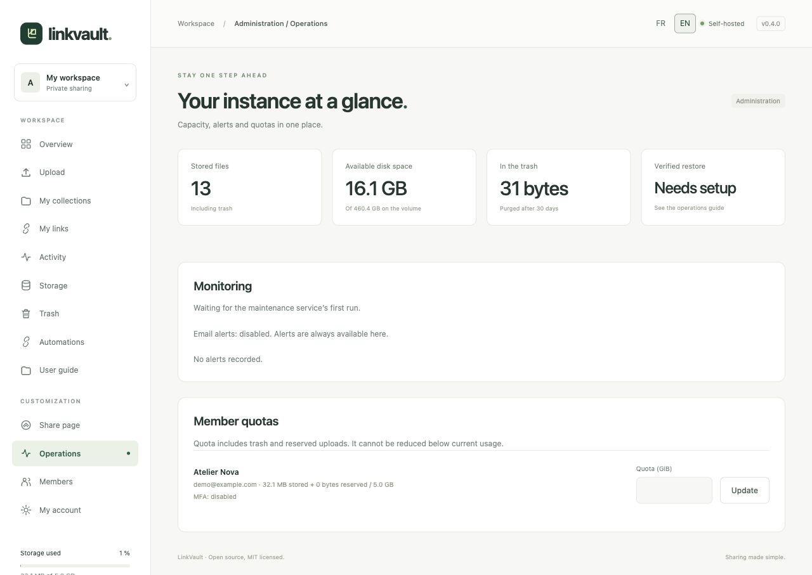

# Administer your instance

The **Operations** page is administrator-only. It summarizes retained file count, free disk space, trash, backup-restore verification, database/antivirus checks and operational alerts.

## Set a member’s quota

Find the member under **Member quotas**, enter a size in GiB and choose **Update**. One GiB is 1,073,741,824 bytes. The quota cannot go below stored files, trash and reserved uploads. An increase does not create physical disk space; check available capacity first.

## Respond to an alert

- **Disk capacity:** remove unneeded files, purge trash after review, or expand the volume. Leave space for upload staging and ZIP downloads.
- **Antivirus unavailable:** inspect the ClamAV service and signature updates. Production uploads fail closed while it is unavailable.
- **Maintenance missing:** verify the maintenance container. It purges expired uploads, trash, sessions and retained events.
- **Backup verification overdue:** run a real backup and restore test; marking a backup as successful without a restore is insufficient.

Email alerts require SMTP and `MONITOR_EMAIL`. Alerts remain visible in the interface even without email delivery. Existing quota reservations and minimum disk reserve still apply to API uploads.

## Back up, upgrade and run webhooks

Follow the [operations runbook](../../OPERATIONS.md) for backup, restore testing, upgrades, monitoring and account erasure. Protect the `.env` encryption keys together with database and file backups; losing or changing these keys can invalidate MFA and integration secrets.

The Compose stack includes a dedicated `webhooks` worker. Start/update the complete stack with `docker compose up -d --build`. On a manual installation, run `python manage.py deliver_webhooks --loop` under a process supervisor. It needs database access and public HTTPS egress. The Automations page warns when its heartbeat is missing.

The worker stores delivery history for 30 days; maintenance cleans it up. This release does not install itself on a VPS: configure your domain, HTTPS, capacity and backups before exposing an instance.
