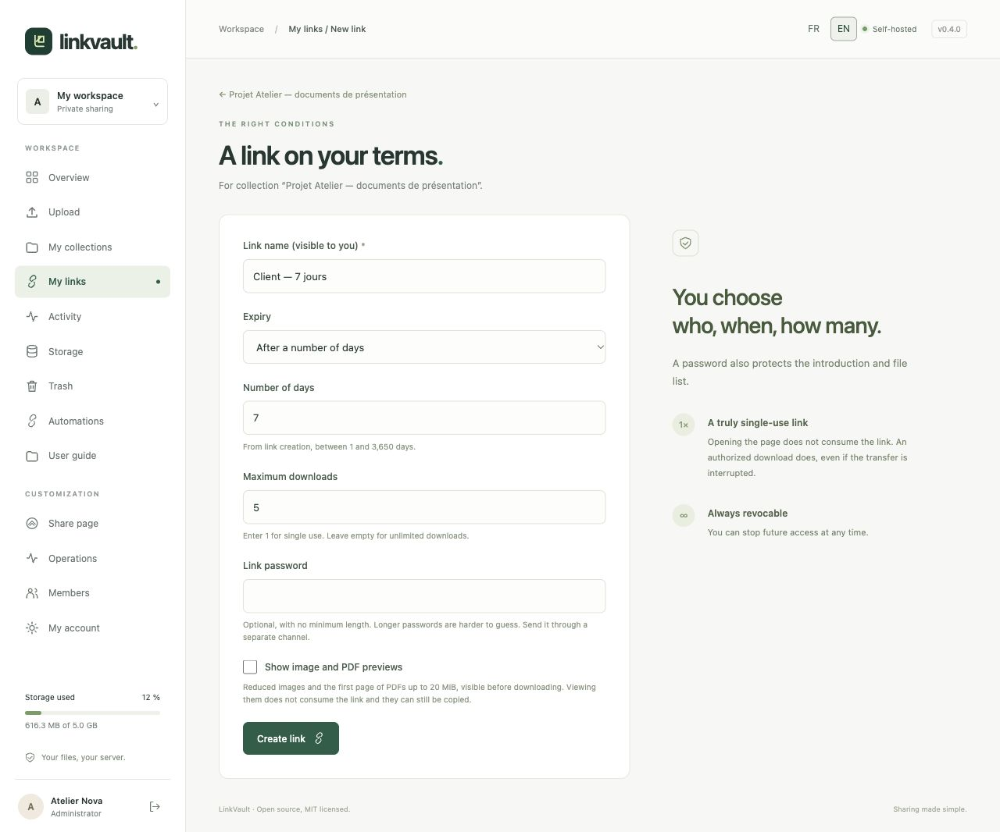
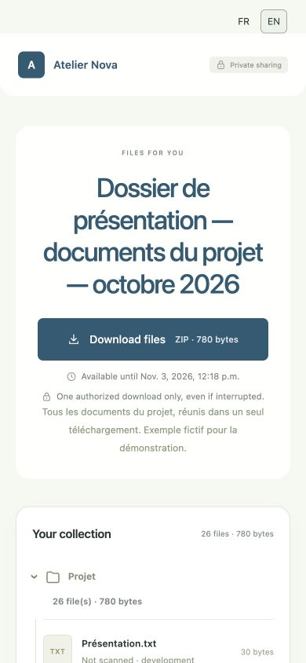
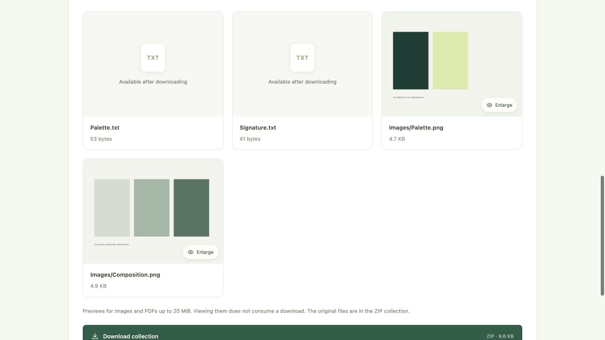
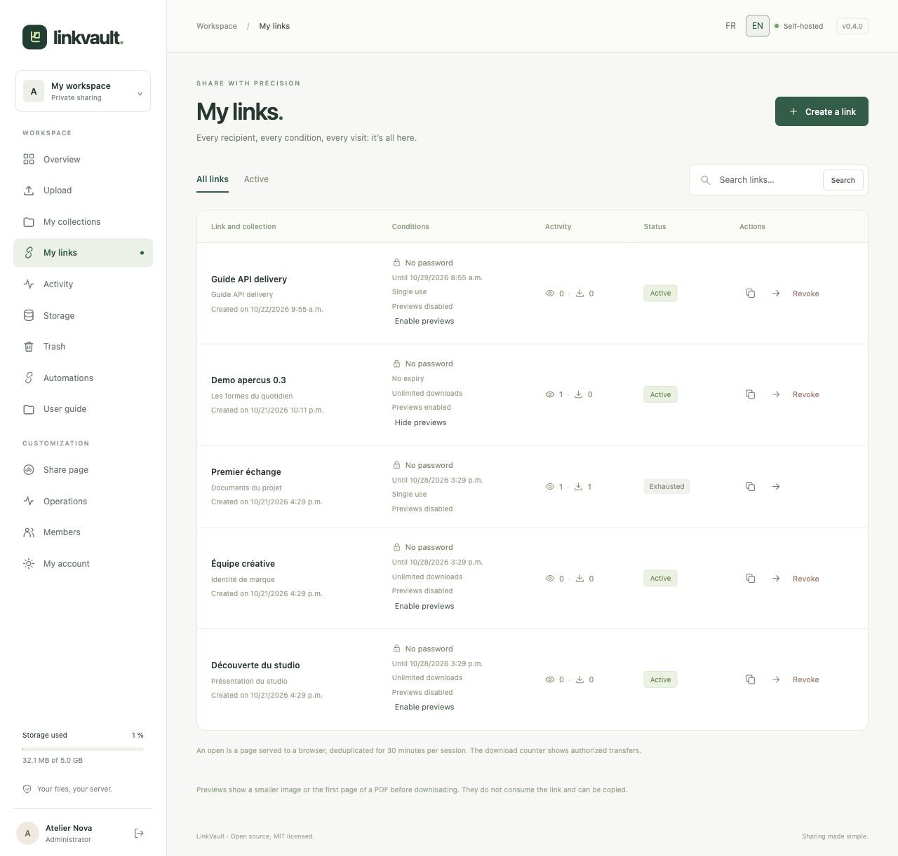

# Share links and previews

To create several links at once, by quantity or from Excel/CSV, see the [bulk-link guide](bulk-links.md). **Rename** also changes an existing link's private name without changing its URL or conditions.

## Create a link with your conditions

Open a collection containing files and choose **Create a link**.

| Field | How to use it |
| --- | --- |
| Link name | A private label to recognize the recipient or workflow. |
| Expiry | **No expiry**, **On a specific date**, or **After a number of days** (1–3,650 from creation; default 7 days). Dates use the instance timezone, Europe/Berlin by default. |
| Maximum downloads | `1` for single use; leave empty for unlimited. Maximum accepted value: 100,000. Scrolling does not change the value. |
| Link password | Optional, no minimum, up to 128 characters. A longer passphrase is harder to guess. Send it through a separate channel. |
| Image and PDF previews | Optional. The creation form enables these by default; the API defaults to off. |

Choose **Create link**. In **My links**, copy the URL and send it to the recipient. Passwords protect both the introduction and file list. A recipient does not need a Liasio account.

Sharing URLs now contain an unpredictable 22-character code after `/s/` instead of the previous 43- or 97-character tokens. Existing links also get this format when copied again; **old URLs still work**. All addresses point to the same link: passwords, expiry, revocation, activity and the download allowance are shared. Batch exports and fresh API responses use the short URL too; export again to update a previously downloaded spreadsheet. An API retry may return its original longer URL, which remains valid. See [link format and compatibility](../../SHARE_LINKS.md).

## See what the recipient sees

The **Download files** button is visible directly below the collection title, before the file list. It shows the ZIP size and any expiry or download limit. A second button remains below the files, so recipients can download after reviewing them as well. Both buttons download the same ZIP with the same access rules.

The list shows expandable folders and subfolders in their order of addition. With previews enabled, expand **View file previews**: JPEG, PNG, WebP and GIF images (first frame), and PDFs (first page), can be viewed before downloading. The original must be at most 20 MiB; images are limited to 24 megapixels. Previews are smaller, metadata-free JPEGs. Other file types display their name, type and size. A missing preview never prevents an authorized original download.

Click a thumbnail to enlarge it. Use the previous/next controls or arrow keys; Escape closes the viewer. Previews require the same password and valid link as the share page. They do not consume a download, and visible previews can be copied. See the [technical preview model](../../PREVIEWS.md).

## Manage or revoke a link

Use **My links** to search, filter active links, show/hide previews, inspect counts or **Revoke**. Confirm revocation to block future access. To change a password, expiry or download limit, create a replacement link and revoke the old one.

Opening a page does not consume a single-use link. An authorized ZIP download does, including an interrupted transfer. A revoked, expired or exhausted link cannot start a new download; a transfer already in progress may finish. Revocation cannot remove copies already downloaded.
