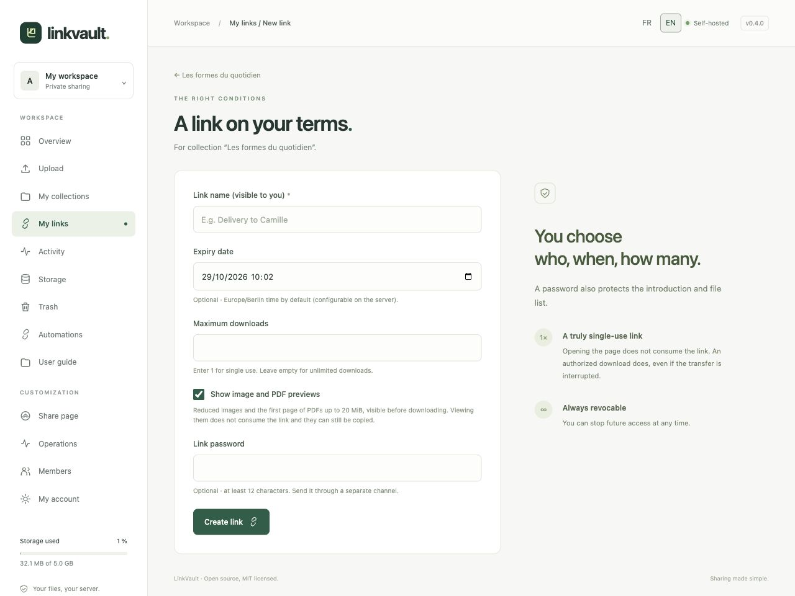

# Share links and previews

## Create a link with your conditions

Open a collection containing files and choose **Create a link**.

| Field | How to use it |
| --- | --- |
| Link name | A private label to recognize the recipient or workflow. |
| Expiry date | Optional; the workspace form uses the instance timezone (Europe/Berlin by default). |
| Maximum downloads | `1` for single use; leave empty for unlimited. Maximum accepted value: 100,000. |
| Link password | Optional, at least 12 characters. Send it through a separate channel. |
| Image and PDF previews | Optional. The creation form enables these by default; the API defaults to off. |

Choose **Create link**. In **My links**, copy the URL and send it to the recipient. Passwords protect both the introduction and file list. A recipient does not need a LinkVault account.

## See what the recipient sees

With previews enabled, JPEG, PNG, WebP and GIF images (first frame), and PDFs (first page), can be viewed before downloading. The original must be at most 20 MiB; images are limited to 24 megapixels. Previews are smaller, metadata-free JPEGs. Other file types display their name, type and size. A missing preview never prevents an authorized original download.

Click a thumbnail to enlarge it. Use the previous/next controls or arrow keys; Escape closes the viewer. Previews require the same password and valid link as the share page. They do not consume a download, and visible previews can be copied. See the [technical preview model](../../PREVIEWS.md).

## Manage or revoke a link

Use **My links** to search, filter active links, show/hide previews, inspect counts or **Revoke**. Confirm revocation to block future access. To change a password, expiry or download limit, create a replacement link and revoke the old one.

Opening a page does not consume a single-use link. An authorized ZIP download does, including an interrupted transfer. A revoked, expired or exhausted link cannot start a new download; a transfer already in progress may finish. Revocation cannot remove copies already downloaded.
