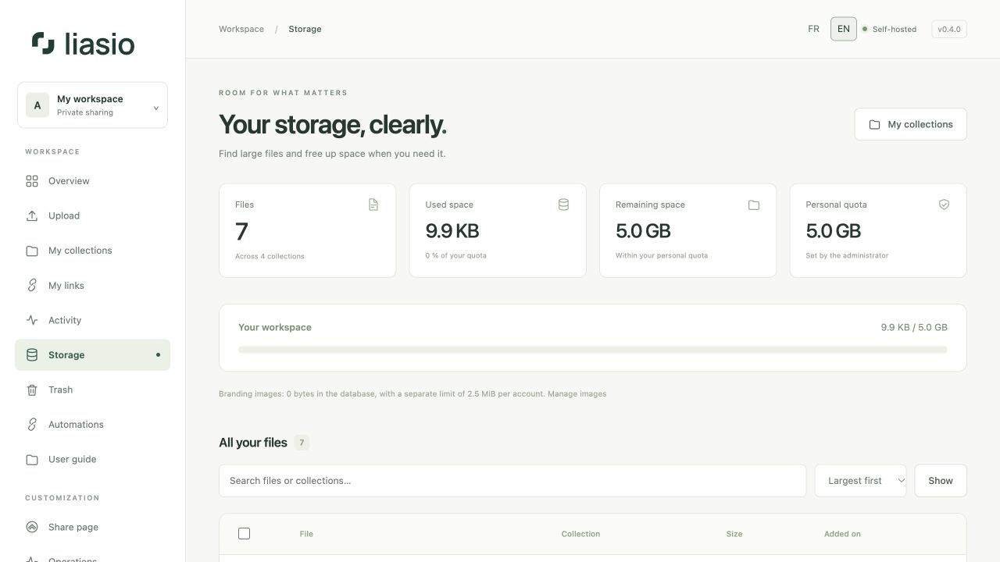
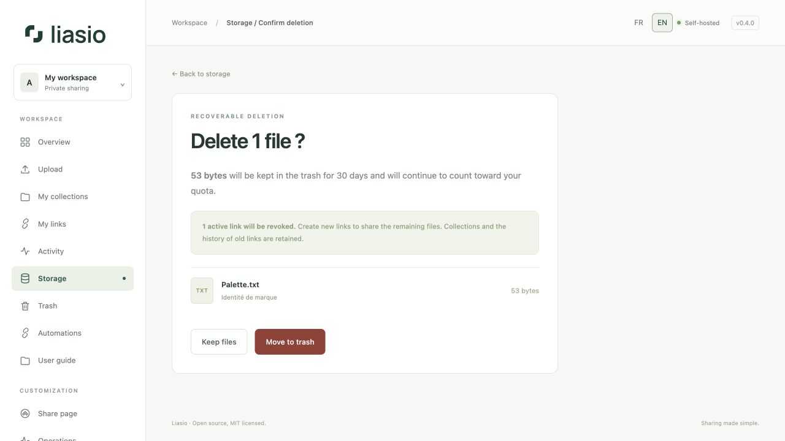
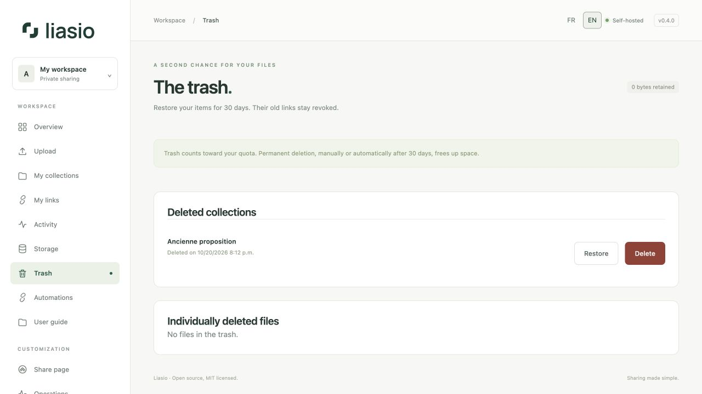

# Storage, trash and deletion

## Understand usage

Open **Storage** to see file count, used space, remaining quota and a searchable file inventory. Sort by largest, smallest, newest or name. Administrators also see host disk usage and usage by account.

This is **disk storage**, not live RAM consumption. Your quota includes retained files and trash. Pending uploads reserve additional space. Server free disk space includes all applications and temporary ZIP archives, so it can differ from Liasio’s file totals.

## Remove selected files

1. Search or sort the inventory. Select individual rows or all rows **on the current page** (not all results).
2. Choose **Review deletion**. Review the file count, total bytes and affected links.
3. Confirm **Move to trash**. Links for affected collections are revoked. The rest of each collection remains available to you; issue new links if you want to share it again.

## Restore or permanently delete

Open **Trash**. Entire deleted collections and individually deleted files are listed separately. **Restore** returns an item to your library, with its old links still revoked. A file inside a deleted collection is restored through that collection.

To release quota immediately, choose **Delete permanently**, review the confirmation and confirm. This removes the retained originals and cannot be undone through Liasio. Otherwise maintenance purges trash after the configured retention (30 days by default). Restoring a collection only restores files deleted with it; files deleted earlier remain in the trash.

For a larger quota, ask an administrator to change it under [Operations](operations.md). Emptying trash cannot fix another application’s disk usage; server-wide shortages need server administration.
