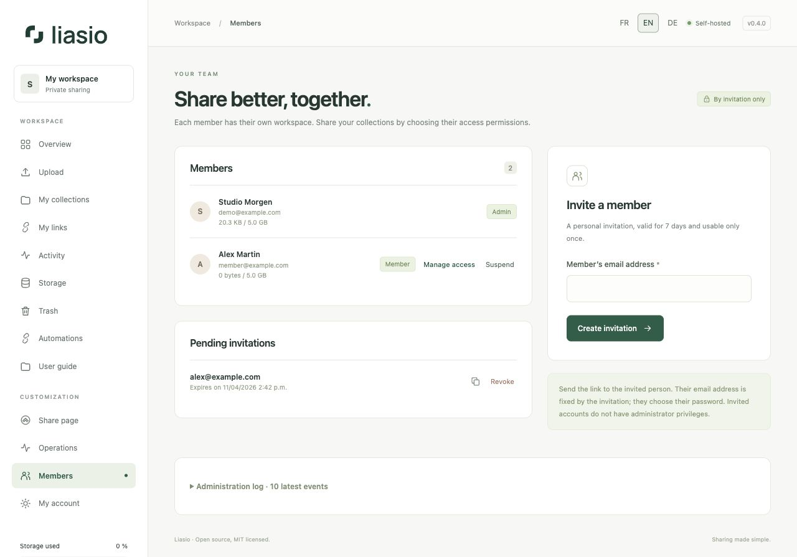
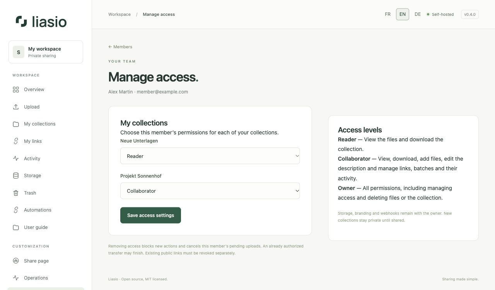

# Invite and manage members

An invitation creates a personal account. **It does not automatically share your collections.** An administrator can invite and suspend members, but this role does not grant access to another account’s private files.

## Invite a member

1. In **Members**, enter their email and click **Create invitation**.
2. Copy the invitation link and send it to the person. Liasio does not send an email automatically.
3. The recipient chooses a name and password. The email is fixed by the invitation; invited accounts are not administrators.
4. Once they accept, grant collection access as described below.

Invitations expire after seven days and can be accepted once. An existing account cannot be invited again. **Revoke** cancels an unused invitation; create a new invitation to replace an expired one.

## Give access to collections

In **Members**, click **Manage access** beside the member. Choose a level for each of **your** collections, then **Save access settings**. Other owners’ private collections are not listed.

| Level | Allowed actions |
| --- | --- |
| No access | The collection remains invisible. |
| Reader | View the description and file tree; download the ZIP. Recipient links, batches and activity are not accessible. |
| Collaborator | Reader permissions plus uploading files, editing the description, creating and managing links and batches, exporting lists and viewing their activity. |
| Owner | All permissions, including access management, deleting files or the collection, and managing trash. The creator owns the collection; this role is not assignable in the menu. |

Any owner can also open a collection and click **Manage access**, enter an active member’s email and choose a role. Select **No access** to withdraw a grant. Only the owner manages these permissions; a collaborator cannot grant workspace access to another account.

Members find authorized collections in **My collections** and the dashboard, marked **Shared by**. The collection page shows their role. They use their own account and, for automation, their own API key.

The **Download files** button is for signed-in members and does not consume recipient-link downloads. Uploaded files count against the owner’s quota. Antivirus, capacity limits and the requirement to revoke active links before changing files still apply. Collection branding and webhooks remain with the owner; actions are attributed to the member performing them.

## Remove access or change a role

Changes apply to subsequent requests, including requests with existing API keys. Downgrading a Collaborator to Reader or removing access cancels that member’s pending uploads to the collection and releases reserved storage. An already authorized transfer may finish.

**Existing public links are not automatically revoked.** Revoke unwanted links under **My links**. Removing access does not delete files or copies already downloaded. New collections remain private until explicitly shared.

## Suspend or reactivate

In **Members**, choose **Suspend** and confirm. Suspension removes sessions, revokes the member’s own links and API keys and pauses their webhooks. Files remain stored and count against their quota. Shared collection access is unavailable while the account is suspended. Links belonging to other collection owners remain valid.

**Reactivate** allows a new login and restores use of collection grants that were not removed. Revoked links and keys stay revoked; webhooks stay paused. Administrator accounts cannot be suspended from this page.

## Audit and quotas

The page shows the ten latest administrative events, including access changes. Adjust storage limits in **Operations → Member quotas**. Permanent account erasure is a server command documented in the [operations runbook (French)](../../OPERATIONS.md).
