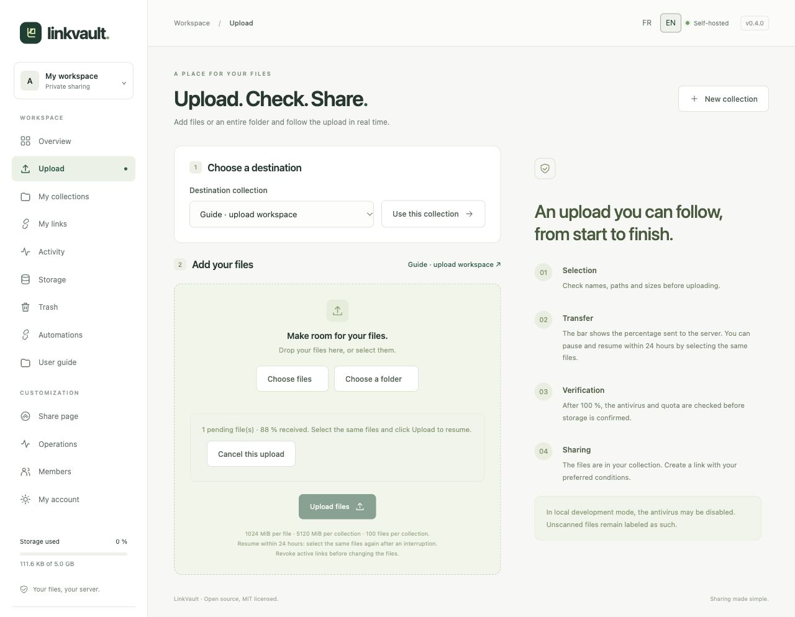
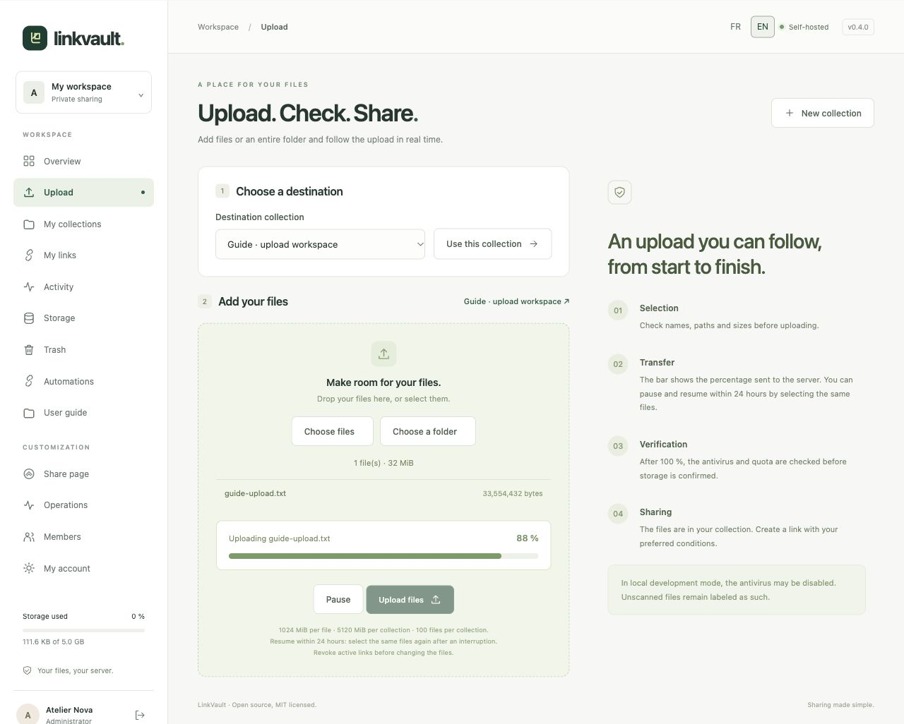

# Upload files or a folder

## Select the destination and files

1. Open **Upload**, select an existing collection and choose **Use this collection**. Create a collection first if none exists.
2. Choose **Choose files** for individual files, or **Choose a folder** for an entire directory tree. You can also drop individual files onto the upload area. Use the folder picker to preserve a folder’s structure.
3. Check the selected paths, sizes and total, then choose **Upload files**. The browser may ask you to confirm sharing the selected folder with the site.

By default, each file may be up to 1 GiB, each collection up to 5 GiB, with at most 100 files. The administrator can change size limits; the page shows your instance’s values. Your personal quota, trash usage and pending reservations also apply. Hidden paths, traversal, duplicate names and disallowed extensions are rejected.

## Read progress and confirmation

The bar measures bytes accepted by the server in checksummed 4 MiB chunks. **100% does not yet mean finished**: antivirus scanning, quota checks and final storage follow. Success returns you to the collection with its files listed. Production rejects files when malware scanning fails or is unavailable.

## Pause, resume or cancel

Choose **Pause**; the current chunk finishes first. To resume after an interruption or reload, select the exact same files and click **Upload files**. Already received chunks are reused for up to 24 hours. The pending-upload area shows received progress and **Cancel this upload**. Canceling releases its reserved quota; expired uploads are removed by maintenance.

A user can have five pending uploads. Revoke active links before adding files. If quota or disk space runs out, free space through [Storage](storage.md) or ask the administrator. For an antivirus refusal, inspect the original file; do not disable protection to force it through.

Without JavaScript, a basic individual-file form is available, with a 500 MiB request limit. Progress, folder selection and resume require JavaScript. For automated transfers, use the [API](automation.md).
