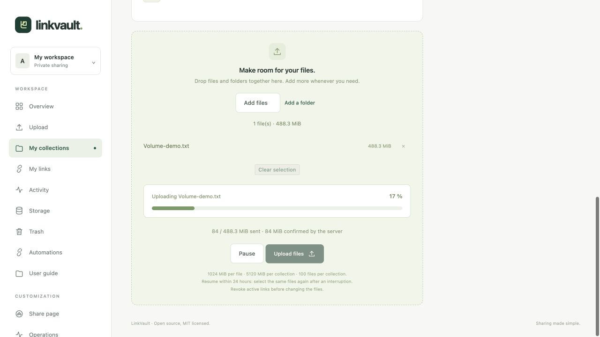

# Upload files and folders

## Choose a destination and prepare your selection

1. Open **Upload**, choose an existing collection, then **Use this collection**. Create one first if the list is empty.
2. **Drop files and folders together** into the same area. Nested folders are read automatically. You can also use **Add files** or the smaller **Add a folder** action: the browser’s native picker distinguishes these two choices.
3. Add more items whenever needed; they accumulate in the existing selection. An already selected path is kept without replacement. **×** removes one file from the selection; **Clear selection** starts over without deleting stored files.
4. Review the directory tree, sizes and total, then choose **Upload files**. Your browser may ask you to confirm access to the selected folder.

Paths are retained in the owner’s view, recipient page and ZIP. Folders are grouped in first-appearance order; later imports follow earlier ones. Hidden files (including `.DS_Store`) and empty folders are excluded. If your browser cannot drop folders, use **Add a folder**.

Defaults: 1 GiB per file, 5 GiB per collection and 100 files, including trash and pending uploads. Your instance limits appear on the page. Unsafe relative paths, file/folder collisions and forbidden extensions are rejected. Paths allow at most 20 components.

## Follow real transfer progress

The meter follows bytes actually transmitted by your browser, including progress inside the current 4 MiB block. Details distinguish **sent** bytes from bytes **confirmed by the server** after integrity checks. Speed and remaining time are estimates based on your connection; no timer simulates progress.

**100% completes the transfer, not the entire import.** Antivirus scanning and saving follow as a separate phase. Keep the page open, especially for large folders. After success, the collection shows your files. Production imports fail closed if antivirus rejects a file or is unavailable.

## Pause, resume or cancel

**Pause** interrupts the current block request. Confirmed blocks are retained. Choose **Upload files** to resume. After reloading or losing connectivity, reselect the same files and folders: the server retains their offsets for 24 hours. An unconfirmed block may be retransmitted; it is not counted twice.

Pending uploads offer **Cancel this upload**, which releases reserved quota. Maintenance removes expired sessions. Each account can have five pending sessions. Revoke active links before adding files to an already shared collection.

If quota or disk space runs out, use [Storage](storage.md) or contact the administrator. Investigate an antivirus rejection without disabling protection.

Without JavaScript, a basic individual-file form remains available, limited to 500 MiB per request. Folders, progress and resuming require JavaScript. For automation, see the [API guide](automation.md).
