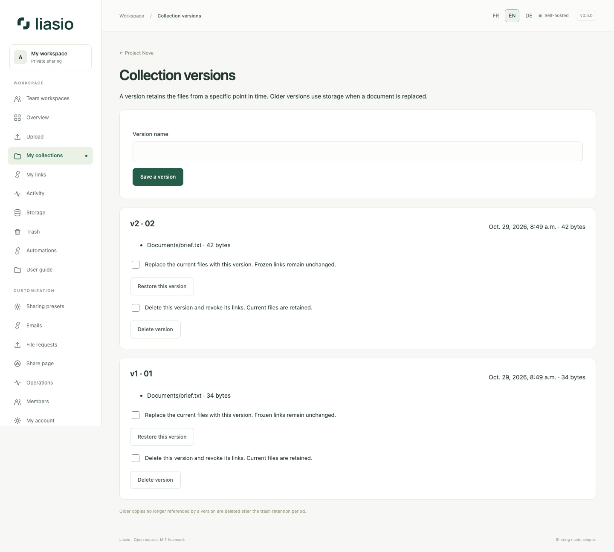

# Versions and selective downloads

Open a folder and choose **Versions**. A version records the current file rows and their immutable bytes, not a copy of the branding or presentation. A folder supports 100 saved versions. Identical automatic snapshots reuse the latest version; a manually named snapshot can be saved explicitly.

When creating a link, leave **Follow future updates** off to freeze its files. Choose an existing version or freeze the current files. Enable following updates only when recipients should see future uploads and replacements. You cannot choose both a version and live updates.

To replace a document, select **Replace files with the same path and retain their previous version** in the upload form. File paths, including directories, determine replacements. The old bytes remain for pinned links; a live link sees the replacement. The entire new file counts toward quota while old copies remain. Resolve any same-path file in the trash before replacing it.

For a pre-0.5 link, use **Freeze existing links** before modifying the folder. This preserves its URL, rules and counter. Until then, active legacy links retain their modification lock.

Owners can restore a saved version after finishing pending uploads. Current files are saved first, and pinned links keep their original content. Deleting a version revokes its links; current files are retained. Superseded copies no longer referenced by a version are purged after the trash-retention delay. A referenced file cannot be permanently removed individually; delete its version first or remove the entire folder.

On the recipient page, **Download files** retrieves the full archive. Select file checkboxes and download the selection for only those documents: one selected file returns the original, several return a ZIP preserving paths. Either action consumes one authorized download. Viewing the page/previews consumes none; an interrupted download may still consume its authorization.
