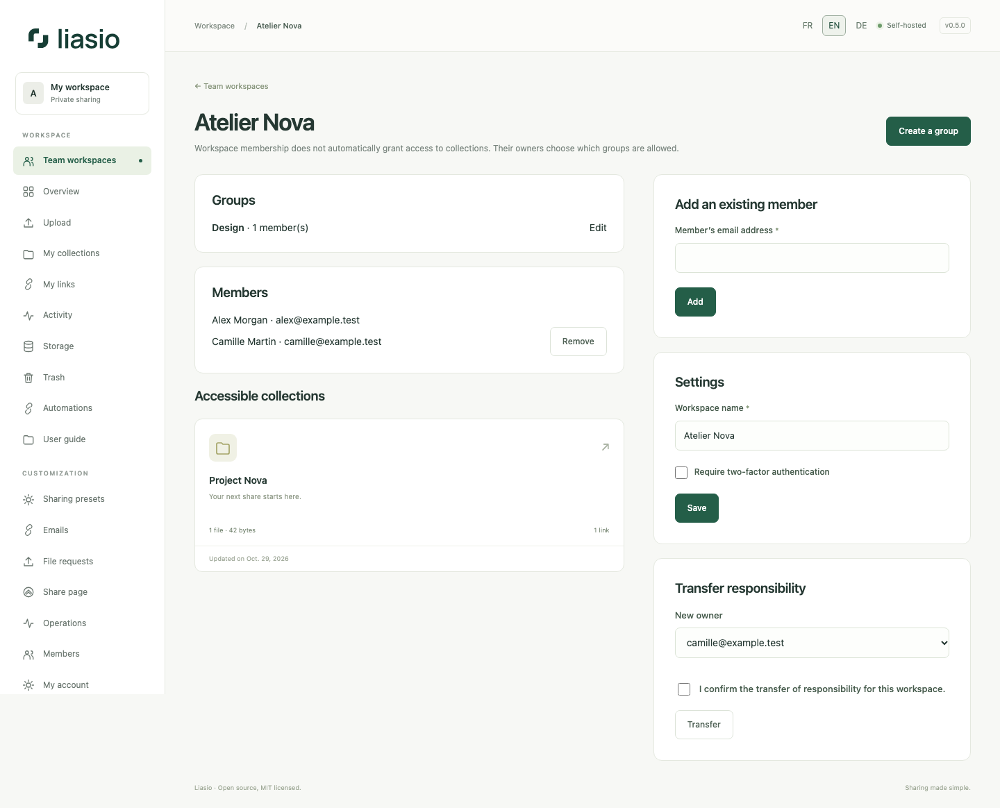

# Team spaces, groups and ownership

1. Open **Team workspaces**, name a space and create it. You become its manager. Add existing active members by email; invite new accounts from **Members** first.
2. Create a group, give it a name and select its members. Only the space manager can change groups or membership. A space supports 200 members and 100 groups; an account can manage 20 spaces.
3. Open a folder you own, then **Team and ownership**. Attach it to the space. Assign each group **Reader**, **Collaborator** or no access. Membership alone does not reveal a folder.
4. Readers can browse and download. Collaborators can also edit presentation, upload, create/manage links and batches, export and create versions. Only the folder owner can delete files, change grants, restore/delete versions or transfer ownership.
5. To transfer a folder, enter an active member's email and confirm. In a team space, that member must belong to the space. The transfer preserves files and URLs and moves all bytes, including trash/history, to the new owner's quota; insufficient quota blocks it. Pending uploads are canceled. The previous owner keeps only any separately granted access.

Group membership is controlled by the space manager: granting a group access means trusting that manager to choose its members. Individual grants remain independent. Removing a group grant or member blocks subsequent operations and cancels uploads if no other collaborator grant remains. Existing recipient links must be revoked separately when required. Detaching a folder removes group grants but preserves direct grants.

Enable your own TOTP first, then select **Require two-factor authentication** in space settings. Members without MFA must set it up before using their account/API. The manager can also transfer responsibility for the space to an existing member. Folder ownership is separate and does not change automatically.

See [account protection](account.md) and [versions](versions.md).

To delete a group, edit it, select the deletion confirmation and choose **Delete group**. Its grants are removed; direct access and other group grants still apply.
