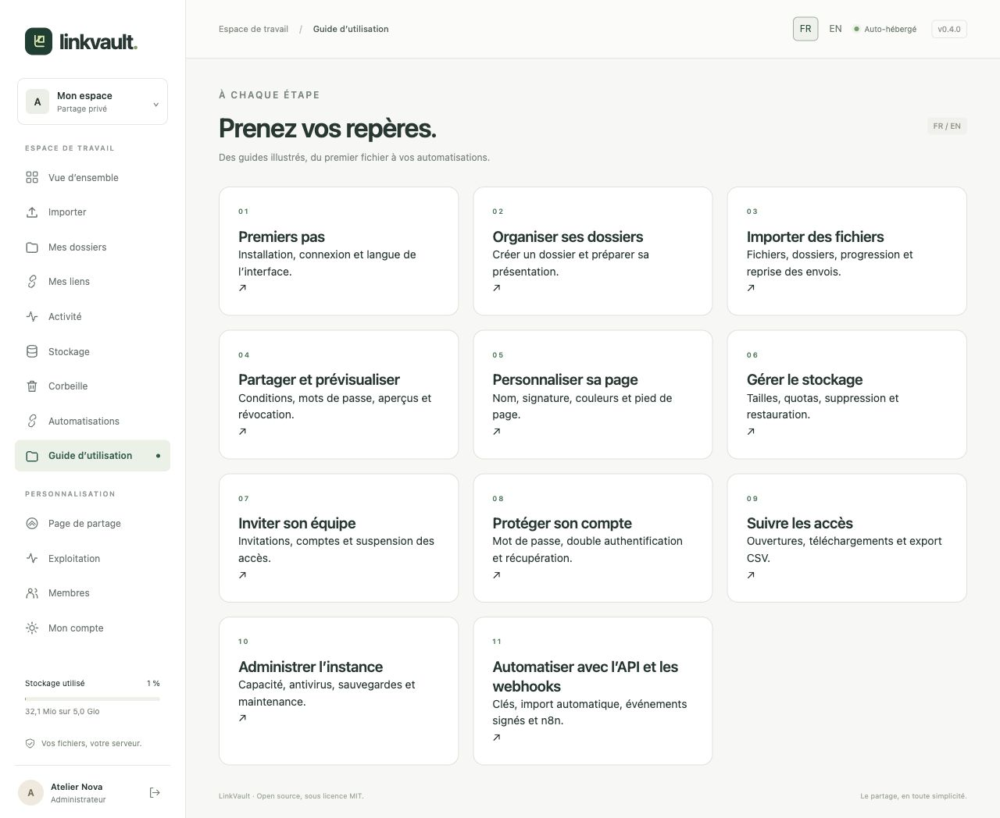

# Guide d’utilisation Liasio

Version 0.4 · Ces mêmes guides sont accessibles dans votre instance via **Guide d’utilisation**. Les captures proviennent réellement de l’application locale, avec des données fictives et la langue correspondante. Elles montrent un environnement de développement ; l’antivirus et les services dépendent du déploiement. Aucun identifiant secret réel n’est visible.

1. [Premiers pas](getting-started.md)
2. [Dossiers](collections.md)
3. [Imports et reprise](uploads.md)
4. [Liens et aperçus](sharing.md)
5. [Personnalisation](branding.md)
6. [Stockage et corbeille](storage.md)
7. [Membres et invitations](team.md)
8. [Sécurité et récupération du compte](account.md)
9. [Activité et CSV](activity.md)
10. [Exploitation et quotas](operations.md)
11. [API, webhooks et n8n](automation.md)
12. [Liens en lot, Excel et CSV](bulk-links.md)
13. [Créer, consulter et exporter les lots par API](bulk-links-api.md)

[English](../en/README.md) · [Français](../fr/README.md) · [Deutsch](../de/README.md) · [API reference](../../API.md)
