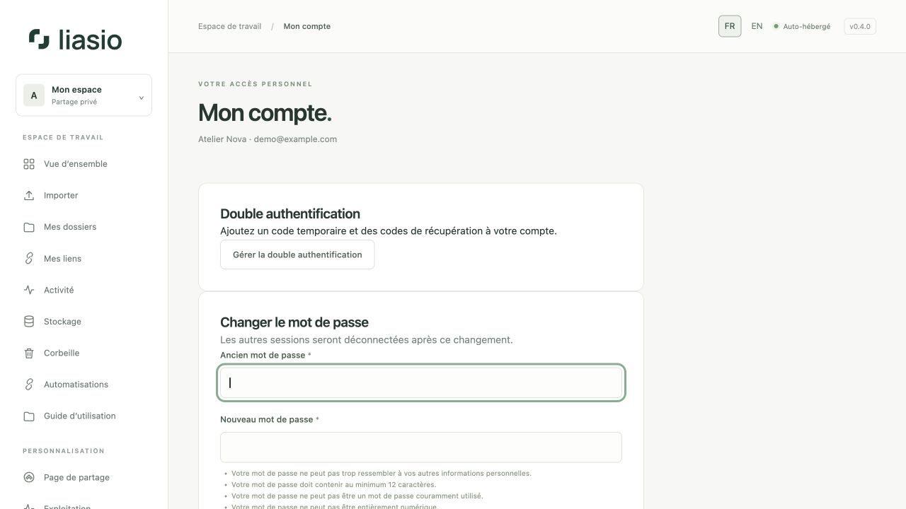
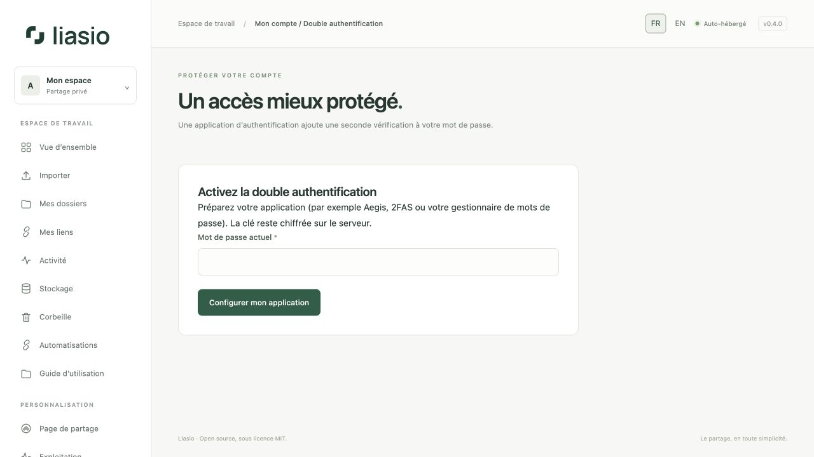

# Protéger et récupérer son compte

## Changer le mot de passe

Ouvrez **Mon compte**, saisissez le mot de passe actuel, un nouveau mot de passe unique d’au moins 12 caractères et sa confirmation. Cliquez sur **Mettre à jour le mot de passe**. Les autres sessions sont déconnectées ; la session actuelle est conservée. Les clés API existantes deviennent invalides : remplacez-les dans vos automatisations.

## Activer la double authentification

1. Ouvrez **Gérer la double authentification** et confirmez le mot de passe actuel pour commencer.
2. Scannez le QR code dans une application TOTP ou saisissez la clé manuellement. Gardez ce QR/code secret. La configuration expire après dix minutes.
3. Saisissez un nouveau code à six chiffres et cliquez sur **Activer et obtenir mes codes**.
4. Enregistrez les codes de récupération dans un gestionnaire privé. Ils ne sont affichés qu’une fois et remplacent chacun un code d’application une seule fois.

Aux connexions suivantes, saisissez le mot de passe puis le code de l’application. Un code déjà utilisé pendant la même période ne fonctionne plus : attendez le suivant. Un code de récupération permet l’accès si vous perdez l’application.

## Renouveler les codes ou désactiver la MFA

Sur cette page, confirmez le mot de passe et un code d’application ou de récupération valide, puis choisissez **Renouveler les codes** ou **Désactiver**. Le renouvellement invalide les anciens codes de récupération. Modifier la MFA déconnecte les autres sessions et invalide les clés API. Ne retirez pas votre application avant confirmation.

## Mot de passe oublié ou second facteur perdu

Depuis la connexion, cliquez sur **Mot de passe oublié ?**. Si SMTP est configuré et qu’un compte actif correspond, un lien personnel valable une heure est envoyé. Le message reste identique pour une adresse inconnue. Réinitialiser le mot de passe ne contourne pas la MFA.

Utilisez un code de récupération si l’application est perdue. Si l’application et les codes sont tous perdus, contactez l’administrateur pour une récupération contrôlée : il n’existe pas de contournement public. Une invitation expirée nécessite une nouvelle invitation, pas une réinitialisation du mot de passe.

## Sessions et protection d’équipe

[Sessions actives](advanced-operations.md) affiche vos appareils et permet de déconnecter une session ou tous les autres appareils. Les sessions existantes sont reprises lors de la mise à jour ; leur appareil d’origine peut être inconnu. Si un [espace d’équipe](workspaces.md) exige la MFA, vous devez l’activer et ne pouvez pas la désactiver tant que cette obligation s’applique. La connexion d’entreprise facultative se relie explicitement depuis le compte ; une adresse identique ne fusionne jamais des identités.
