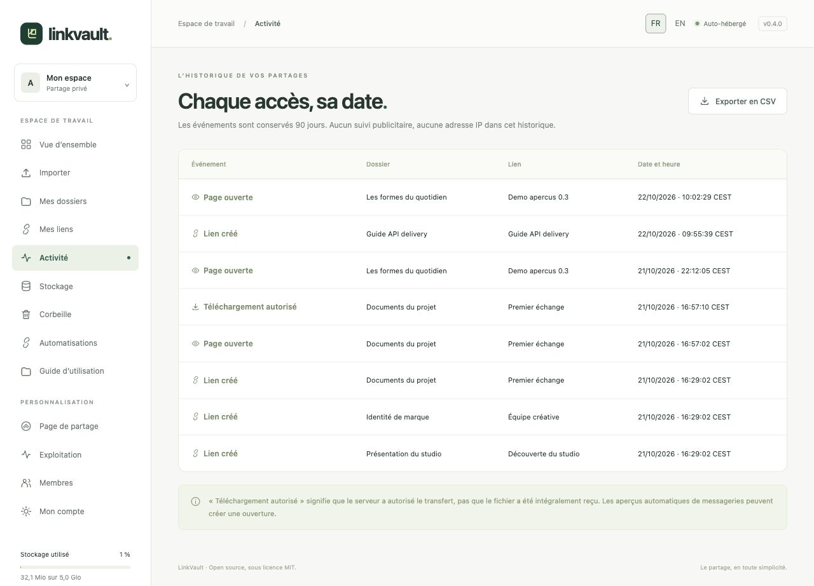

# Comprendre l’activité et les téléchargements

Ouvrez **Activité** pour consulter l’historique daté de vos liens. Depuis un dossier ou **Mes liens**, le contrôle d’activité d’un lien permet de le filtrer ; **Afficher tous les liens** revient à l’historique global.

| Événement | Signification |
| --- | --- |
| Lien créé | Un nouveau lien de partage a été créé. |
| Page ouverte | La page autorisée a été servie. Les ouvertures répétées pendant 30 minutes dans une même session sont dédupliquées. |
| Téléchargement autorisé | Le serveur a préparé le ZIP et autorisé le transfert. Cela ne prouve pas la réception de tous les octets. |
| Lien révoqué | Les prochains accès par ce lien sont désactivés. |

Les aperçus n’incrémentent pas les téléchargements. Les robots d’analyse de liens, les aperçus de messagerie et votre propre visite peuvent générer une ouverture. Les compteurs ne représentent ni des personnes uniques ni une preuve de livraison. Aucun traceur publicitaire ni adresse IP brute ne figure dans cet historique.

## Exporter et comprendre la conservation

Cliquez sur **Exporter en CSV** pour obtenir jusqu’à 10 000 événements du filtre actuel. Les dates du CSV sont en ISO 8601 avec décalage UTC ; l’interface affiche le fuseau du serveur. Les noms pouvant former une formule de tableur sont neutralisés dans l’export.

Les événements sont conservés 90 jours par défaut (`EVENT_RETENTION_DAYS`). Les compteurs de téléchargements cumulés peuvent donc dépasser le nombre d’événements encore présents. La maintenance supprime les anciens événements ; exportez-les avant l’échéance si vous devez conserver vos propres archives.

Pour recevoir les notifications automatiquement, abonnez-vous à **link.opened** ou **download.started** dans [Automatisations](automation.md). Les événements contiennent des identifiants, sans e-mail du destinataire ni contenu des fichiers.
